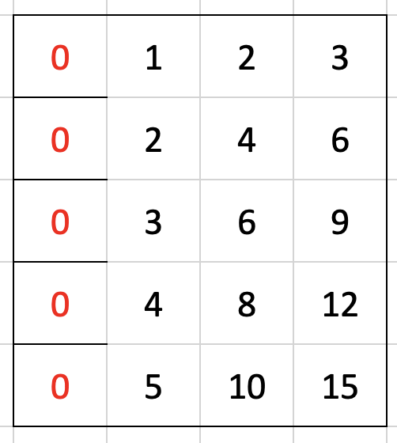
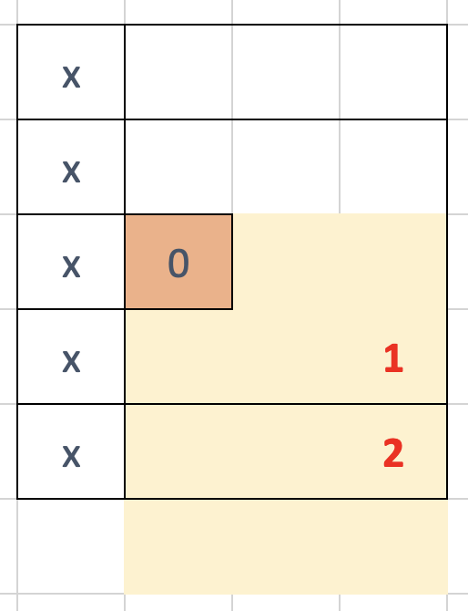

# Accumulative sum well explained

**Author:** xhunter1412
**Votes:** 1
**Link:** [https://leetcode.com/problems/stamping-the-grid/solutions/1680101/](https://leetcode.com/problems/stamping-the-grid/solutions/1680101/)

---

From our example
Step 1 O(nm): Build accumulative sum of` empty cell`

Step 2 O(nm): Mark stamps location
Stamps location can located if and only if the accumulated sum from `[x1][y1]` to `[x2][y2]`  = `stampW * stampH`
Step 3 O(nm): Build accumulative sum of `stamps`
Step 4 O(nm): Check all of `empty cell` is belong to any stamps based on the accumulated sum of `stamps` 


```
func possibleToStamp(grid [][]int, stampHeight int, stampWidth int) bool {
    n := len(grid)
    m := len(grid[0])
    emptyCells := make([][]int, n)
    stamps := make([][]int, n)
    for i := range emptyCells {
        emptyCells[i] = make([]int, m)
        stamps[i] = make([]int, m)
    }
    for i := range grid {
        for j := range grid[i] {
            emptyCells[i][j] = 1 - grid[i][j]
            if i > 0 {
                emptyCells[i][j] += emptyCells[i-1][j]
            }
            if j > 0 {
                emptyCells[i][j] += emptyCells[i][j-1]
            }
            if i > 0 && j > 0 {
                emptyCells[i][j] -= emptyCells[i-1][j-1]
            }
            x, y := i - stampHeight +1 , j - stampWidth +1
            cur := emptyCells[i][j]
            if x > 0 {
                cur -= emptyCells[x-1][j]
            }
            if y > 0 {
                cur -= emptyCells[i][y-1]
            }
            if x > 0 && y > 0 {
                cur += emptyCells[x-1][y-1]
            }
            //fmt.Println(x, y, cur)
            if cur == stampHeight * stampWidth {
                stamps[i][j] = 1
            }
        }
    }
    
    for i := range grid {
        for j := range grid[i] {
            if i > 0 {
                stamps[i][j] += stamps[i-1][j]
            }
            if j > 0 {
                stamps[i][j] += stamps[i][j-1]
            }
            if i > 0 && j > 0 {
                stamps[i][j] -= stamps[i-1][j-1]
            }
        }
    }
   
    for i := range grid {
        for j := range grid[i] {
            if grid[i][j] == 1 {
                continue
            }
            
            x, y := i + stampHeight, j + stampWidth
            if x >= n {
                x = n -1
            } 
            if y >= m {
                y = m -1
            }
            cur := stamps[x][y]
            if i > 0 {
                cur -= stamps[i-1][y]
            }
            if j > 0 {
                cur -= stamps[x][j-1]
            }
            if i > 0 && j > 0 {
                cur += stamps[i-1][j-1]
            }
            if cur == 0 {
                return false
            }
        }
    }
    return true
    
}
```
