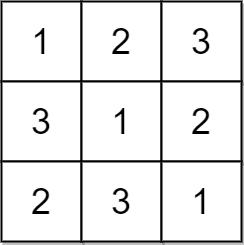
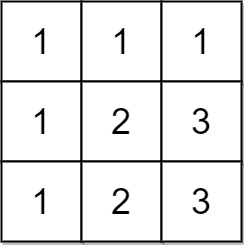

# [2133. Check if Every Row and Column Contains All Numbers](https://leetcode.com/problems/check-if-every-row-and-column-contains-all-numbers/)

| Category | Difficulty | Likes | Dislikes |
| :------: | :--------: | :---: | :------: |
| Algorithms | Easy | 1071 | 58 |

**Tags:** [`array`](https://leetcode.com/tag/array), [`hash-table`](https://leetcode.com/tag/hash-table), [`matrix`](https://leetcode.com/tag/matrix)

**Companies:** `karat`, `zoho`, `indeed`, `instacart`

## Description

An `n x n` matrix is **valid** if every row and every column contains **all** the integers from `1` to `n` (**inclusive**).

Given an `n x n` integer matrix `matrix`, return `true` *if the matrix is **valid**.* Otherwise, return `false`.

 

**Example 1:**


```

Input: matrix = [[1,2,3],[3,1,2],[2,3,1]]
Output: true
Explanation: In this case, n = 3, and every row and column contains the numbers 1, 2, and 3.
Hence, we return true.

```

**Example 2:**


```

Input: matrix = [[1,1,1],[1,2,3],[1,2,3]]
Output: false
Explanation: In this case, n = 3, but the first row and the first column do not contain the numbers 2 or 3.
Hence, we return false.

```

 

**Constraints:**

	- `n == matrix.length == matrix[i].length`

	- `1 <= n <= 100`

	- `1 <= matrix[i][j] <= n`

---

**Links:** [Submissions](https://leetcode.com/problems/check-if-every-row-and-column-contains-all-numbers/) | [Solutions](https://leetcode.com/problems/check-if-every-row-and-column-contains-all-numbers/)
