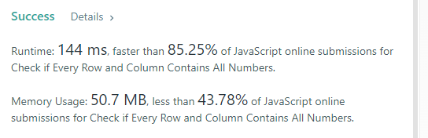
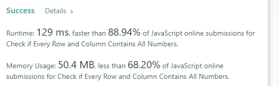
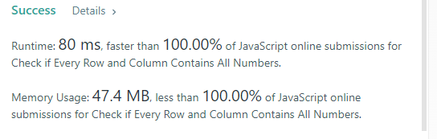

# [JavaScript] 2133. Check if Every Row and Column Contains All Numbers

**Author:** pgmreddy
**Votes:** 12
**Link:** [https://leetcode.com/problems/check-if-every-row-and-column-contains-all-numbers/solutions/1679417/](https://leetcode.com/problems/check-if-every-row-and-column-contains-all-numbers/solutions/1679417/)

---

---

Hope it is simple to understand.

---

Solution 1

```
var checkValid = function (mat) {
    let R = mat.length;                                               // row & column count
    let C = mat[0].length;

    for (let i = 0; i < R; i++) {
        let set = new Set();
        for (let j = 0; j < C; j++) set.add(mat[i][j]);               // add all the integers to a set
        if (set.size !== C) return false;                             // C integers this row?
    }

    for (let j = 0; j < C; j++) {
        let set = new Set();
        for (let i = 0; i < R; i++) set.add(mat[i][j]);               // add all the integers to a set
        if (set.size !== R) return false;                             // R integers this column?
    }

    return true;
};
```


---

Solution 2

```
var checkValid = function (mat) {
  let m = mat.length;
  let n = mat[0].length;

  let rnums = Array.from({ length: m }, () => new Set());
  let cnums = Array.from({ length: n }, () => new Set());
  for (let i = 0; i < m; i++) {
    for (let j = 0; j < n; j++) {
      rnums[i].add(mat[i][j]);
      cnums[j].add(mat[i][j]);
    }
  }

  for (let i = 0; i < m; i++)
    if (rnums[i].size !== m) {
      return false;
    }
  for (let j = 0; j < n; j++)
    if (cnums[j].size !== n) {
      return false;
    }
  return true;
};
```



---

Solution 3

```
var checkValid = function (mat) {
  let m = mat.length;
  let n = mat[0].length;

  let nums = new Set();
  for (let i = 0; i < m; i++) {
    nums.clear();
    for (let j = 0; j < n; j++) nums.add(mat[i][j]);
    if (nums.size !== n) return false;
  }
  for (let j = 0; j < n; j++) {
    nums.clear();
    for (let i = 0; i < m; i++) nums.add(mat[i][j]);
    if (nums.size !== m) return false;
  }

  return true;
};
```


---

Solution 4 - tricky one

```
var checkValid = function (mat) {
  let m = mat.length;
  let n = mat[0].length;

  let rnums = new Set();
  let cnums = new Set();
  for (let i = 0; i < m; i++) {
    rnums.clear();
    cnums.clear();
    for (let j = 0; j < n; j++) {
      cnums.add(mat[i][j]);
      rnums.add(mat[j][i]);
    }
    if (rnums.size !== m) return false;
    if (cnums.size !== n) return false;
  }

  return true;
};
```



---

Solution 5 - 2rd tricky one

```
var checkValid = function (mat) {
  function revertToOriginalMatrix() {
    for (let i = 0; i < m; i++)
      for (let j = 0; j < n; j++) {
        if (mat[i][j] < 0) mat[i][j] *= -1;
      }
  }

  let m = mat.length;
  let n = mat[0].length;

  for (let i = 0; i < m; i++)
    for (let j = 0; j < n; j++) {
      let val = Math.abs(mat[i][j]);
      let index = val - 1;
      if (mat[i][index] < 0) return false;
      mat[i][index] *= -1;
    }
  revertToOriginalMatrix();

  for (let j = 0; j < n; j++)
    for (let i = 0; i < m; i++) {
      let val = Math.abs(mat[i][j]);
      let index = val - 1;
      if (mat[index][j] < 0) return false;
      mat[index][j] *= -1;
    }
  revertToOriginalMatrix();

  return true;
};
```


---

Solution 6 - 3rd tricky one - The Ultimate one

```
var checkValid = function (mat) {
  let m = mat.length;
  let n = mat[0].length;

  for (let i = 0; i < m; i++)
    for (let j = 0; j < n; j++) {
      let val = Math.abs(mat[i][j]);
      let index = val - 1;
      if (mat[i][index] < 0) return false;
      mat[i][index] *= -1;
    }

  for (let j = 0; j < n; j++)
    for (let i = 0; i < m; i++) {
      let val = Math.abs(mat[i][j]);
      let index = val - 1;
      if (mat[index][j] > 0) return false;
      mat[index][j] *= -1;
    }

  return true;
};
```



---
