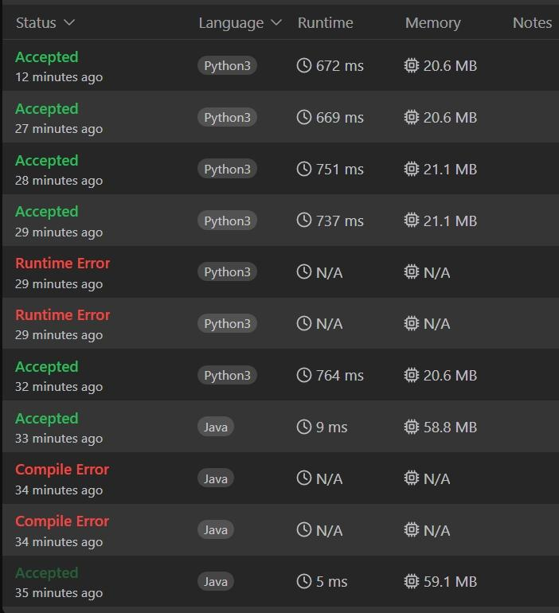
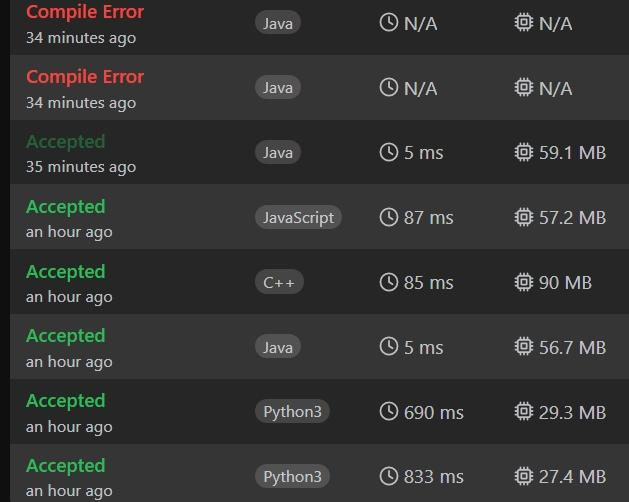

# Same Concept of Sliding Window || O(N) in 3 Langs. || Margin(94%)

**Author:** Success_Code
**Votes:** 117
**Link:** [https://leetcode.com/problems/minimum-swaps-to-group-all-1s-together-ii/solutions/5571652/](https://leetcode.com/problems/minimum-swaps-to-group-all-1s-together-ii/solutions/5571652/)

---


# Intuition Behind the Code
### Fools yell from bot accounts, we just need to move on.. This is my soln with submission history attached below..After Several attempts was able to provide soln with acceptable margin

1. Counting 1s (`k`):
   - First, the code calculates the total number of 1s in the array, denoted by `k`. This is because the task is to find the smallest window (or segment) of size `k` that contains the maximum number of 1s.

2. Initial Window Calculation:
   - The code then computes the number of 1s in the first window of size `k`. This is achieved by summing up the first `k` elements of the array. This sum is stored in the variable `cnt` and also in `mx` (as the initial maximum count of 1s in any window).

3. Sliding Window Technique:
   - The core part of the solution involves a sliding window approach to move through the array and calculate the number of 1s in each window of size `k`.
   - For each step from `i = k` to `i = n + k - 1` (where `n` is the length of the array):
     - The code updates the `cnt` by adding the next element in the window (`nums[i % n]`) and removing the element that is sliding out of the window (`nums[(i - k + n) % n]`).
     - The maximum number of 1s found in any window of size `k` is updated in `mx`.

4. Result Calculation:
   - Finally, the result is derived as `k - mx`, which represents the minimum number of swaps needed. This is because `k` is the total number of 1s, and `mx` is the maximum number of 1s found in any window of size `k`. Therefore, the difference `k - mx` gives the minimum number of 0s that need to be swapped with 1s to achieve the desired grouping of 1s.


# Complexity
- Time complexity:
O(n)

- Space complexity:
O(1)

# Code

```python []
class Solution:
    def minSwaps(self, nums: List[int]) -> int:
        k = nums.count(1)
        mx = cnt = sum(nums[:k])
        n = len(nums)
        for i in range(k, n + k):
            cnt += nums[i % n]
            cnt -= nums[(i - k + n) % n]
            mx = max(mx, cnt)
        return k - mx
```
```java []
class Solution {
    public int minSwaps(int[] nums) {
        int k = Arrays.stream(nums).sum();
        int n = nums.length;
        int cnt = 0;
        for (int i = 0; i < k; ++i) {
            cnt += nums[i];
        }
        int mx = cnt;
        for (int i = k; i < n + k; ++i) {
            cnt += nums[i % n] - nums[(i - k + n) % n];
            mx = Math.max(mx, cnt);
        }
        return k - mx;
    }
}
```
```C++ []
class Solution {
public:
    int minSwaps(vector<int>& nums) {
        int k = accumulate(nums.begin(), nums.end(), 0);
        int n = nums.size();
        int cnt = accumulate(nums.begin(), nums.begin() + k, 0);
        int mx = cnt;
        for (int i = k; i < n + k; ++i) {
            cnt += nums[i % n] - nums[(i - k + n) % n];
            mx = max(mx, cnt);
        }
        return k - mx;
    }
};
```

# Code built after many attempts:



