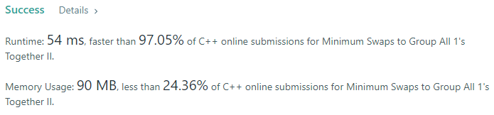
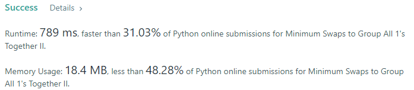
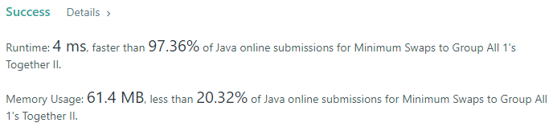
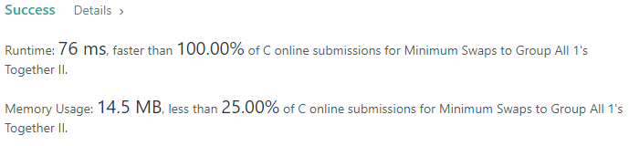
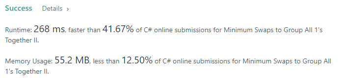
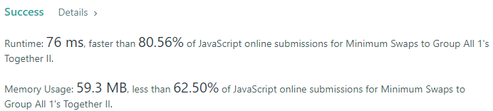

# 💢☠💫Easiest👾Faster✅💯 Lesser🧠 🎯 C++✅Python3🐍✅Java✅C✅Python🐍✅C#✅💥🔥💫Explained☠💥🔥 Beats 💯

**Author:** Edwards310
**Votes:** 2
**Link:** [https://leetcode.com/problems/minimum-swaps-to-group-all-1s-together-ii/solutions/5574133/](https://leetcode.com/problems/minimum-swaps-to-group-all-1s-together-ii/solutions/5574133/)

---

# Intuition







```javascript []
/**
 * @param {number[]} nums
 * @return {number}
 */
var minSwaps = function (nums) {
    let n = nums.length, ones = 0;
    let circular = Array(2 * n).fill(0);
    for (let u = 0; u < n; ++u) {
        circular[u] = circular[u + n] = nums[u];
        ones += nums[u];
    }
    var maxOnes = 0;
    var currOnes = 0, i = 0, j = 0;
    for (j = 0; j < ones; ++j)
        currOnes += circular[j];
    maxOnes = Math.max(maxOnes, currOnes);
    while (j < circular.length) {
        currOnes = currOnes - circular[i] + circular[j];
        if (maxOnes < currOnes)
            maxOnes = currOnes;
        ++j;
        ++i;
    }

    return ones - maxOnes;
};
```
```C++ []
// Start Of Edwards310's Template...
#pragma GCC optimize("O2")
#include <bits/stdc++.h>

using namespace std;
#define FOR(a, b, c) for (int a = b; a < c; a++)
#define FOR1(a, b, c) for (int a = b; a <= c; ++a)
#define Rep(i, n) FOR(i, 0, n)
#define Rep1(i, n) FOR1(i, 1, n)
#define RepA(ele, nums) for (auto& ele : nums)
#define WHL(i, n) while (i < n)

// end of Edwards310's Template
class Solution {
public:
    int minSwaps(vector<int>& nums) {
        int n = nums.size(), ones = 0;
        vi circular(n * 2, 0);
        Rep(i, n) {
            circular[i] = circular[i + n] = nums[i];
            ones += nums[i];
        }
        int maxOnes = 0, currOnes = 0, i = 0, j = 0;
        for (j = 0; j < ones; ++j)
            currOnes += circular[j];

        maxOnes = fmax(maxOnes, currOnes);
        WHL(j, circular.size()) {
            currOnes = currOnes - circular[i] + circular[j];
            maxOnes = fmax(maxOnes, currOnes);
            ++j, ++i;
        }
        return ones - maxOnes;
    }
};
```
```Python3 []
class Solution:
    def minSwaps(self, nums: List[int]) -> int:
        n, ones = len(nums), 0

        res = [0] * (2 * n)
        for i in range(n):
            res[i] = res[i + n] = nums[i]
            ones += nums[i]

        maxOnes = currOnes = i = j = 0

        while j < ones:
            currOnes += res[j]
            j += 1

        maxOnes = max(maxOnes, currOnes)
        while j < len(res):
            currOnes = currOnes - res[i] + res[j]
            maxOnes = max(maxOnes, currOnes)
            j += 1
            i += 1
        return ones - maxOnes

```
```Java []
class Solution {
    public int minSwaps(int[] nums) {
        int n = nums.length, ones = 0;
        int[] circular = new int[n * 2];
        for (int i = 0; i < n; ++i) {
            circular[i] = circular[i + n] = nums[i];
            ones += nums[i];
        }

        // create a window of size ones
        int maxOnes = 0, curOnes = 0, i = 0, j = 0;
        for (j = 0; j < ones; ++j) {
            curOnes += circular[j];
        }

        if (maxOnes < curOnes) {
            maxOnes = curOnes;
        }

        while (j < circular.length) {
            curOnes = curOnes - circular[i] + circular[j];
            if (maxOnes < curOnes)
                maxOnes = curOnes;
            ++j;
            ++i;
        }

        return ones - maxOnes;
    }
}
```
```C []
int minSwaps(int* nums, int numsSize) {
    int n = numsSize, ones = 0;
    int circular[2 * n] = {};
    for (int i = 0; i < n; ++i) {
        circular[i] = circular[i + n] = nums[i];
        ones += nums[i];
    }

    // create a window of size ones
    int maxOnes = 0, curOnes = 0, i = 0, j = 0;
    for (j = 0; j < ones; ++j) {
        curOnes += circular[j];
    }

    if (maxOnes < curOnes)
        maxOnes = curOnes;

    while (j < (2 * n)) {
        curOnes = curOnes - circular[i] + circular[j];
        if (maxOnes < curOnes)
            maxOnes = curOnes;
        ++j;
        ++i;
    }

    return ones - maxOnes;
}
```
```Python []
class Solution(object):
    def minSwaps(self, nums):
        """
        :type nums: List[int]
        :rtype: int
        """
        n , ones = len(nums) , 0
        
        res = [0] * (2 * n)
        for i in range(n):
            res[i] = res[i + n] = nums[i]
            ones += nums[i]
            
        maxOnes = currOnes = i = j = 0
        
        while j < ones:
            currOnes += res[j]
            j += 1
            
        maxOnes = max(maxOnes, currOnes)
        while j < len(res):
            currOnes = currOnes - res[i] + res[j]
            maxOnes = max(maxOnes, currOnes)
            j += 1
            i += 1
        return ones - maxOnes
```
```C# []
public class Solution {
    public int MinSwaps(int[] nums) {
        int n = nums.Length, ones = 0;
        int[] circular = new int[n * 2];
        for (int u = 0; u < n; ++u) {
            circular[u] = circular[u + n] = nums[u];
            ones += nums[u];
        }
        int maxOnes = 0, curOnes = 0, i = 0, j = 0;
        for (j = 0; j < ones; ++j)
            curOnes += circular[j];
        maxOnes = Math.Max(maxOnes, curOnes);

        while (j < circular.Length) {
            curOnes = curOnes - circular[i] + circular[j];
            maxOnes = Math.Max(maxOnes, curOnes);
            ++j;
            ++i;
        }

        return ones - maxOnes;
    }
}
```

<!-- Describe your first thoughts on how to solve this problem. -->

# Approach
<!-- Describe your approach to solving the problem. -->

# Complexity
- Time complexity:
<!-- Add your time complexity here, e.g. $$O(n)$$ -->
      O(n)
- Space complexity:
<!-- Add your space complexity here, e.g. $$O(n)$$ -->
      O(2 * n)
# Code
```
class Solution:
    def minSwaps(self, nums: List[int]) -> int:
        n , ones = len(nums) , 0
        
        res = [0] * (2 * n)
        for i in range(n):
            res[i] = res[i + n] = nums[i]
            ones += nums[i]
            
        maxOnes = currOnes = i = j = 0
        
        while j < ones:
            currOnes += res[j]
            j += 1
            
        maxOnes = max(maxOnes, currOnes)
        while j < len(res):
            currOnes = currOnes - res[i] + res[j]
            maxOnes = max(maxOnes, currOnes)
            j += 1
            i += 1
        return ones - maxOnes
```

