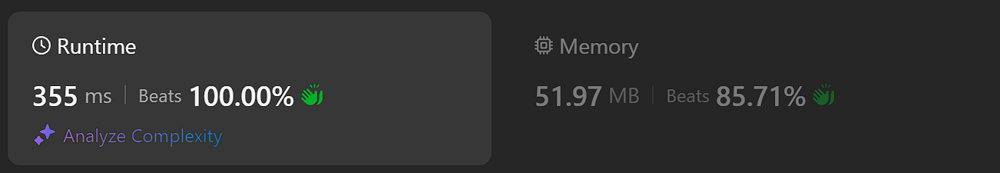
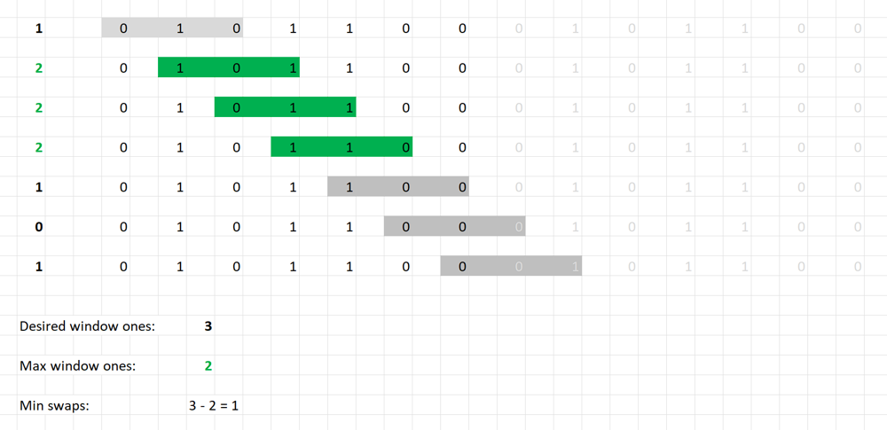
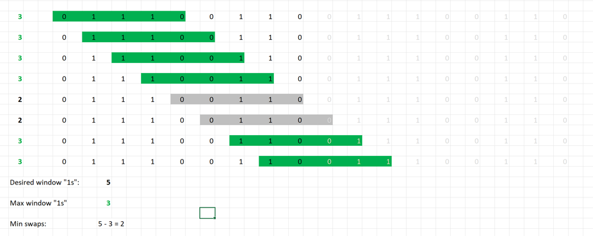
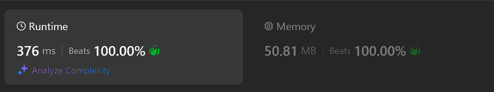

# Kotlin. Beats 100% (355 ms). Doubled array (System.arraycopy) + sliding window

**Author:** mobdev778
**Votes:** 2
**Link:** [https://leetcode.com/problems/minimum-swaps-to-group-all-1s-together-ii/solutions/5573136/](https://leetcode.com/problems/minimum-swaps-to-group-all-1s-together-ii/solutions/5573136/)

---



# Code
```
class Solution {
    fun minSwaps(nums: IntArray): Int {
        var ones = 0
        for (n in nums) {
            ones += n
        }

        var windowOnes = 0
        for (i in 0 until ones) {
            windowOnes += nums[i]
        }
        if (windowOnes == ones) return 0

        var maxWindowOnes = windowOnes

        val bigArray = IntArray(nums.size shl 1)
        System.arraycopy(nums, 0, bigArray, 0, nums.size)
        System.arraycopy(nums, 0, bigArray, nums.size, nums.size)

        var left = 0
        var right = ones
        while (left < nums.size) {
            windowOnes -= bigArray[left++]
            windowOnes += bigArray[right++]
            maxWindowOnes = Math.max(maxWindowOnes, windowOnes)
        }
        return ones - maxWindowOnes
    }
}
```

# Approach

To avoid unnecessary fiddling around with a looping array, I simply decided to make an array of size "x2" and search for a solution on this doubled array using a sliding window algorithm.
This will save time on the extra check for the transition of the right border of the window to the left border.

To copy the array I use the System.arraycopy() operation - this is the fastest that the virtual machine can offer for copying the contents of arrays.

After the array is created, we no longer need to bother with possible indexes going beyond the "nums.size", so we can focus entirely on finding the result.

We use the sliding window algorithm. To find a solution, first count all the "1" numbers inside the array and write it to the variable "ones". Next, I define a window of size "ones" and start moving it inside the array "nums".

The best window will be one that collects the maximum possible number of "1" numbers from "nums".

The minimum number of swap operations will be the difference between the total number of 1s and the maximum number of 1s that got into the window.

Example 1:


Example 2:


One more attempt (one pointer sliding window):



```
class Solution {
    fun minSwaps(nums: IntArray): Int {
        var ones = 0
        for (n in nums) {
            ones += n
        }

        var windowOnes = 0
        for (i in 0 until ones) {
            windowOnes += nums[i]
        }
        if (windowOnes == ones) return 0

        var maxWindowOnes = windowOnes

        val bigArray = IntArray(nums.size shl 1)
        System.arraycopy(nums, 0, bigArray, 0, nums.size)
        System.arraycopy(nums, 0, bigArray, nums.size, nums.size)

        for (i in 0 until nums.size) {
            windowOnes -= bigArray[i]
            if (bigArray[i + ones] == 1) {
                maxWindowOnes = Math.max(maxWindowOnes, ++windowOnes)
            }
        }
        return ones - maxWindowOnes
    }
}
```
