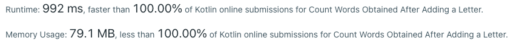

# Prime Hash - NO Sort, NO Trie - 5 lines - 100 % - O(n*s)/O(n)

**Author:** kotlincheck
**Votes:** 6
**Link:** [https://leetcode.com/problems/count-words-obtained-after-adding-a-letter/solutions/1866692/](https://leetcode.com/problems/count-words-obtained-after-adding-a-letter/solutions/1866692/)

---


# Idea:
*In the end we just need to have a hashing function that is independent of the order.*

So first step: Compute "special" hash from string in `startWords`. Map every letter to a prime number an take the product. Then, with hash as the hash of the current word in `targetWords`, go through each char in the string, and divide this hash with the current char's corresponding prime number.  If the result is in the hashmap, we're good! Because that means it was a word that was formed by the original word by jumbling up the letters (prime number product doesn't care about order) and adding another (we divided by every char and checked)

Runtime `O(n*s)` where n is the length of the larger of the two arrays and s is the length of the largest word. If you consider the length constant (max 26 according to the contraints) you can simplify to `O(n)`



```
class Solution {
    fun wordCount(startWords: Array<String>, targetWords: Array<String>): Int {
        val set = startWords.asSequence().map{it.hashify()}.toSet()        // start word set prime hash set: Compute "prime hash" from string in startWords by mapping every letter to a prime number and taking the product 
        fun filterCond(str: String) = str.hashify().let{hash -> str.asSequence().filter{set.contains(hash/primeMap[it]!!.toBigInteger())}.any()}  // Filter condition - take target word hash, divide by every prime of the corresponding char in the target word, check if result is in start word set
        return targetWords.asSequence().filter{filterCond(it)}.count() // just count how many match the filter condition
    }
    
    private fun String.hashify() = this.fold(1.toBigInteger()) { prod, it -> prod*primeMap[it]!!.toBigInteger()}  // Go through every char of the string, multiply it up after passing it through the hashmap
      
    val primeMap = mapOf(
        'a' to 2,
        'b' to 3,
        'c' to 5,
        'd' to 7,
        'e' to 11,
        'f' to 13,
        'g' to 17,
        'h' to 19,
        'i' to 23,
        'j' to 29,
        'k' to 31,
        'l' to 37,
        'm' to 41,
        'n' to 43,
        'o' to 47,
        'p' to 53,
        'q' to 59,
        'r' to 61,
        's' to 67,
        't' to 71,
        'u' to 73,
        'v' to 79,
        'w' to 83,
        'x' to 89,
        'y' to 97,
        'z' to 101
    )
}
```