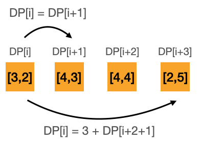

# [Python] DP Solution with detail explanation and picture

**Author:** ArthurLin
**Votes:** 39
**Link:** [https://leetcode.com/problems/solving-questions-with-brainpower/solutions/1692918/](https://leetcode.com/problems/solving-questions-with-brainpower/solutions/1692918/)

---

## **1. Code:**

```
class Solution:
    def mostPoints(self, questions: List[List[int]]) -> int:
        N = len(questions)
        DP = [0 for i in range(N+1)]
        for i in range(N-1, -1, -1):
            p, b = questions[i]
            DP[i] = max(p + DP[min(N, i + b + 1)], DP[i+1])
        return DP[0]
```
*Note: `min(N, i + b + 1)` is just a little trick to prevent index overflow*

## **2. Explanation:**



For any DP question, the most important things are *state definition* and *transition of states*.

**a. State Definition:**
Let `DP[i]` means the most points we can get from question[i] to the last question.
So the answer will be `DP[0]` since it means the most points we can get from question[0] to the last one.

**b. Transition of States:**
Let's calculate it from the last question to the first.

If we are at question `i` and we already know the max points we can get starting from all the questions after current one, that is, we already know `DP[i+1]`, `DP[i+2]`, ... `DP[N-1]`, we can easily calculate the max points we can get at current one, since we only have two choices:

1. Take this points: the max points we can get is `current point + DP[i + current brainpower + 1]`  (since we need to skip all the intermediate steps)
2. Don't take this points: the max points we can get is the same as `DP[i + 1]`

Just like the picture shows above and of course we want to choose the larger one.

So the transition function is now `DP[i] = max(questions[i][0] + DP[i + questions[i][1] + 1] ,  DP[i + 1])`, and since DP[i] depends on states after, we should do it reversely from last question to first one.

**c. For those who are still confused about why we should start from the last index instead of the first index**

I have been confused by this question for a long time, too, until I realized the magic of the transition function.

Actually, the transition function itself will tell you which direction is right. Since our `DP[i]` need to be calculated by `combination of some DP[i + ?]`, which means, we need to know the answer of `DP[i+?]` before `DP[i]`. So we should iterate from the last index. If your transition function give you `DP[i] =  combination of some DP[i-?]`, then you should start from the first index. If you got both directions? It will be very tricky and need to do some advanced transformation first, otherwise, it can't be solved by DP.

This concept can help you deal with some harder DP questions like: [Minimum Cost to Cut a Stick](https://leetcode.com/problems/minimum-cost-to-cut-a-stick/). After you write done the transition function, you will understand why the direction of each layer of iterations are different.

## **3. Time Complexity**
O(N)