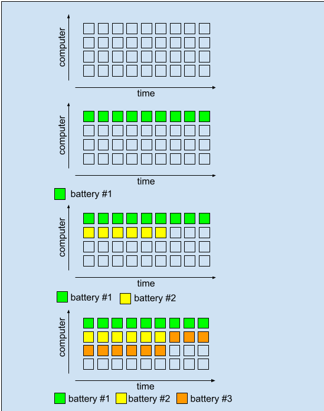

# Binary search kotlin solution

**Author:** mihaillinkov
**Votes:** 2
**Link:** [https://leetcode.com/problems/maximum-running-time-of-n-computers/solutions/3825036/](https://leetcode.com/problems/maximum-running-time-of-n-computers/solutions/3825036/)

---

# Intuition
Let's try to solve another problem, answering a question whether we can run all $$n$$ computers for $$T$$ minutes. Simple observation that we can't use any battery longer than $$T$$ minutes. We just need to iterate over all batteries and find 
$$ S = \\sum_{b \\in batteries} \\min(b, \\ T)$$. 
If $$S / T >=n$$ - answer yes, we can run all computers for $$T$$ minutes, otherwise answer is no.

Some illustrations to this approach:
  



# Approach
We will use binary search to find answer. To check whether we can run $$n$$ computers for $$T$$ minutes - use beforementioned approach.

# Complexity
- Time complexity:$$O(N * log(M))$$
where $$M = \\sum _{b \\in batteries}b$$, and $$N$$ - number of batteries.

- Space complexity: $$O(1)$$

# Code
```
class Solution {
    fun maxRunTime(n: Int, batteries: IntArray): Long {
        var l = 1L
        var r = batteries.map { it.toLong() }.sum()

        fun check(t: Long): Boolean {
            var cnt = 0L
            var s = 0L
            for (v in batteries.map { minOf(it.toLong(), t) }) {
                cnt += (s + v) / t
                s = (s + v) % t
            }
            return cnt >= n
        }

        while (r - l > 1) {
            val t = (r + l) / 2
            if (check(t)) {
                l = t
            } else {
                r = t
            }
        }

        return if (check(r)) r else l
    }


}

```