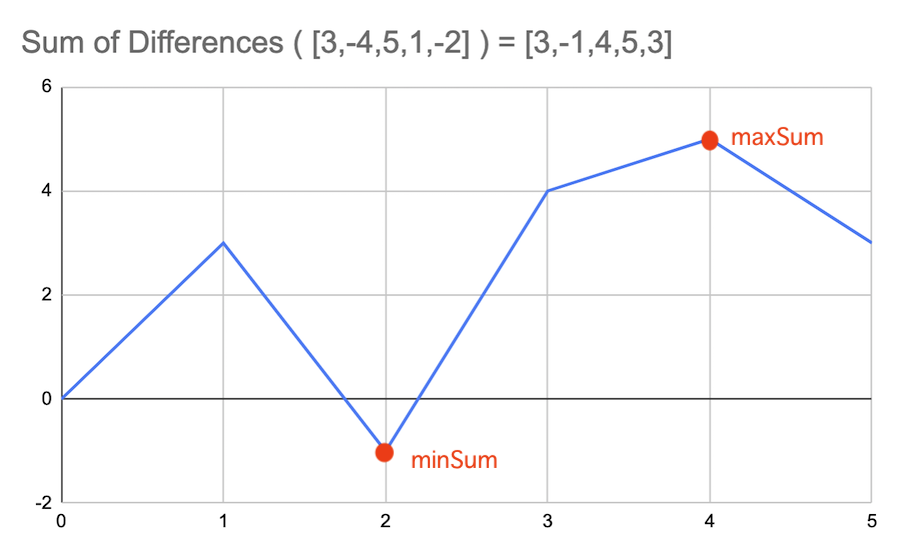
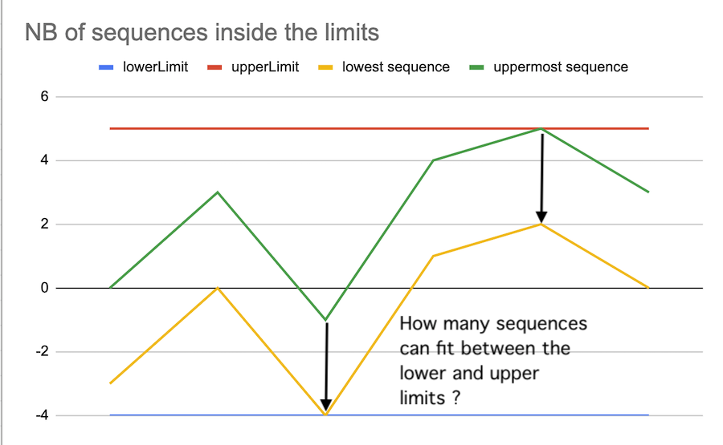

# [Java, Kotlin, Python] Intuitive illustrations graph within the lower and upper limits

**Author:** chenon
**Votes:** 3
**Link:** [https://leetcode.com/problems/count-the-hidden-sequences/solutions/1713582/](https://leetcode.com/problems/count-the-hidden-sequences/solutions/1713582/)

---

# Explanation
To see graphically the problem : how many series/sequences can be included withing these lower and upper limits.

## Example
Input: 
differences = [3,-4,5,1,-2], lower = -4, upper = 5
Output: 4

We are interested in computing the accumulated sum of differences. Assume `accSum` is initialized to 0, we add each element of the array one by one.
3 = 3  + 3
-1 = 3 -4
4 = -1 + 5 
5 = 4  + 1
3 = 5-2

**And the  accumulated sum of differences = [3,-1,4,5,3]**

The sequence starts at (0,0).


We are interested about the minimum and maximum of the sum.
In order to determine whether the number of sequences that will fit inside the lower and upper limits.



**How to calculate the number of sequences inside the horizontal limits ?**

I brute forced [during the contest](https://leetcode.com/contest/biweekly-contest-70/problems/count-the-hidden-sequences/)   and got the [answer thanks to Lee215](https://leetcode.com/problems/count-the-hidden-sequences/discuss/1709755/JavaC%2B%2BPython-Straight-Forward-Solution-with-Explantion).

Intuitively, it is the difference of upper and lower limit  malus the difference of maxSum and minSum. 
Add + 1 . Why ? Because imagine if the upper, lower limits  are equals and the only sequence is inside the limits.

# Codes
Time complexity : O(n)
Space complexity: O(1)

Note: there is an edge case going over the `Integer` range, we have to use `Long` type.

## Java

```
    public int numberOfArrays(int[] differences, int lower, int upper) {
        long  accSum = 0;
        long  maxSum = 0;
        long  minSum = 0;
        for (int d : differences) {
            accSum += d;
            maxSum = Math.max(maxSum, accSum);
            minSum = Math.min(minSum, accSum);
        }
        return (int) Math.max(0, (upper - lower) - (maxSum - minSum) + 1);
    }
```

## Kotlin

```
    fun numberOfArrays(differences: IntArray, lower: Int, upper: Int): Int {
        var accSum = 0L
        var minSum = 0L
        var maxSum = 0L
        
        for(diff in differences){
            accSum += diff
            minSum = minOf(accSum , minSum)
            maxSum = maxOf(accSum, maxSum)
        }
        
        return maxOf(0, (upper- lower) - (maxSum - minSum) +1).toInt()
    }
```

## Python 3
```
    def numberOfArrays(self, differences: List[int], lower: int, upper: int) -> int:
        accSum = 0
        minSum = 0
        maxSum = 0
        for d in differences:
            accSum += d
            minSum = min(minSum, accSum)
            maxSum = max(maxSum, accSum)
        
        return max(0, (upper - lower) - (maxSum - minSum) + 1)
```