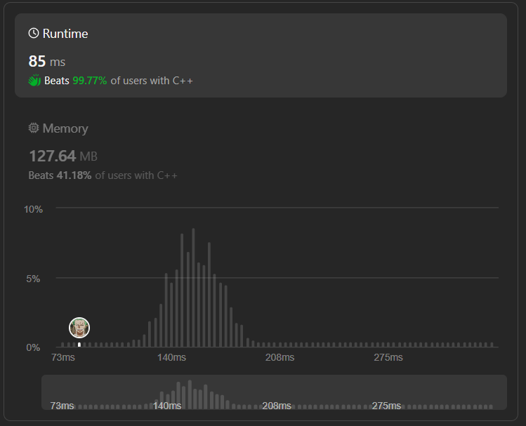
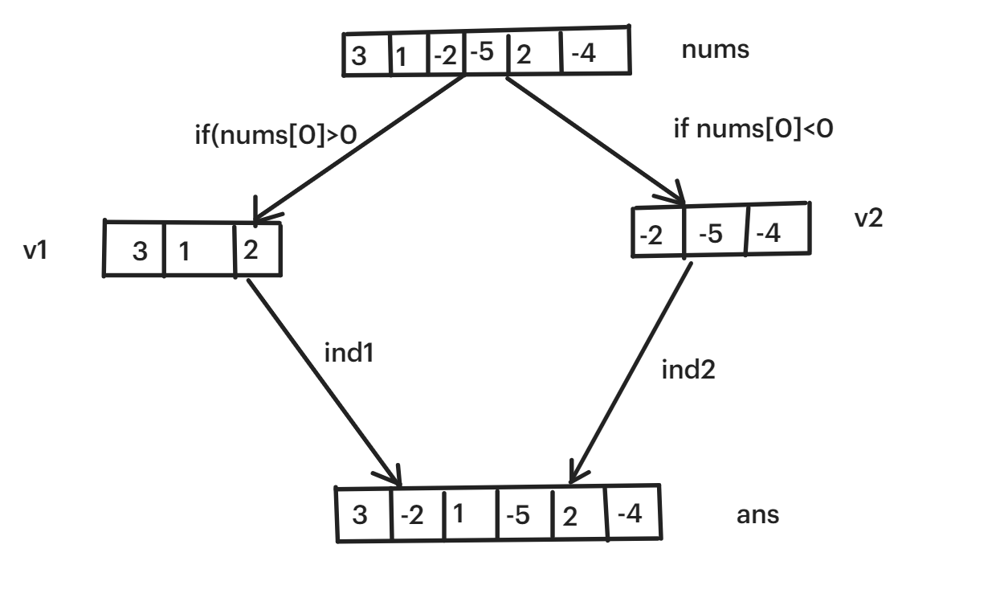
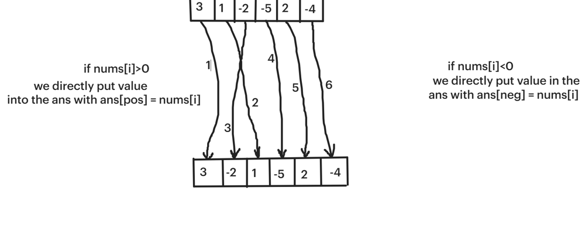

# ✅☑Beats 100% Users || [C++/Java/Python/JavaScript] || 2 Approaches || EXPLAINED🔥

**Author:** MarkSPhilip31
**Votes:** 163
**Link:** [https://leetcode.com/problems/rearrange-array-elements-by-sign/solutions/4723628/](https://leetcode.com/problems/rearrange-array-elements-by-sign/solutions/4723628/)

---

# DO GIVE IT A LIKE IF THAT WAS HELPFUL\uD83E\uDEE1\uD83D\uDC47


---


---


# Approaches
(Also explained in the code)

#### ***Approach 1 ( Brute Force )***
1. We will iterate over the `nums` vector.
1. If we encounter positive number then putting in `v1` and if negative putting in `v2`.



3. With the help of while loop iterating both together and putting values in the `ans` vector, where `ind1` in index for `v1` and `ind2` for `v2` and the 1st element should be positive.
```NOTE\uD83D\uDDD2\uD83D\uDE80 []

Here, we're appending values sequentially thayswhy used push_back()


```

# Complexity
- Time complexity:
   $$O(n)$$
    

- Space complexity:
   $$O(n)$$
    


# Code
```C++ []
class Solution {
public:
    vector<int> rearrangeArray(vector<int>& nums) {
        vector<int>v1,v2,ans;
        
        for(int i =0;i<nums.size();i++){
            if(nums[i]>0)v1.push_back(nums[i]);
            else v2.push_back(nums[i]);
        }
        int ind1=0,ind2=0;
        

        while(ind2<nums.size()/2){
            ans.push_back(v1[ind1]);
            ind1++;
            ans.push_back(v2[ind2]);
            ind2++;
        }
        return ans;
    }
};


```

```Java []
import java.util.*;

class Solution {
    public int[] rearrangeArray(int[] nums) {
        List<Integer> v1 = new ArrayList<>();
        List<Integer> v2 = new ArrayList<>();
        List<Integer> ans = new ArrayList<>();
        
        for (int num : nums) {
            if (num > 0) {
                v1.add(num);
            } else {
                v2.add(num);
            }
        }
        
        int ind1 = 0, ind2 = 0;
        
        while (ind2 < nums.length / 2) {
            ans.add(v1.get(ind1));
            ind1++;
            ans.add(v2.get(ind2));
            ind2++;
        }
        
        return ans.stream().mapToInt(Integer::intValue).toArray();
    }
}


```
```python3 []
class Solution:
    def rearrangeArray(self, nums: List[int]) -> List[int]:
        v1, v2, ans = [], [], []
        
        for num in nums:
            if num > 0:
                v1.append(num)
            else:
                v2.append(num)
        
        ind1, ind2 = 0, 0
        
        while ind2 < len(nums) // 2:
            ans.append(v1[ind1])
            ind1 += 1
            ans.append(v2[ind2])
            ind2 += 1
        
        return ans


```
```javascript []
var Solution = function() {};

Solution.prototype.rearrangeArray = function(nums) {
    let v1 = [];
    let v2 = [];
    let ans = [];
    
    for (let num of nums) {
        if (num > 0) {
            v1.push(num);
        } else {
            v2.push(num);
        }
    }
    
    let ind1 = 0;
    let ind2 = 0;
    
    while (ind2 < nums.length / 2) {
        ans.push(v1[ind1]);
        ind1++;
        ans.push(v2[ind2]);
        ind2++;
    }
    
    return ans;
};


```

---

#### ***Approach 2( Optimized )***
1. Here we are directly putting values in the `ans` vector with the help of 2 pointer approach where initially both the indexes `pos` and `neg` are `0` and `1`.
1. If we encounter positive element then will put values in the `ans` vector with the help of `ans[pos] = nums[i]` and if found negative element then `ans[neg] = nums[i]`.




```NOTE\uD83D\uDDD2\uD83D\uDE80 []

Here, we can't use ans.push_back() to add elements because
 we're not appending values sequentially. Instead, we're placing
 values at specific indexes based on the element we have.

The number 1....6 are the order in which the elements where
 pushed into the ans vector.


```

# Complexity
- Time complexity:
   $$O(n)$$
    

- Space complexity:
   $$O(n)$$
    


# Code
```C++ []
class Solution {
public:
    vector<int> rearrangeArray(vector<int>& nums) {
        vector<int>ans(nums.size(),0);
        
        
        int pos=0,neg=1;
        

        for(int i=0;i<nums.size();i++){
            if(nums[i]>0){
                ans[pos] = nums[i];
                pos+=2;
            }else{
                ans[neg] = nums[i];
                neg+=2;
            }
        }
        return ans;
    }
};


```

```Java []

import java.util.*;

class Solution {
    public int[] rearrangeArray(int[] nums) {
        int[] ans = new int[nums.length];
        int pos = 0, neg = 1;
        
        for (int i = 0; i < nums.length; i++) {
            if (nums[i] > 0) {
                ans[pos] = nums[i];
                pos += 2;
            } else {
                ans[neg] = nums[i];
                neg += 2;
            }
        }
        
        return ans;
    }
}


```
```python3 []
class Solution:
    def rearrangeArray(self, nums: List[int]) -> List[int]:
        ans = [0] * len(nums)
        pos, neg = 0, 1
        
        for num in nums:
            if num > 0:
                ans[pos] = num
                pos += 2
            else:
                ans[neg] = num
                neg += 2
        
        return ans


```
```javascript []

var Solution = function() {};

Solution.prototype.rearrangeArray = function(nums) {
    let ans = new Array(nums.length).fill(0);
    let pos = 0, neg = 1;
    
    for (let i = 0; i < nums.length; i++) {
        if (nums[i] > 0) {
            ans[pos] = nums[i];
            pos += 2;
        } else {
            ans[neg] = nums[i];
            neg += 2;
        }
    }
    
    return ans;
};

```

---


# DO GIVE IT A LIKE IF THAT WAS HELPFUL\uD83E\uDEE1\uD83D\uDC47

---
---


---