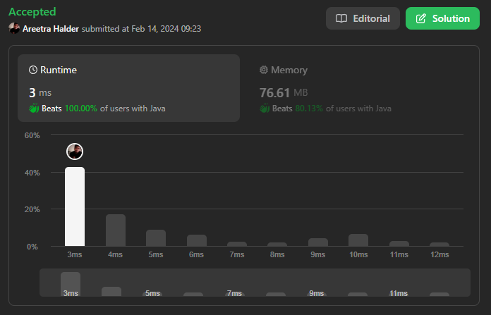

# 🔥🔥✅ Beats 100% with Proof | Very Easy to Understand ✅🔥🔥

**Author:** areetrahalder
**Votes:** 13
**Link:** [https://leetcode.com/problems/rearrange-array-elements-by-sign/solutions/4724208/](https://leetcode.com/problems/rearrange-array-elements-by-sign/solutions/4724208/)

---

# Proof - Upvote if you are watching the proof



# Intuition
<!-- Describe your first thoughts on how to solve this problem. -->
The solution uses two pointers (`pos` and `neg`) to keep track of the positions where positive and negative integers should be placed. It iterates through the given array (`nums`) and places positive integers at positions indexed by `pos` (increasing by 2) and negative integers at positions indexed by `neg` (also increasing by 2).

> # Why does this work?
> This solution works by iterating through the array and placing positive integers at even indices and negative integers at odd indices, ensuring consecutive pairs have opposite signs, and preserving relative order.

# Approach
<!-- Describe your approach to solving the problem. -->
1. Initialize two pointers `pos` and `neg` to 0 and 1 respectively.
Iterate through the array nums.
2. If the current element is positive, place it at the position indexed by `pos` and update `pos` by increasing it by 2.
3. If the current element is negative, place it at the position indexed by `neg` and update `neg` by increasing it by 2.
4. Continue this process until all elements are placed at the correct positions.

# Complexity
- Time complexity:
<!-- Add your time complexity here, e.g. $$O(n)$$ -->
> where n is the length of the array `nums`. The solution iterates through the array once.

- Space complexity:
<!-- Add your space complexity here, e.g. $$O(n)$$ -->
> where n is the length of the array `nums`. The solution uses an additional array (`output`) of the same length as `nums`.

# Code
```Java []
class Solution {
    public int[] rearrangeArray(int[] nums) {
        int n = nums.length;
        int[] output = new int[n];
        int i = 0, pos = 0, neg = 1;
        while(i < n){
            if(nums[i++] > 0){
                output[pos] = nums[i - 1];
                pos += 2;
            }else{
                output[neg] = nums[i - 1];
                neg += 2;
            }
        }
        return output;
    }
}
```
```C++ []
class Solution {
public:
    vector<int> rearrangeArray(std::vector<int>& nums) {
        int n = nums.size();
        std::vector<int> output(n, 0);
        int i = 0, pos = 0, neg = 1;
        while (i < n) {
            if (nums[i++] > 0) {
                output[pos] = nums[i - 1];
                pos += 2;
            } else {
                output[neg] = nums[i - 1];
                neg += 2;
            }
        }
        return output;
    }
};

```
```C []
/**
 * Note: The returned array must be malloced, assume caller calls free().
 */
int* rearrangeArray(int* nums, int numsSize, int* returnSize) {
    int n = numsSize;
    int* output = (int*)malloc(n * sizeof(int));
    int i = 0, pos = 0, neg = 1;
    while (i < n) {
        if (nums[i++] > 0) {
            output[pos] = nums[i - 1];
            pos += 2;
        } else {
            output[neg] = nums[i - 1];
            neg += 2;
        }
    }
    *returnSize = n;
    return output;
}
```
```C# []
public class Solution {
    public int[] RearrangeArray(int[] nums) {
        int n = nums.Length;
        int[] output = new int[n];
        int i = 0, pos = 0, neg = 1;
        while (i < n) {
            if (nums[i++] > 0) {
                output[pos] = nums[i - 1];
                pos += 2;
            } else {
                output[neg] = nums[i - 1];
                neg += 2;
            }
        }
        return output;
    }
}
```
```Javascript []
/**
 * @param {number[]} nums
 * @return {number[]}
 */
var rearrangeArray = function(nums) {
    const n = nums.length;
    const output = new Array(n);
    let i = 0, pos = 0, neg = 1;
    
    while (i < n) {
        if (nums[i++] > 0) {
            output[pos] = nums[i - 1];
            pos += 2;
        } else {
            output[neg] = nums[i - 1];
            neg += 2;
        }
    }
    
    return output;
};
```
```Typescript []
function rearrangeArray(nums: number[]): number[] {
    const n = nums.length;
    const output: number[] = new Array(n);
    let i = 0, pos = 0, neg = 1;
    
    while (i < n) {
        if (nums[i++] > 0) {
            output[pos] = nums[i - 1];
            pos += 2;
        } else {
            output[neg] = nums[i - 1];
            neg += 2;
        }
    }
    
    return output;
}
```
```Python []
class Solution(object):
    def rearrangeArray(self, nums):
        n = len(nums)
        output = [0] * n
        i, pos, neg = 0, 0, 1
        while i < n:
            if nums[i] > 0:
                output[pos] = nums[i]
                pos += 2
            else:
                output[neg] = nums[i]
                neg += 2
            i += 1
        return output
```
```Python3 []
class Solution:
    def rearrangeArray(self, nums: List[int]) -> List[int]:
        n = len(nums)
        output = [0] * n
        i, pos, neg = 0, 0, 1

        while i < n:
            if nums[i] > 0:
                output[pos] = nums[i]
                pos += 2
            else:
                output[neg] = nums[i]
                neg += 2
            i += 1

        return output
```

# Upvote - Please


