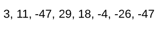
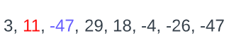
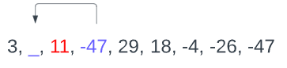
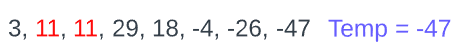
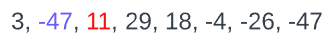
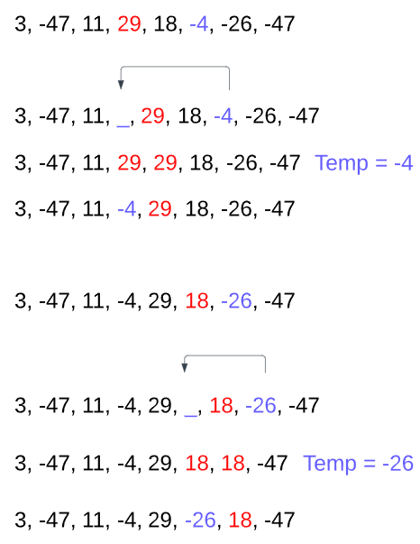

# O(1) Space complexity explained

**Author:** SirMeowingtons5
**Votes:** 17
**Link:** [https://leetcode.com/problems/rearrange-array-elements-by-sign/solutions/2678355/](https://leetcode.com/problems/rearrange-array-elements-by-sign/solutions/2678355/)

---

# Note before
This solution is suboptimal in time complexity (Beats only 5%), so I highly advice to use it simply as an inspiration rather than final solution.

# Intuition
We have to check whether the number at current position has the right sign, and if it's not, we need to find the nearest number with opposite index and put it before the current number.

# Approach
I'll try to explain as detailed as possible. Feel free to scroll down till the end of solution if you just want to read the full code.

## Initial condition

Let's use [3, 11, -47, 29, 18, -4, -26, -47] as an example.



We need to iterate through all the items
```
for (i in nums.indices) {
    //...
}
```

## Checking if number at the right position
We start with iterating through each number and checking whether it's at the right index or not.
There might be two cases:
1. Current index is even and the number is negative
2. Current index is odd and the number is positive

```
val isNegativeAtWrongPlace = i % 2 == 0 && nums[i] < 0
val isPositiveAtWrongPlace = i % 2 == 1 && nums[i] > 0
```

First item at the wrong position is **11**.

So now that we found that there's a number at a wrong position, we have to place the closest number with opposite sign before it.

## Finding the closest number with opposite sign
But first, we have to find it.
Just iterate from current index until we find the first suitable number.
```
if (isNegativeAtWrongPlace || isPositiveAtWrongPlace) {
    var nearestOppositeIndex = i

    if (isNegativeAtWrongPlace) {
        while (nums[nearestOppositeIndex] < 0) {
            nearestOppositeIndex++
        }
    } else {
        while (nums[nearestOppositeIndex] >= 0) {
            nearestOppositeIndex++
        }
    }
}
```
First number with opposite sign is **-47**.
Now we have both the number that is at the wrong position and the number we have to place before it.



## Moving opposite sign number before the target
Whan we want to do is somehow move **-47** before **11**, so both numbers would be at the correct positions.



To achieve this, all we have to do is save the opposite sign number in temp variable, then shift all items between two indices one time right.
```
val nearestOpposite = nums[nearestOppositeIndex]
```

## Shifting numbers right
Since we already saved opposite number, we don't need to keep it in array during the shift. So, just iterate from `nearestOppositeIndex` down to `i+1` (index that is next to the element with wrong sign) and assign the value of previous item (i.e. `num[j] = num[j-1]`).

```
for (j in nearestOppositeIndex downTo i + 1) {
    nums[j] = nums[j - 1]
}
```
Now the array looks like this:


## Placing opposite sign number at the right place
Now all we need to do is place opposite sign number (that we store in temp variable) at the index of the original number that had wrong sign.

```
nums[i] = nearestOpposite
```

And after this the array looks like this:


## Rest of the example
I don't think repeating each step in depth is necessary, still there's an interesting situation where we have three positive and then three negative numbers in a row. Let's just visualize the rest of this approach.




<!-- Describe your approach to solving the problem. -->

# Complexity
- Time complexity: O(n^2)

- Space complexity: O(1)

# Code
```
class Solution {

    fun rearrangeArray(nums: IntArray): IntArray {
        for (i in nums.indices) {
            val isNegativeAtWrongPlace = i % 2 == 0 && nums[i] < 0
            val isPositiveAtWrongPlace = i % 2 == 1 && nums[i] > 0

            if (isNegativeAtWrongPlace || isPositiveAtWrongPlace) {
                var nearestOppositeIndex = i

                if (isNegativeAtWrongPlace) {
                    while (nums[nearestOppositeIndex] < 0) {
                        nearestOppositeIndex++
                    }
                } else {
                    while (nums[nearestOppositeIndex] >= 0) {
                        nearestOppositeIndex++
                    }
                }

                val temp = nums[nearestOppositeIndex]

                for (j in nearestOppositeIndex downTo i + 1) {
                    nums[j] = nums[j - 1]
                }

                nums[i] = temp
            }
        }

        return nums
    }
}
```