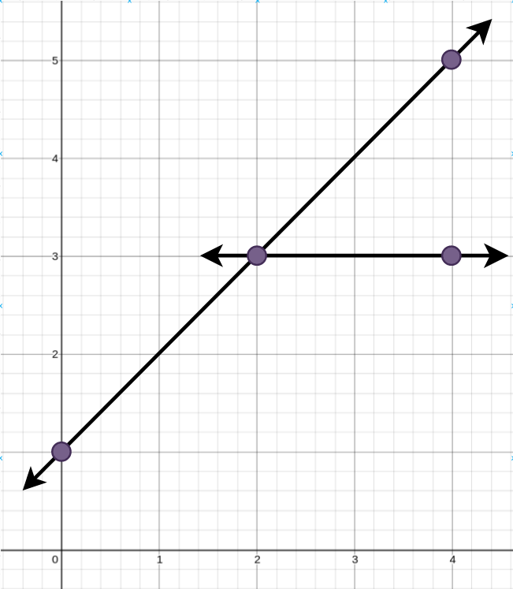
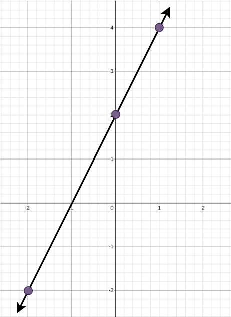

# [2152. Minimum Number of Lines to Cover Points](https://leetcode.com/problems/minimum-number-of-lines-to-cover-points/)

| Category | Difficulty | Likes | Dislikes |
| :------: | :--------: | :---: | :------: |
| Algorithms | Medium | 75 | 14 |

**Tags:** [`array`](https://leetcode.com/tag/array), [`hash-table`](https://leetcode.com/tag/hash-table), [`math`](https://leetcode.com/tag/math), [`dynamic-programming`](https://leetcode.com/tag/dynamic-programming), [`backtracking`](https://leetcode.com/tag/backtracking), [`bit-manipulation`](https://leetcode.com/tag/bit-manipulation), [`geometry`](https://leetcode.com/tag/geometry), [`bitmask`](https://leetcode.com/tag/bitmask)

**Companies:** `morgan-stanley`

## Description

You are given an array `points` where `points[i] = [x_i, y_i]` represents a point on an **X-Y **plane.

**Straight lines** are going to be added to the **X-Y** plane, such that every point is covered by at **least **one line.

Return *the **minimum **number of **straight lines** needed to cover all the points*.

 

**Example 1:**


```

Input: points = [[0,1],[2,3],[4,5],[4,3]]
Output: 2
Explanation: The minimum number of straight lines needed is two. One possible solution is to add:
- One line connecting the point at (0, 1) to the point at (4, 5).
- Another line connecting the point at (2, 3) to the point at (4, 3).

```

**Example 2:**


```

Input: points = [[0,2],[-2,-2],[1,4]]
Output: 1
Explanation: The minimum number of straight lines needed is one. The only solution is to add:
- One line connecting the point at (-2, -2) to the point at (1, 4).

```

 

**Constraints:**

	- `1 <= points.length <= 10`

	- `points[i].length == 2`

	- `-100 <= x_i, y_i <= 100`

	- All the `points` are **unique**.

---

**Links:** [Submissions](https://leetcode.com/problems/minimum-number-of-lines-to-cover-points/) | [Solutions](https://leetcode.com/problems/minimum-number-of-lines-to-cover-points/)
