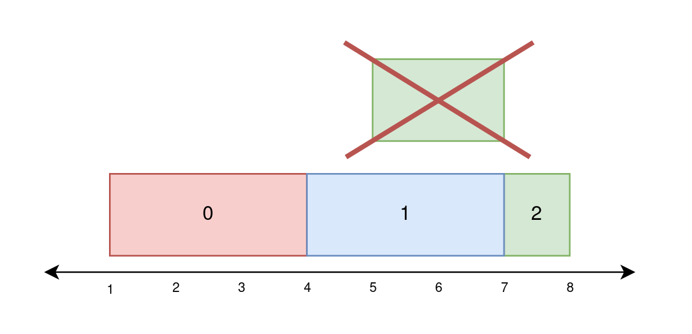
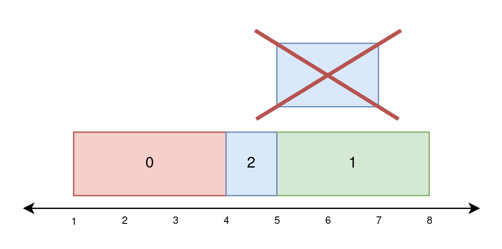
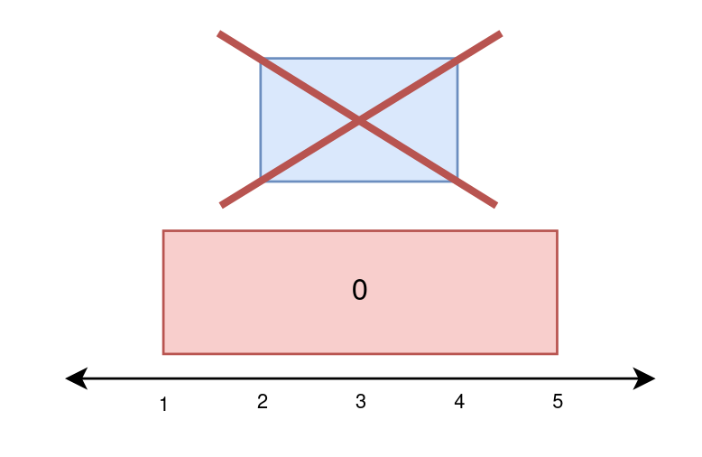

# [2158. Amount of New Area Painted Each Day](https://leetcode.com/problems/amount-of-new-area-painted-each-day/)

| Category | Difficulty | Likes | Dislikes |
| :------: | :--------: | :---: | :------: |
| Algorithms | Hard | 439 | 44 |

**Tags:** [`array`](https://leetcode.com/tag/array), [`segment-tree`](https://leetcode.com/tag/segment-tree), [`ordered-set`](https://leetcode.com/tag/ordered-set)

**Companies:** `uber`, `google`

## Description

There is a long and thin painting that can be represented by a number line. You are given a **0-indexed** 2D integer array `paint` of length `n`, where `paint[i] = [start_i, end_i]`. This means that on the `i^th` day you need to paint the area **between** `start_i` and `end_i`.

Painting the same area multiple times will create an uneven painting so you only want to paint each area of the painting at most **once**.

Return *an integer array *`worklog`* of length *`n`*, where *`worklog[i]`* is the amount of **new** area that you painted on the *`i^th`* day.*

 

**Example 1:**


```

Input: paint = [[1,4],[4,7],[5,8]]
Output: [3,3,1]
Explanation:
On day 0, paint everything between 1 and 4.
The amount of new area painted on day 0 is 4 - 1 = 3.
On day 1, paint everything between 4 and 7.
The amount of new area painted on day 1 is 7 - 4 = 3.
On day 2, paint everything between 7 and 8.
Everything between 5 and 7 was already painted on day 1.
The amount of new area painted on day 2 is 8 - 7 = 1. 

```

**Example 2:**


```

Input: paint = [[1,4],[5,8],[4,7]]
Output: [3,3,1]
Explanation:
On day 0, paint everything between 1 and 4.
The amount of new area painted on day 0 is 4 - 1 = 3.
On day 1, paint everything between 5 and 8.
The amount of new area painted on day 1 is 8 - 5 = 3.
On day 2, paint everything between 4 and 5.
Everything between 5 and 7 was already painted on day 1.
The amount of new area painted on day 2 is 5 - 4 = 1. 

```

**Example 3:**


```

Input: paint = [[1,5],[2,4]]
Output: [4,0]
Explanation:
On day 0, paint everything between 1 and 5.
The amount of new area painted on day 0 is 5 - 1 = 4.
On day 1, paint nothing because everything between 2 and 4 was already painted on day 0.
The amount of new area painted on day 1 is 0.

```

 

**Constraints:**

	- `1 <= paint.length <= 10^5`

	- `paint[i].length == 2`

	- `0 <= start_i < end_i <= 5 * 10^4`

---

**Links:** [Submissions](https://leetcode.com/problems/amount-of-new-area-painted-each-day/) | [Solutions](https://leetcode.com/problems/amount-of-new-area-painted-each-day/)
