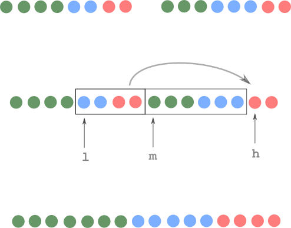

# 🚩inplace NlogN ^^

**Author:** andrii_khlevniuk
**Votes:** 43
**Link:** [https://leetcode.com/problems/partition-array-according-to-given-pivot/solutions/1752535/](https://leetcode.com/problems/partition-array-according-to-given-pivot/solutions/1752535/)

---

**divide and conquer**
**time: `O(NlogN)`; space: `O(1)`**
```
vector<int> pivotArray(vector<int>& n, int p) 
{
	for(int d{2}; d<2*size(n); d<<=1)
		for(auto b{begin(n)}, m{b}, e{b}; b<end(n); b=e)
		{
			m = min(b+d/2, end(n)),
			e = min(b+d,   end(n));
			auto l = lower_bound(b, m, p),
				 h = upper_bound(m, e, p);
			rotate(l, m, h);
		}
	return n;
}
```
**Notation:**
`d` - current chunk size (power of two) `= 2,4,8...`;
`b` - **b**eginning of the merge chunk;
`m` - **m**iddle of the merge chunk;
`e` - **e**nd of the merge chunk;
`l` and `h` come from "**l**ow" and "**h**igh".


<br>
Divide and conquer technique example:


<br>
<br>

Single "merge" operation example:

<br>



<br>

Another problem that uses partition as a subproblem [2149.  Rearrange Array Elements by Sign](https://leetcode.com/problems/rearrange-array-elements-by-sign/discuss/1729673/4-solutions)