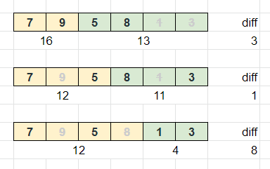

# Two Heaps and Temp Array

**Author:** votrubac
**Votes:** 29
**Link:** [https://leetcode.com/problems/minimum-difference-in-sums-after-removal-of-elements/solutions/1747244/](https://leetcode.com/problems/minimum-difference-in-sums-after-removal-of-elements/solutions/1747244/)

---

**Intuition:** we remove largest elements if it affects the first array, and smallest - if the second.

We can split the array into two subarrays at some point `i` (`n <= i <= 2 * n`). We remove `i - n` largest elements from the first subarray, and `2 * n - i` smallest elements from the second subarray. That way, for a given split, we get the smallest possible `sum_first`, and largest possible `sum_second`.

Here is the example for `[7,9,5,8,1,3]` test case:



We track and return the minimum difference among all these splits. To make it efficient, we use max/min heaps to track smallest/largest numbers, and update `sum_first` and `sum_second`.

**C++**
```cpp
long long minimumDifference(vector<int>& nums) {
    int n = nums.size() / 3;
    priority_queue<int> pq_l(begin(nums), begin(nums) + n);
    priority_queue<int, vector<int>, greater<int>> pq_r(begin(nums) + 2 * n, end(nums));
    long long sum_first = accumulate(begin(nums), begin(nums) + n, 0LL);
    long long sum_second = accumulate(begin(nums) + 2 * n, end(nums), 0LL); 
    vector<long long> diffs(n + 1);
    for (int i = n; i <= 2 * n; ++i) {
        diffs[i - n] = sum_first;
        if (pq_l.top() > nums[i]) {
            sum_first += nums[i] - pq_l.top();
            pq_l.pop();
            pq_l.push(nums[i]);
        }
    }
    for (int i = 2 * n - 1; i >= n - 1; --i) {
        diffs[i - n + 1] -= sum_second;
        if (pq_r.top() < nums[i]) {
            sum_second += nums[i] - pq_r.top();
            pq_r.pop();
            pq_r.push(nums[i]);
        }
    }
    return *min_element(begin(diffs), end(diffs));
}
```
**Complexity Analysys**
- Time: O(n log n) for heap operations.
- Memory: O(n) for the heaps and temp array.