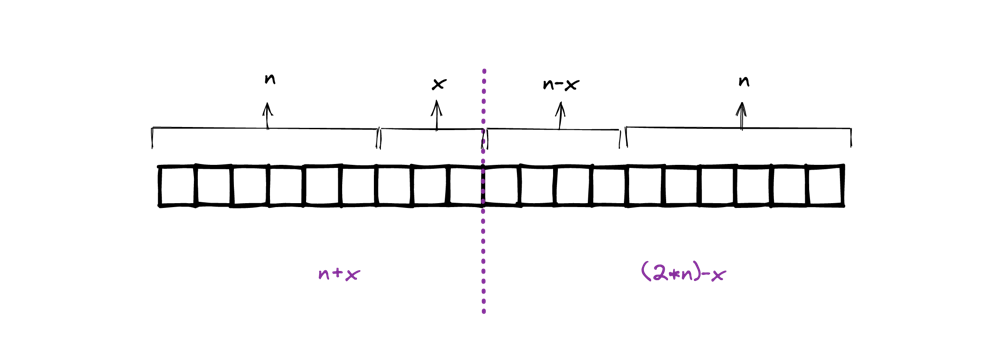
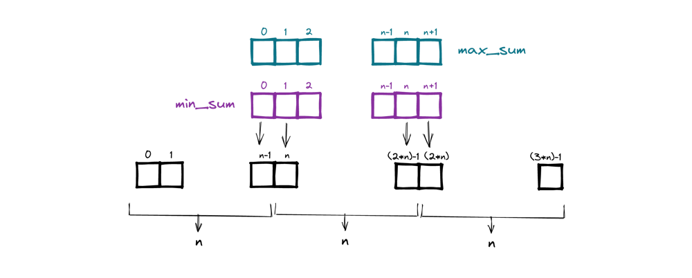

# Python solution | O(nlogn) | explained with diagram | heap and dp solution

**Author:** wilspi
**Votes:** 4
**Link:** [https://leetcode.com/problems/minimum-difference-in-sums-after-removal-of-elements/solutions/2392142/](https://leetcode.com/problems/minimum-difference-in-sums-after-removal-of-elements/solutions/2392142/)

---

This solution is a combination of dp and heaps.
Time: `O(nlogn)`

# Explanation:

We can select in first part:
* first `n` elements or
* min `n` elements from first `n+1` elements
* min `n` elements from first `n-2` elements
* ...
* min `n` elements from first `2n` elements


In other words,
we need to find a partition such that:
* `n` minimum-value elements  from `n+x` are in first part and
* `n` maximum-value elements from `2n-x` are in second part




Here,
* difference would be minimum when we choose top minimum-value elements in first part and top maximum-value elements in second part
* `x` can move from `[0, n]` 
	* when `x` is `0`, we make sure there are `n` elements in first part 
	  (and from `2n` elements in second part -> `n` maximum-value elements will be selected and other `n` will be removed)
	* when `x` is `n` we make sure there are `n` elements in second part

Now, we need `min_sum` for first part and `max_sum` for second part for all `x` values, then we can calculate the minimum difference (note: this is not absolute difference).
We will store these values in respective arrays and later calculate the minimum difference, shown below:



To calculate `min_sum` we will use `max_heap` to pop out maximum value for each iteration and insert the current element, 
similarly for calculating `max_sum` we will use `min_heap`

# Solution

See code below:


```python
class Solution:
    def minimumDifference(self, nums: List[int]) -> int:
        n = len(nums) // 3

        # calculate max_sum using min_heap for second part
        min_heap = nums[(2 * n) :]
        heapq.heapify(min_heap)

        max_sum = [0] * (n + 2)
        max_sum[n + 1] = sum(min_heap)
        for i in range((2 * n) - 1, n - 1, -1):
            # push current
            heapq.heappush(min_heap, nums[i])
            # popout minimum from heap
            val = heapq.heappop(min_heap)
            # max_sum for this partition
            max_sum[i - n + 1] = max_sum[i - n + 2] - val + nums[i]


        # calculate min_sum using max_heap for first part
        max_heap = [-x for x in nums[:n]]
        heapq.heapify(max_heap)

        min_sum = [0] * (n + 2)
        min_sum[0] = -sum(max_heap)
        for i in range(n, (2 * n)):
            # push current
            heapq.heappush(max_heap, -nums[i])
            # popout maximum from heap
            val = -heapq.heappop(max_heap)
            # min_sum for this partition
            min_sum[i - n + 1] = min_sum[i - n] - val + nums[i]


        # find min difference bw second part (max_sum) and first part (min_sum)
        ans = math.inf
        for i in range(0, n + 1):
            print(i, min_sum[i], max_sum[i])
            ans = min((min_sum[i] - max_sum[i + 1]), ans)

        return ans

```

