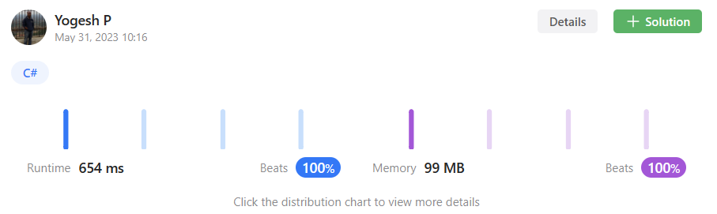

# Simplest + Fast solution | 100% runtime + space efficient | C#

**Author:** Baymax_
**Votes:** 1
**Link:** [https://leetcode.com/problems/design-bitset/solutions/3580911/](https://leetcode.com/problems/design-bitset/solutions/3580911/)

---

# Intuition & Approach
<!-- Describe your first thoughts on how to solve this problem. -->

Using two StringBuilder, one to maintain original and one to maintain flipped version of original we can solve the given problem faster.




# Complexity
- Time complexity:
<!-- Add your time complexity here, e.g. $$O(n)$$ -->
All functionalities except 'ToString' runs in O(1)
ToString takes O(N)

- Space complexity:
<!-- Add your space complexity here, e.g. $$O(n)$$ -->
O(N)

## Please upvote if you like the approach

# Code
```
public class Bitset {
    // original bit string of zeros and count of ones in it (initially 0)
    StringBuilder orig;
    int oneCount;

    //flipped version of original - all bits set to 1s
    StringBuilder flip;
    int length;

    public Bitset(int size) {
        orig = new StringBuilder();
        oneCount = 0;

        flip = new StringBuilder();

        length = size;

        for (int i = 0; i < length; i++)
        {
            orig.Append('0');
            flip.Append('1');
        }
    }
    
    public void Fix(int idx) {
        if (orig[idx] != '1')
        {
            orig[idx] = '1';
            oneCount++;

            flip[idx] = '0';
        }
    }
    
    public void Unfix(int idx) {
        if (orig[idx] != '0')
        {
            orig[idx] = '0';
            oneCount--;

            flip[idx] = '1';
        }
    }
    
    public void Flip() {
        //update 1s count - to the one's count of flipped
        oneCount = length - oneCount;

        //swap original and flipped stringbuilders
        StringBuilder tempPointer = orig;
        orig = flip;
        flip = tempPointer;
    }
    
    public bool All() {
        return (oneCount == length);
    }
    
    public bool One() {
        return (oneCount > 0);
    }
    
    public int Count() {
        return oneCount;
    }
    
    public string ToString() {
        return orig.ToString();
    }
}
```

## Please upvote if you like the approach

