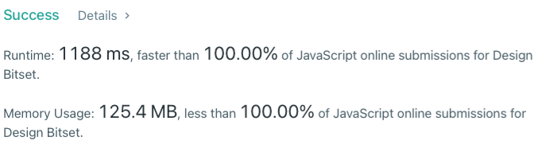

# [Javascript] 3 attempts/tweaks, finally reworked for 100% faster and 100% less mem

**Author:** paultman
**Votes:** 4
**Link:** [https://leetcode.com/problems/design-bitset/solutions/1750521/](https://leetcode.com/problems/design-bitset/solutions/1750521/)

---



This was question 3 in last nights contest.  At first read, seems really easy... (famous last words).
First attempt was just using an array, filled with zeros to start, and do the operations per the instructions.  Easy peasy... nope, got a TLE.
Ok, so i'll just optimize a few things.  no more filters... nope, still not enough.  Maybe the flip was taking too long.  Ok, i'll make a dupicate inverse array, and just swap them on flip calls... still TLE... what else... I still had a pretty inefficient "count" function... how to speed that up... ugg, time ran out.

Next morning I browsed the discussion and found a pretty sharp solution that wasn't an impovement to what I had, but a complete change of implementation.  Rather than using the array up front, why not have 2 sets, one for 0's another for 1's.  simply move indexes between the two.  Each function implementation was easy, and oh so efficient.  Credit to pgmreddy for his code paste into the discussion board.

Here's my code, along with commented out iterations before getting to the final where I used 2 sets:

```
var Bitset = function(size) {
    //this.bits = new Array(size).fill(0);
    //this.bitsOp = new Array(size).fill(1);
    this.set0 = new Set();
    this.set1 = new Set();
    for (let i = 0; i<size; i++) this.set0.add(i);
};

/** 
 * @param {number} idx
 * @return {void}
 */
Bitset.prototype.fix = function(idx) {
  //this.bits[idx] = 1;
  //this.bitsOp[idx] = 0;
  if (this.set0.has(idx)) {
    this.set1.add(idx);
    this.set0.delete(idx);
  }
};

/** 
 * @param {number} idx
 * @return {void}
 */
Bitset.prototype.unfix = function(idx) {
  //this.bits[idx] = 0;
  //this.bitsOp[idx] = 1;
  if (this.set1.has(idx)) {
    this.set0.add(idx);
    this.set1.delete(idx);
  }
};

/**
 * @return {void}
 */
Bitset.prototype.flip = function() {
  //this.bits = this.bits.map(x=>(x)?0:1); 
  //this.bits.forEach(x=>x=(x)?0:1); 
  [this.set0, this.set1] = [this.set1, this.set0];
};

/**
 * @return {boolean}
 */
Bitset.prototype.all = function() {
  //return (this.bits.filter(x=>x).length == this.bits.length) 
  //return !this.bits.includes(0);
  //for (let i = 0; i<this.bits.length; i++)
    //if (this.bits[i] === 0) return false;
   //return true; 
  return this.set0.size===0
};

/**
 * @return {boolean}
 */
Bitset.prototype.one = function() {
    //return this.bits.filter(x=>x).length>0 
    //return this.bits.includes(1);
    //for (let i = 0; i<this.bits.length; i++)
      //if (this.bits[i] === 1) return true;
     //return false; 
  return this.set1.size>0;
};

/**
 * @return {number}
 */
Bitset.prototype.count = function() {
    //return this.bits.filter(x=>x).length 
  //return this.bits.reduce((sum, cur)=>sum+cur);
  return this.set1.size;
};

/**
 * @return {string}
 */
Bitset.prototype.toString = function() {
    //return this.bits.join('');
  let set = new Array(this.set0.size+this.set1.size);
  for (let i=0; i<set.length; i++) {
    set[i] = this.set0.has(i)?0:1;
  }
  return set.join('');
};
```