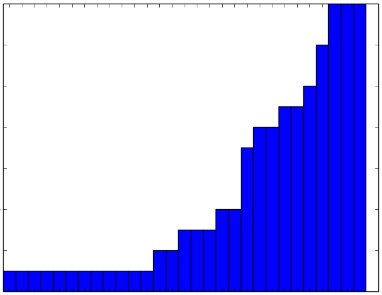
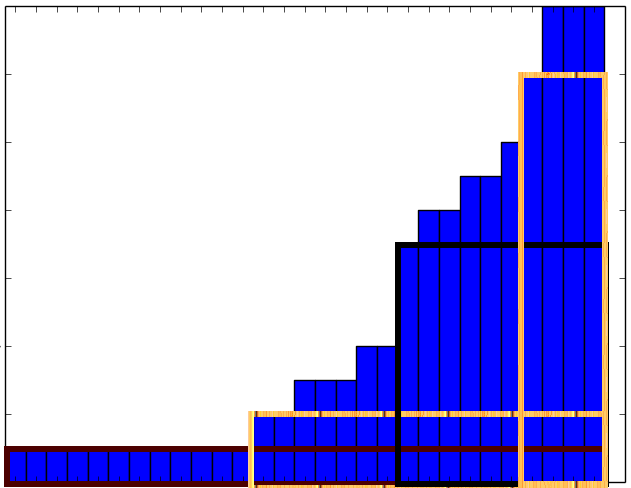

# [Java/Python 3] Sort, then 1 pass find max rectangle, w/ graph explanation and analysis.

**Author:** rock
**Votes:** 69
**Link:** [https://leetcode.com/problems/removing-minimum-number-of-magic-beans/solutions/1766795/](https://leetcode.com/problems/removing-minimum-number-of-magic-beans/solutions/1766795/)

---

**Intuition**
The problem asks us to get the minimum beans by removing part or all from any individual bean bag(s), in order to make remaining bean bags homogeneous in terms of the number of beans. 

Therefore, we can sort input first, then remove smallest bags by whole and largest bags by part, in order to get the biggest rectangle. After computing the area of biggest rectangle, we can subtract it from the total number of beans to get the required minimum beans.

----

After sorting the input, what we need is to find the largest rectangle from the histogram formed by the `beans`. Please refer to different rectangles (not show all of them, just several ones for illustration purpose) in the 2nd picture.





**Java**

```java
    public long minimumRemoval(int[] beans) {
        long mx = 0, sum = 0;
        Arrays.sort(beans)
        for (int i = 0, n = beans.length; i < n; ++i) {
            sum += beans[i];
            mx = Math.max(mx, (long)beans[i] * (n - i));
        }
        return sum - mx;
    }
```
Another style of Java code:
```java
    public long minimumRemoval(int[] beans) {
        long mx = 0, sum = 0, i = 0;
        Arrays.sort(beans);
        for (int bean : beans) {
            sum += bean;
            mx = Math.max(mx, bean * (beans.length - i++));
        }
        return sum - mx;
    }
```

----

**Python 3**
```python
    def minimumRemoval(self, beans: List[int]) -> int:
        mx, n = 0, len(beans)
        for i, bean in enumerate(sorted(beans)):
            mx = max(mx, bean * (n - i))
        return sum(beans) - mx
```

**Analysis:**

Time: `O(nlogn)`, space: `O(n)` - including sorting space.

----

**Q & A**
*Q1:* Why we have to find the "largest rectangle" from the histogram?
*A1:* We are required to remove minimum # of beans to make the remaining bags having same #, and those remaining bags can form a "rectangle". There are `n` options to form rectangles, which one should we choose? The largest one, which need to remove only minimum # of beans.

*Q2*: Which categories or tags does such a problem come from? Greedy or Math?
*A2*: The purpose of sorting is to remove the whole of smallest bags and remove part of biggest bags. Hence the part of the sorting can be regarded as **Greedy**; The computing and finding the largest rectangle part can be regarded as **Math**.

*Q3*: Is [453. Minimum Moves to Equal Array Elements](https://leetcode.com/problems/minimum-moves-to-equal-array-elements) similar to this problem?
*A3*: It is a bit similar.

1. For 453, after a brain teaser we only need to compute the area of the shortest (or lowest) and widest rectangle of dimension `min(nums) * n`;
2. For this problem, we need to go one step further: compute the areas of all possible rectangles, `beans[i] * (number of beans[k] >= beans[i])`, where `n = beans.length, 0 <= i, k < n`, then find the max area out of them.

**End of Q**