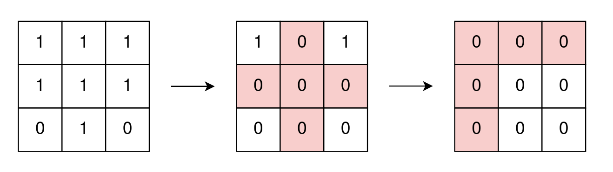
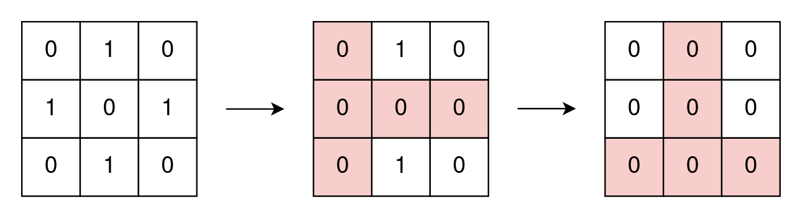
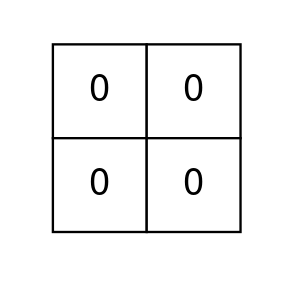

# [2174. Remove All Ones With Row and Column Flips II](https://leetcode.com/problems/remove-all-ones-with-row-and-column-flips-ii/)

| Category | Difficulty | Likes | Dislikes |
| :------: | :--------: | :---: | :------: |
| Algorithms | Medium | 94 | 24 |

**Tags:** [`array`](https://leetcode.com/tag/array), [`bit-manipulation`](https://leetcode.com/tag/bit-manipulation), [`breadth-first-search`](https://leetcode.com/tag/breadth-first-search), [`matrix`](https://leetcode.com/tag/matrix)

**Companies:** `google`

## Description

You are given a **0-indexed** `m x n` **binary** matrix `grid`.

In one operation, you can choose any `i` and `j` that meet the following conditions:

	- `0 <= i < m`

	- `0 <= j < n`

	- `grid[i][j] == 1`

and change the values of **all** cells in row `i` and column `j` to zero.

Return *the **minimum** number of operations needed to remove all *`1`*'s from *`grid`*.*

 

**Example 1:**


```

Input: grid = [[1,1,1],[1,1,1],[0,1,0]]
Output: 2
Explanation:
In the first operation, change all cell values of row 1 and column 1 to zero.
In the second operation, change all cell values of row 0 and column 0 to zero.

```

**Example 2:**


```

Input: grid = [[0,1,0],[1,0,1],[0,1,0]]
Output: 2
Explanation:
In the first operation, change all cell values of row 1 and column 0 to zero.
In the second operation, change all cell values of row 2 and column 1 to zero.
Note that we cannot perform an operation using row 1 and column 1 because grid[1][1] != 1.

```

**Example 3:**


```

Input: grid = [[0,0],[0,0]]
Output: 0
Explanation:
There are no 1&#39;s to remove so return 0.

```

 

**Constraints:**

	- `m == grid.length`

	- `n == grid[i].length`

	- `1 <= m, n <= 15`

	- `1 <= m * n <= 15`

	- `grid[i][j]` is either `0` or `1`.

---

**Links:** [Submissions](https://leetcode.com/problems/remove-all-ones-with-row-and-column-flips-ii/) | [Solutions](https://leetcode.com/problems/remove-all-ones-with-row-and-column-flips-ii/)
