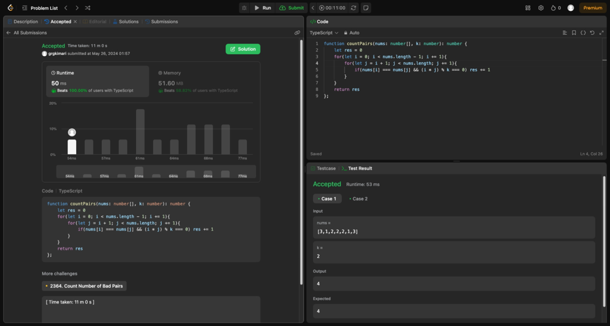

# Simple two pointer solution. Beats 100%!

**Author:** grgkimari
**Votes:** 0
**Link:** [https://leetcode.com/problems/count-equal-and-divisible-pairs-in-an-array/solutions/5208518/](https://leetcode.com/problems/count-equal-and-divisible-pairs-in-an-array/solutions/5208518/)

---



# Intuition
<!-- Describe your first thoughts on how to solve this problem. -->
This is a relatively straightforward array traversal problem. 

# Approach
<!-- Describe your approach to solving the problem. -->
Traverse the array with two pointers while checking the given conditions i.e 
    - That ```nums[i] === nums[j]```
    - That ```(i * j) % k === 0```

# Complexity
- Time complexity:
<!-- Add your time complexity here, e.g. $$O(n)$$ -->
### O(n^2)

- Space complexity:
<!-- Add your space complexity here, e.g. $$O(n)$$ -->
### O(n)

# Code
```
function countPairs(nums: number[], k: number): number {
    let res = 0
    for(let i = 0; i < nums.length - 1; i += 1){
        for(let j = i + 1; j < nums.length; j += 1){
            if(nums[i] === nums[j] && (i * j) % k === 0) res += 1
        }
    }
    return res
};
```