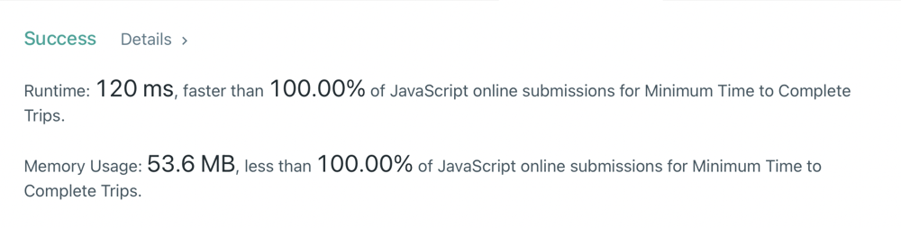

# [JavaScript / 100% faster / easy / clean] code

**Author:** ShashwatBangar
**Votes:** 5
**Link:** [https://leetcode.com/problems/minimum-time-to-complete-trips/solutions/1802834/](https://leetcode.com/problems/minimum-time-to-complete-trips/solutions/1802834/)

---



```
var minimumTime = function(time, totalTrips) {
    let low = 1;
    let high = Number.MAX_SAFE_INTEGER;
    let ans = 0;
    
    while(low <= high) {
        let mid = Math.floor(low + (high - low) / 2); // to prevent overflow
        
        if(isPossible(time, mid, totalTrips)) {
            ans = mid
            high = mid - 1;
        } else {
            low = mid + 1;
        }
    }
    return ans;
};

function isPossible(arr, mid, totalTrips) {
    let trips = 0;
    for (let i = 0; i < arr.length; i++) {
      trips += Math.floor(mid / arr[i]);
    }
    return trips >= totalTrips;
}
```

hard luck today : / , just after the contest My solution got accepted, happens...