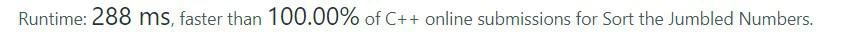

# C++||100% Faster||using multimap||with explanation

**Author:** deleted_user
**Votes:** 14
**Link:** [https://leetcode.com/problems/sort-the-jumbled-numbers/solutions/1822221/](https://leetcode.com/problems/sort-the-jumbled-numbers/solutions/1822221/)

---



multimap has a property that it store key in sorted ordered and but for same key and different value it don't change given ordered. 
time complexity of insertion,search deletion is log(n) 
for example
input-
{(7, 40), (2, 30), (7, 50), (3, 60), (7,30), (6, 50), (6, 10)}
output
{(2, 30), (3, 60), (6, 50) , (6, 10), (7, 40), (7, 50), (7,30)}

```
class Solution {
public:
    #include<map>    
    int getvalue(int n,vector<int>& mapping){
        int value=0,t=1;
        if(n==0)
            return mapping[0];
        while(n!=0){
            int temp=n%10;            
            value=mapping[temp]*t+value;
            t=t*10, n=n/10;
        }
        return value;
    }            
    vector<int> sortJumbled(vector<int>& mapping, vector<int>& nums) {        
        multimap<int,int> m;
        for(int a:nums){            
            int temp=getvalue(a,mapping);                        
            m.insert(make_pair(temp,a));
        }        
        nums.clear();
        for(auto itr=m.begin();itr!=m.end();itr++){
            nums.push_back(itr->second);
        }
        return nums;
    }
};
```