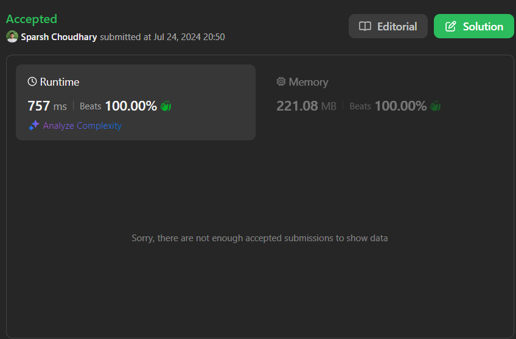

# SUPER EASY 😂 | BEATS 100% 👌| EK DUM LALLU 🎯| LOLLIPOP SOLUTION 🍭|

**Author:** CodeWithSparsh
**Votes:** 2
**Link:** [https://leetcode.com/problems/sort-the-jumbled-numbers/solutions/5529220/](https://leetcode.com/problems/sort-the-jumbled-numbers/solutions/5529220/)

---




#### Sorting Array Based on Mapped Values with Stable Sorting in Dart

# Intuition
<!-- Describe your first thoughts on how to solve this problem. -->
My first thought was to transform the given numbers according to the mapping and then sort the numbers based on their transformed values. Since we need to maintain the relative order of elements with the same mapped value, a stable sorting algorithm is essential.

# Approach
<!-- Describe your approach to solving the problem. -->
1. Create a map (`rec`) to store the digit mapping from the given array.
2. For each number in the `nums` array, compute its mapped value by converting each digit according to the `rec` map.
3. Store these original numbers along with their corresponding mapped values as pairs in a list.
4. Sort this list of pairs based on the mapped values. If two mapped values are the same, maintain the relative order from the original list.
5. Extract the original numbers from the sorted list of pairs to get the final sorted array.

# Complexity
- Time complexity:
<!-- Add your time complexity here, e.g. $$O(n)$$ -->
The time complexity is \\(O(n \\log n)\\), where \\(n\\) is the number of elements in the `nums` array. This is due to the sorting step, which dominates the overall complexity.

- Space complexity:
<!-- Add your space complexity here, e.g. $$O(n)$$ -->
The space complexity is \\(O(n)\\) because we need additional space to store the mapped values and pairs of original numbers and their mapped values.

# Code
```dart
class Solution {
  List<int> sortJumbled(List<int> mapping, List<int> nums) {
    // Create a map for the digit mapping
    Map<int, int> rec = {};
    for (int i = 0; i < mapping.length; i++) {
      rec[i] = mapping[i];
    }

    // Create a list of pairs (original number, mapped value)
    List<MapEntry<int, int>> mappedNums = [];
    for (int nm in nums) {
      String numStr = nm.toString();
      String newNumStr = numStr.split("").map((digit) => rec[int.parse(digit)]).join();
      int newNum = int.parse(newNumStr);
      mappedNums.add(MapEntry(nm, newNum));
    }

    // Sort the list of pairs based on the mapped values, maintaining relative order for same values
    mappedNums.sort((a, b) {
      if (a.value != b.value) {
        return a.value.compareTo(b.value);
      } else {
        return nums.indexOf(a.key).compareTo(nums.indexOf(b.key));
      }
    });

    // Extract the sorted original numbers
    List<int> sortedNums = mappedNums.map((entry) => entry.key).toList();
    return sortedNums;
  }
}

/*
Example Walkthrough
Given mapping = [8,9,4,0,2,1,3,5,7,6] and nums = [991,338,38]:

Mapping:

991 becomes 669.
338 becomes 007 (or 7 after removing leading zeros).
38 becomes 07 (or 7 after removing leading zeros).
Creating Pairs:

Pairs: [(991, 669), (338, 7), (38, 7)].
Sorting:

Sort primarily by the mapped values.
If mapped values are equal (7 for 338 and 38), maintain the original order (338 before 38).
Result:

The sorted array is [338, 38, 991].
This ensures the elements are sorted based on their mapped values while maintaining the original relative order for elements with the same mapped value.
*/

```

This solution ensures that the `nums` array is sorted based on their mapped values while maintaining the original relative order for elements with the same mapped values.


