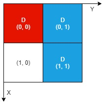

# [2201. Count Artifacts That Can Be Extracted](https://leetcode.com/problems/count-artifacts-that-can-be-extracted/)

| Category | Difficulty | Likes | Dislikes |
| :------: | :--------: | :---: | :------: |
| Algorithms | Medium | 225 | 204 |

**Tags:** [`array`](https://leetcode.com/tag/array), [`hash-table`](https://leetcode.com/tag/hash-table), [`simulation`](https://leetcode.com/tag/simulation)

**Companies:** `imc`

## Description

There is an `n x n` **0-indexed** grid with some artifacts buried in it. You are given the integer `n` and a **0-indexed **2D integer array `artifacts` describing the positions of the rectangular artifacts where `artifacts[i] = [r1_i, c1_i, r2_i, c2_i]` denotes that the `i^th` artifact is buried in the subgrid where:

	- `(r1_i, c1_i)` is the coordinate of the **top-left** cell of the `i^th` artifact and

	- `(r2_i, c2_i)` is the coordinate of the **bottom-right** cell of the `i^th` artifact.

You will excavate some cells of the grid and remove all the mud from them. If the cell has a part of an artifact buried underneath, it will be uncovered. If all the parts of an artifact are uncovered, you can extract it.

Given a **0-indexed** 2D integer array `dig` where `dig[i] = [r_i, c_i]` indicates that you will excavate the cell `(r_i, c_i)`, return *the number of artifacts that you can extract*.

The test cases are generated such that:

	- No two artifacts overlap.

	- Each artifact only covers at most `4` cells.

	- The entries of `dig` are unique.

 

**Example 1:**


```

Input: n = 2, artifacts = [[0,0,0,0],[0,1,1,1]], dig = [[0,0],[0,1]]
Output: 1
Explanation: 
The different colors represent different artifacts. Excavated cells are labeled with a &#39;D&#39; in the grid.
There is 1 artifact that can be extracted, namely the red artifact.
The blue artifact has one part in cell (1,1) which remains uncovered, so we cannot extract it.
Thus, we return 1.

```

**Example 2:**


```

Input: n = 2, artifacts = [[0,0,0,0],[0,1,1,1]], dig = [[0,0],[0,1],[1,1]]
Output: 2
Explanation: Both the red and blue artifacts have all parts uncovered (labeled with a &#39;D&#39;) and can be extracted, so we return 2. 

```

 

**Constraints:**

	- `1 <= n <= 1000`

	- `1 <= artifacts.length, dig.length <= min(n^2, 10^5)`

	- `artifacts[i].length == 4`

	- `dig[i].length == 2`

	- `0 <= r1_i, c1_i, r2_i, c2_i, r_i, c_i <= n - 1`

	- `r1_i <= r2_i`

	- `c1_i <= c2_i`

	- No two artifacts will overlap.

	- The number of cells covered by an artifact is **at most** `4`.

	- The entries of `dig` are unique.

---

**Links:** [Submissions](https://leetcode.com/problems/count-artifacts-that-can-be-extracted/) | [Solutions](https://leetcode.com/problems/count-artifacts-that-can-be-extracted/)
