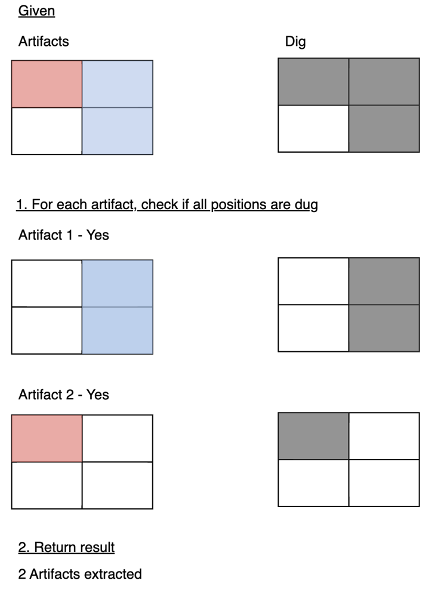

# 📌 [VISUAL] | [Python] | Easy to Understand | O(N^2) Time | O(N^2) Space

**Author:** matthewlkey
**Votes:** 29
**Link:** [https://leetcode.com/problems/count-artifacts-that-can-be-extracted/solutions/1844654/](https://leetcode.com/problems/count-artifacts-that-can-be-extracted/solutions/1844654/)

---

\uD83D\uDD3A**Please UPVOTE: Can we hit 20?** \uD83D\uDD3A

**Approach**
Here we want to check if each part of an artifact is completely dug up. To do this we check each artifact, comparing it to what has been dug to see if it is completely excavated.

**Visual**
Here is a visual for the example in the question description where red and blue are two seperate artifacts. In this example:
n = 2
artifacts = [[0,0,0,0],[0,1,1,1]]
dig = [[0,0],[0,1],[1,1]]

**Code**
See below for code related to this visual.
<iframe src="https://leetcode.com/playground/MFdGPhTs/shared" frameBorder="0" width="800" height="600"></iframe>

\uD83D\uDD3A**Please UPVOTE: Can we hit 20?** \uD83D\uDD3A