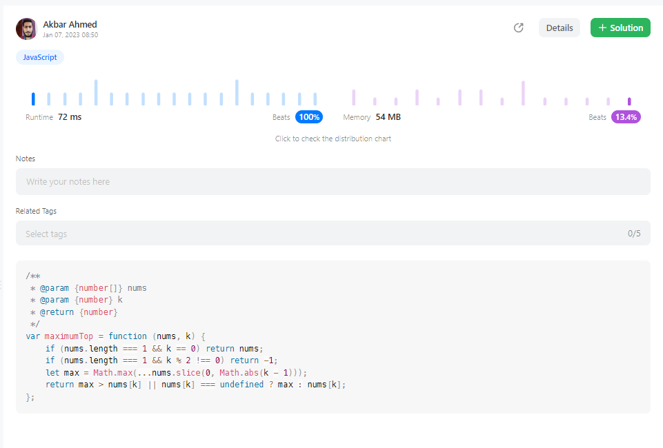

# Runtime 72 ms Beats 100%

**Author:** akbar_ahmed
**Votes:** 1
**Link:** [https://leetcode.com/problems/maximize-the-topmost-element-after-k-moves/solutions/3011417/](https://leetcode.com/problems/maximize-the-topmost-element-after-k-moves/solutions/3011417/)

---


<!-- Add your space complexity here, e.g. $$O(n)$$ -->

# Code:
```
var maximumTop = function (nums, k) {
    if (nums.length === 1 && k == 0) return nums;
    if (nums.length === 1 && k % 2 !== 0) return -1;
    let max = Math.max(...nums.slice(0, Math.abs(k - 1)));
    return max > nums[k] || nums[k] === undefined ? max : nums[k];
};
```

