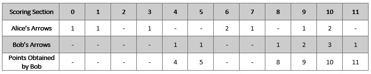
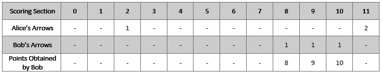

# [2212. Maximum Points in an Archery Competition](https://leetcode.com/problems/maximum-points-in-an-archery-competition/)

| Category | Difficulty | Likes | Dislikes |
| :------: | :--------: | :---: | :------: |
| Algorithms | Medium | 512 | 57 |

**Tags:** [`array`](https://leetcode.com/tag/array), [`backtracking`](https://leetcode.com/tag/backtracking), [`bit-manipulation`](https://leetcode.com/tag/bit-manipulation), [`enumeration`](https://leetcode.com/tag/enumeration)

**Companies:** `kakao`

## Description

Alice and Bob are opponents in an archery competition. The competition has set the following rules:

	- Alice first shoots `numArrows` arrows and then Bob shoots `numArrows` arrows.

	- The points are then calculated as follows:
	
		The target has integer scoring sections ranging from `0` to `11` **inclusive**.

		- For **each** section of the target with score `k` (in between `0` to `11`), say Alice and Bob have shot `a_k` and `b_k` arrows on that section respectively. If `a_k >= b_k`, then Alice takes `k` points. If `a_k 

	- 
	
For example, if Alice and Bob both shot `2` arrows on the section with score `11`, then Alice takes `11` points. On the other hand, if Alice shot `0` arrows on the section with score `11` and Bob shot `2` arrows on that same section, then Bob takes `11` points.

	

You are given the integer `numArrows` and an integer array `aliceArrows` of size `12`, which represents the number of arrows Alice shot on each scoring section from `0` to `11`. Now, Bob wants to **maximize** the total number of points he can obtain.

Return *the array *`bobArrows`* which represents the number of arrows Bob shot on **each** scoring section from *`0`* to *`11`. The sum of the values in `bobArrows` should equal `numArrows`.

If there are multiple ways for Bob to earn the maximum total points, return **any** one of them.

 

**Example 1:**


```

Input: numArrows = 9, aliceArrows = [1,1,0,1,0,0,2,1,0,1,2,0]
Output: [0,0,0,0,1,1,0,0,1,2,3,1]
Explanation: The table above shows how the competition is scored. 
Bob earns a total point of 4 + 5 + 8 + 9 + 10 + 11 = 47.
It can be shown that Bob cannot obtain a score higher than 47 points.

```

**Example 2:**


```

Input: numArrows = 3, aliceArrows = [0,0,1,0,0,0,0,0,0,0,0,2]
Output: [0,0,0,0,0,0,0,0,1,1,1,0]
Explanation: The table above shows how the competition is scored.
Bob earns a total point of 8 + 9 + 10 = 27.
It can be shown that Bob cannot obtain a score higher than 27 points.

```

 

**Constraints:**

	- `1 <= numArrows <= 10^5`

	- `aliceArrows.length == bobArrows.length == 12`

	- `0 <= aliceArrows[i], bobArrows[i] <= numArrows`

	- `sum(aliceArrows[i]) == numArrows`

---

**Links:** [Submissions](https://leetcode.com/problems/maximum-points-in-an-archery-competition/) | [Solutions](https://leetcode.com/problems/maximum-points-in-an-archery-competition/)
