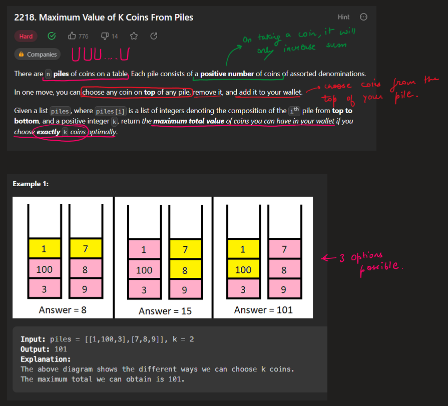
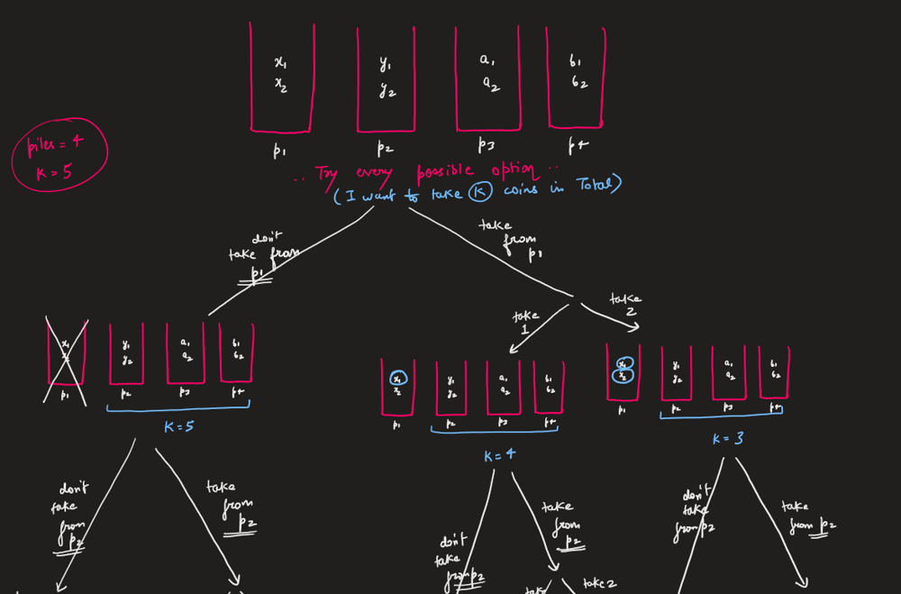
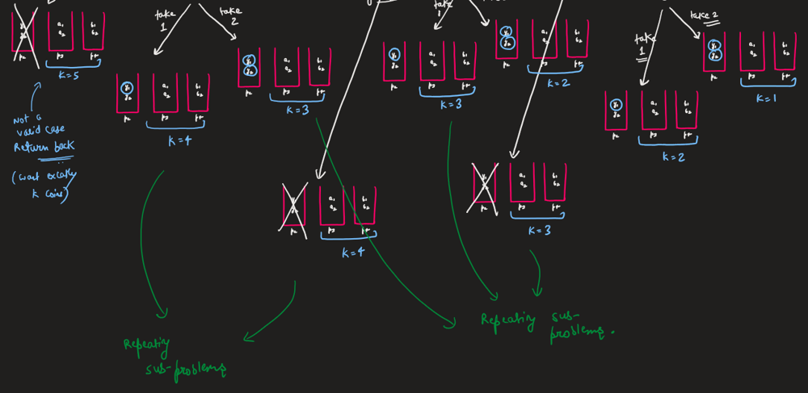
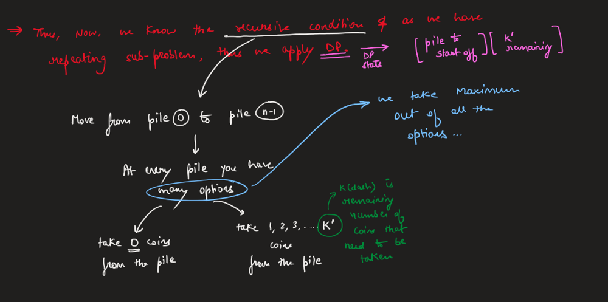
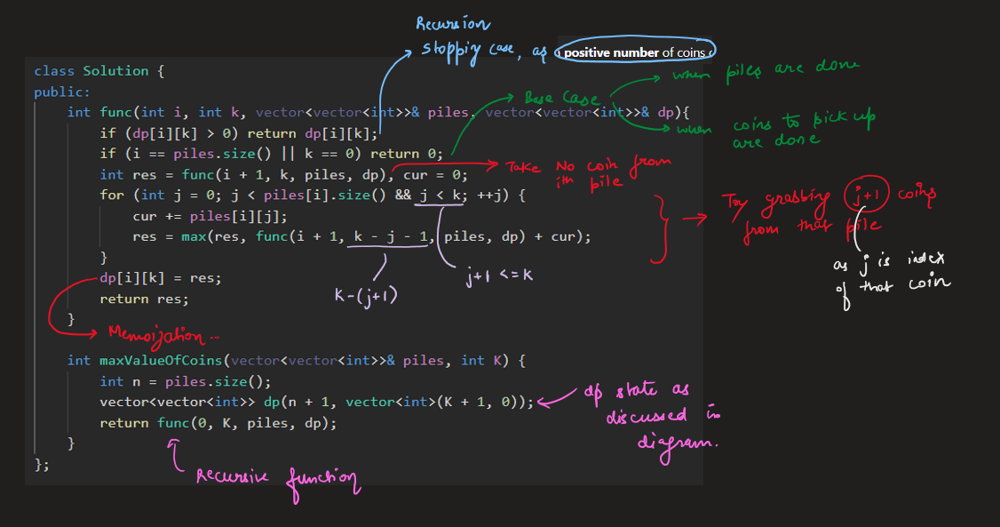
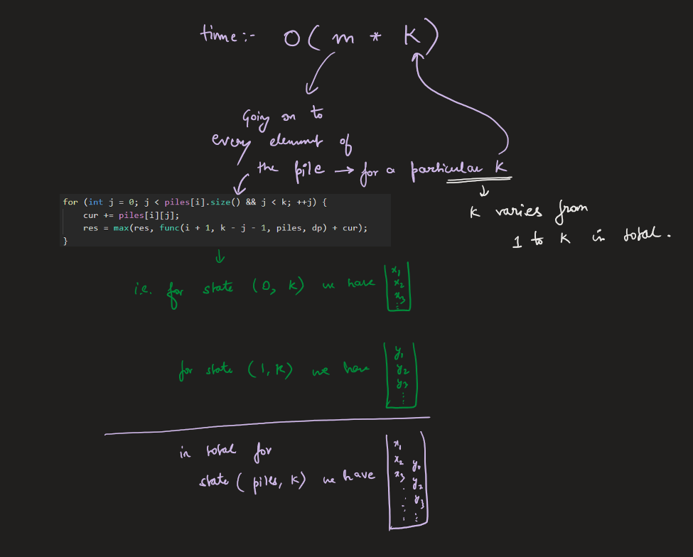
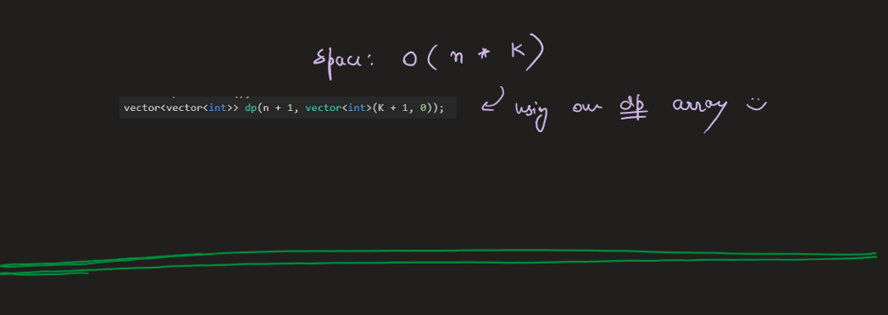

# Image Explanation🏆- [Top Down DP - Easy & Concise] - C++/Java/Python

**Author:** aryan_0077
**Votes:** 116
**Link:** [https://leetcode.com/problems/maximum-value-of-k-coins-from-piles/solutions/3417959/](https://leetcode.com/problems/maximum-value-of-k-coins-from-piles/solutions/3417959/)

---

# Video Solution (`Aryan Mittal`) - Link in LeetCode Profile
`Maximum Value of K Coins From Piles` by `Aryan Mittal`


# Approach & Intution









# Code
```C++ []
class Solution {
public:
    int func(int i, int k, vector<vector<int>>& piles, vector<vector<int>>& dp){
        if (dp[i][k] > 0) return dp[i][k];
        if (i == piles.size() || k == 0) return 0;
        int res = func(i + 1, k, piles, dp), cur = 0;
        for (int j = 0; j < piles[i].size() && j < k; ++j) {
            cur += piles[i][j];
            res = max(res, func(i + 1, k - j - 1, piles, dp) + cur);
        }
        dp[i][k] = res;
        return res;
    }

    int maxValueOfCoins(vector<vector<int>>& piles, int K) {
        int n = piles.size();
        vector<vector<int>> dp(n + 1, vector<int>(K + 1, 0));
        return func(0, K, piles, dp);
    }
};
```
```Java []
class Solution {
    public int func(int i, int k, List<List<Integer>> piles, int[][] dp) {
        if (dp[i][k] > 0) return dp[i][k];
        if (i == piles.size() || k == 0) return 0;
        int res = func(i + 1, k, piles, dp), cur = 0;
        for (int j = 0; j < piles.get(i).size() && j < k; ++j) {
            cur += piles.get(i).get(j);
            res = Math.max(res, func(i + 1, k - j - 1, piles, dp) + cur);
        }
        dp[i][k] = res;
        return res;
    }

    public int maxValueOfCoins(List<List<Integer>> piles, int K) {
        int n = piles.size();
        int[][] dp = new int[n + 1][K + 1];
        return func(0, K, piles, dp);
    }
}
```
```Python []
class Solution:
    def maxValueOfCoins(self, piles: List[List[int]], k: int) -> int:
        
        @functools.lru_cache(None)
        def _search(rest_k: int, pile_pos: int) -> int:
            """Searches for best accumulated coin value starting from pile at position `pile_pos`.
            
            Args:
              - rest_k: The rest of coins we could pick.
              - pile_pos: The starting position of pile we are working on.
            """
            if rest_k == 0 or pile_pos == len(piles): return 0

            # Ignore the current pile and moving to next pile
            current_mv_found = _search(rest_k, pile_pos+1)

            # Start looking solution with current pile being involved
            current_pile = piles[pile_pos]
            accum_coin_value = 0
            for i in range(min(rest_k, len(current_pile))):
                # Accumulate the coins
                accum_coin_value += current_pile[i]

                # Moving to next pile with accumulated coin value in current pile
                current_mv_found = max(
                    current_mv_found, 
                    accum_coin_value + _search(rest_k-i-1, pile_pos+1))

            # Return the maximum accumulated coin value found from current pile.
            return current_mv_found

        # Start searching with initial `k` and first pile
        return _search(k, 0)
```
Credits: Python Solution commented beautifully by @puremonkey2001
