# [Kotlin] Prefix Sum DP Solution

**Author:** devle79
**Votes:** 2
**Link:** [https://leetcode.com/problems/maximum-value-of-k-coins-from-piles/solutions/3419195/](https://leetcode.com/problems/maximum-value-of-k-coins-from-piles/solutions/3419195/)

---

# Approach
<!-- Describe your approach to solving the problem. -->

Use top-down dp to find max value of coin.

Save every optimal value in dp table and use that value at next iteration.

Flow goes like this:

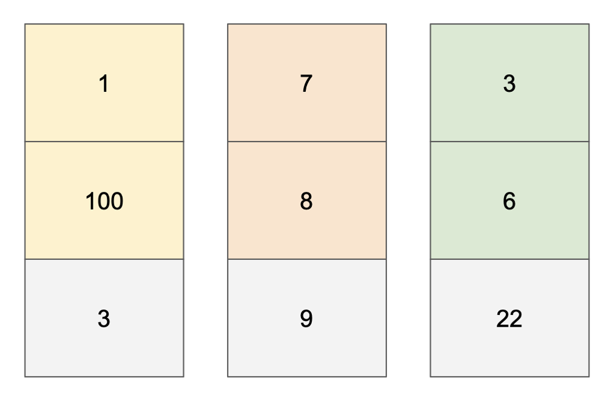

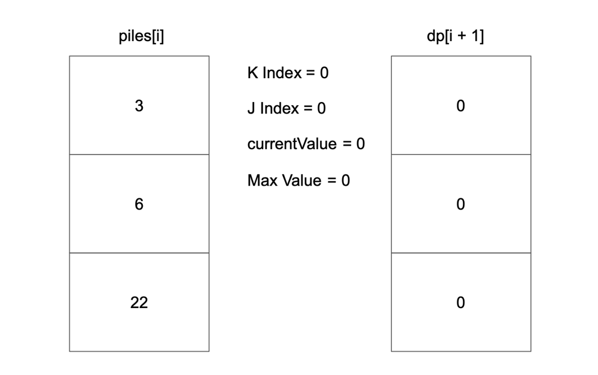

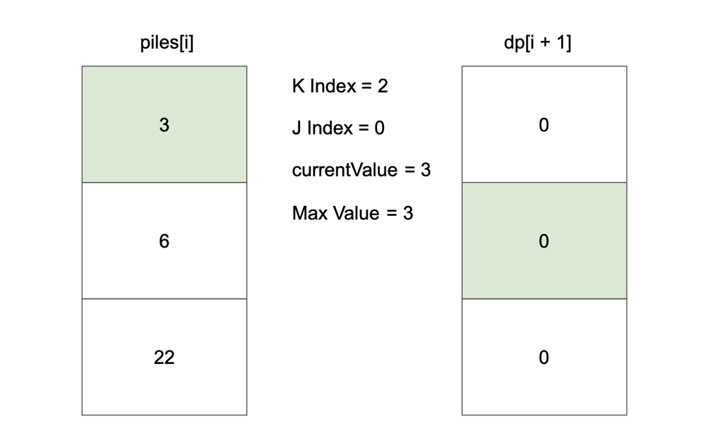

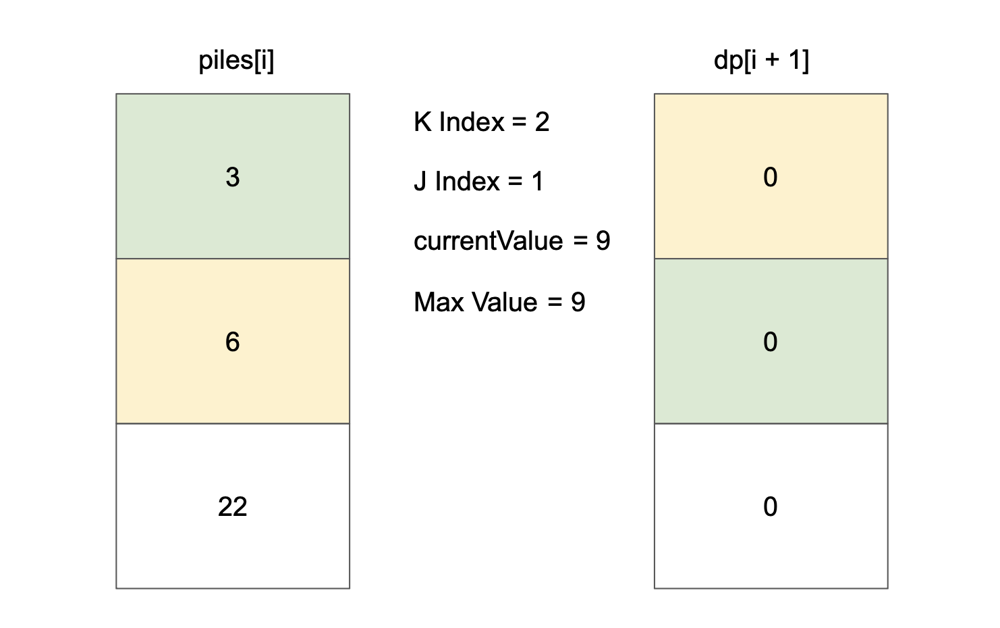

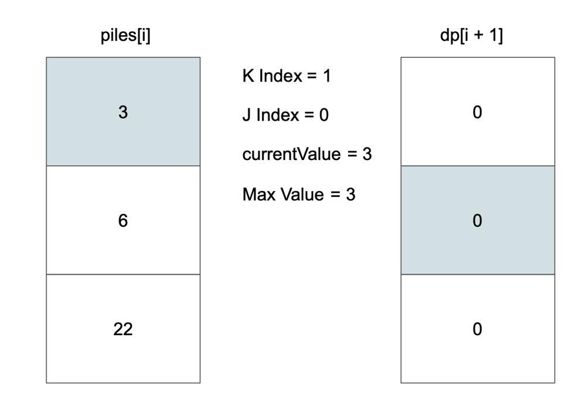

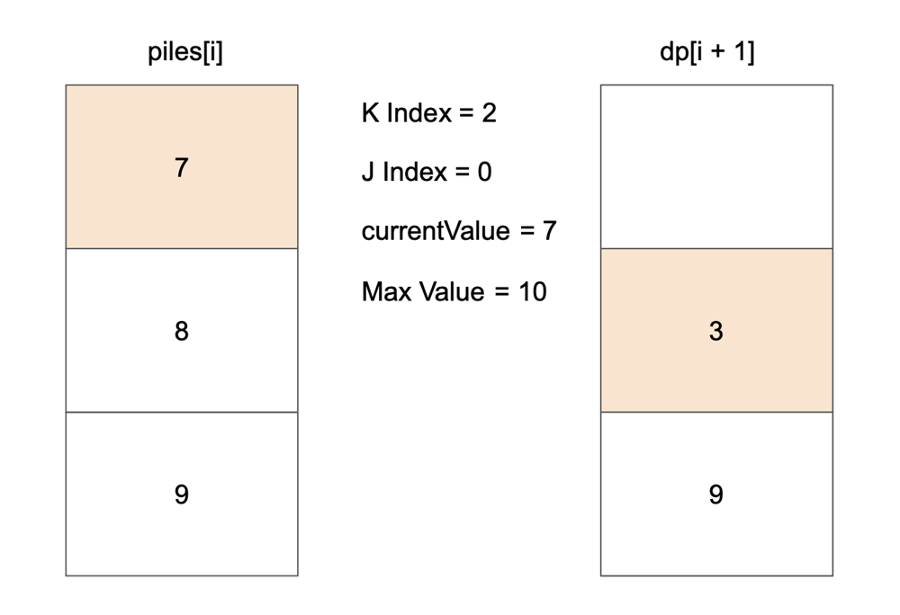

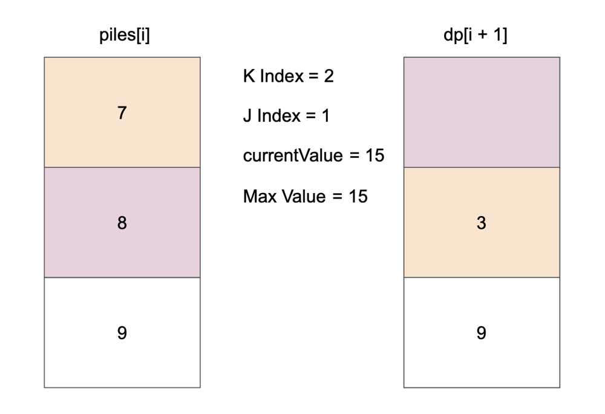

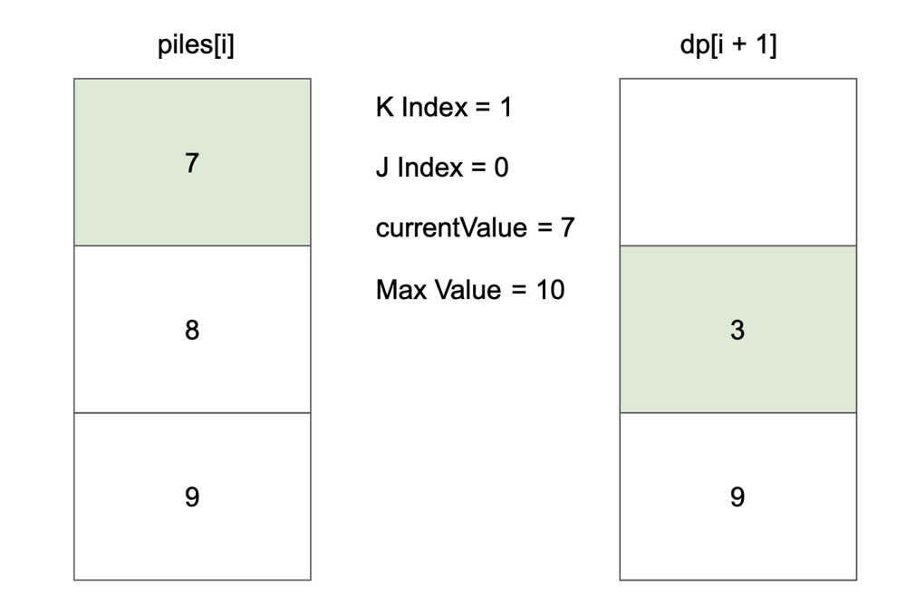

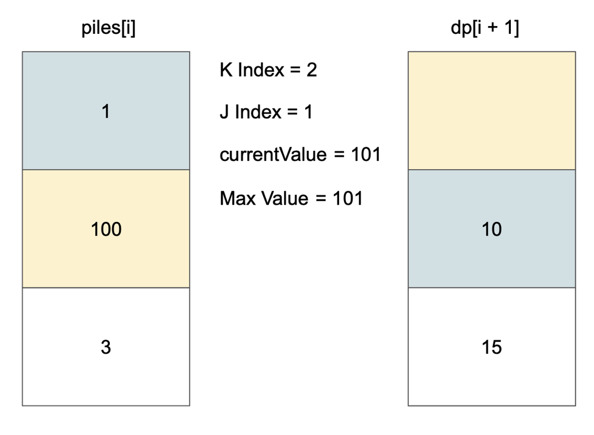

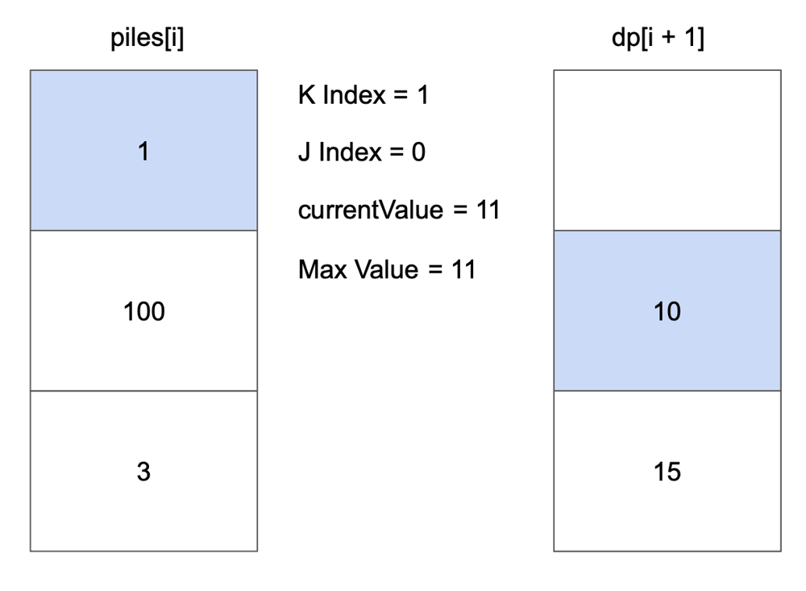

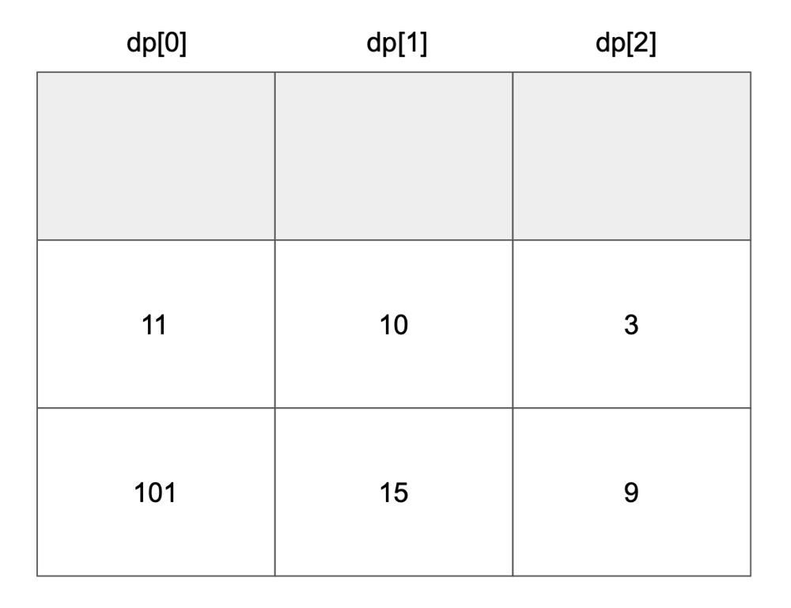


# Complexity
- Time complexity: $$O(n * k)$$
<!-- Add your time complexity here, e.g. $$O(n)$$ -->

- Space complexity: $$O(n * k)$$
<!-- Add your space complexity here, e.g. $$O(n)$$ -->

# Code
```
class Solution {

    fun maxValueOfCoins(piles: List<List<Int>>, k: Int): Int {
       val dp = Array(piles.size + 1) { IntArray(k + 1) }

        for (i in piles.lastIndex downTo 0) {
            for (kIndex in k downTo 1) {
                var currentValue = 0
                var maxValue = dp[i + 1][kIndex]

                for (j in 0 until minOf(kIndex, piles[i].size)) {
                    currentValue += piles[i][j]
                    maxValue = maxOf(maxValue, currentValue + dp[i + 1][kIndex - (j + 1)])
                }

                dp[i][kIndex] = maxValue
            }
        }

        return dp[0][k]
    }

}
```