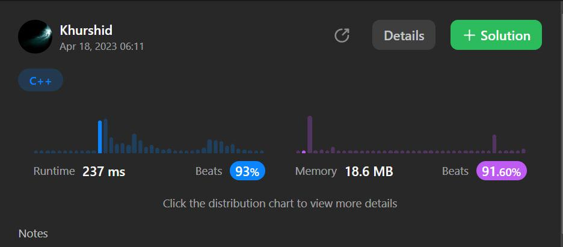
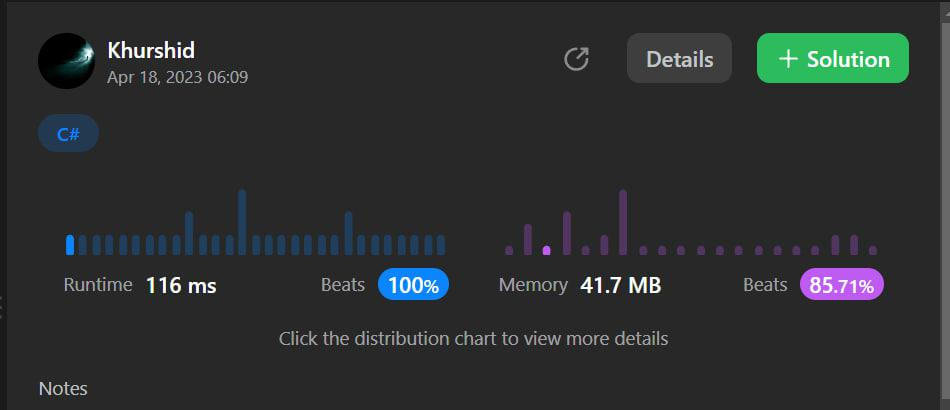

# ✅C++ ✅C# ✅JavaScript 🔥very easy solution.Beats 100% and explained too.💯

**Author:** aloneguy
**Votes:** 11
**Link:** [https://leetcode.com/problems/find-triangular-sum-of-an-array/solutions/3428816/](https://leetcode.com/problems/find-triangular-sum-of-an-array/solutions/3428816/)

---

# Intuition:We will use two pointers method and run through the array with loops and each time we reduce the length of array by decrement the right pointer.
<!-- Describe your first thoughts on how to solve this problem. -->




```C++ []
class Solution {
public:
    int triangularSum(vector<int>& nums) {
        int start = 0, end = nums.size() - 1;
        while (start < end) {
            for (int i = start; i < end; i++) {
                nums[i] = (nums[i] + nums[i + 1]) % 10;
            }
            end--;
        }
        return nums[0];
    }
};
```
```C# []
public class Solution {
    public int TriangularSum(int[] nums) {
        int start = 0, end = nums.Length - 1;
        while (start < end) {
            for (int i = start; i < end; i++) {
                nums[i] = (nums[i] + nums[i + 1]) % 10;
            }
            end--;
        }
        return nums[0];
    }
}
```
```javascript []
var triangularSum = function(nums) {
  let start = 0, end = nums.length - 1;
  while (start < end) {
    for (let i = start; i < end; i++) {
      nums[i] = (nums[i] + nums[i + 1]) % 10;
    }
    end--;
  }
  return nums[0];
};
```


