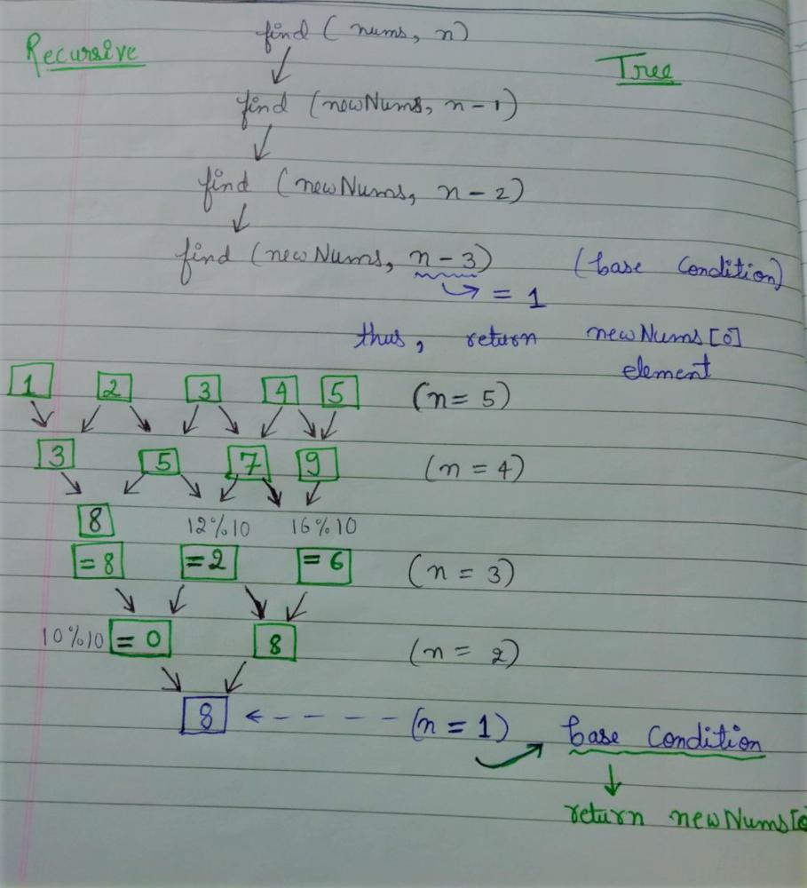

# Dedicated to Beginners | With explanation

**Author:** tishasingh01
**Votes:** 40
**Link:** [https://leetcode.com/problems/find-triangular-sum-of-an-array/solutions/1907386/](https://leetcode.com/problems/find-triangular-sum-of-an-array/solutions/1907386/)

---

```
class Solution {
    public int triangularSum(int[] nums) {
        return find(nums,nums.length);
    }
    
    public int find(int[] a, int n){
        if(n == 1)
            return a[0];
            
        for(int i=0;i<n-1;i++){
            a[i] = (a[i] + a[i+1])%10; 
        }
        return find(a,n-1);
    }
}
```
