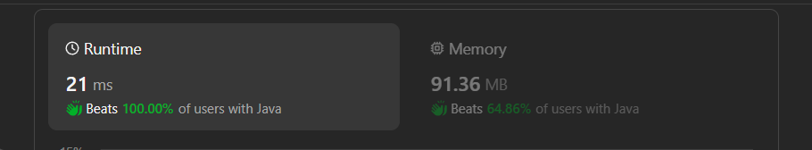

# ✅Beats 100% - C++/Java/Python/JS - Explained with [ Video ] - Hash - Count

**Author:** lancertech6
**Votes:** 136
**Link:** [https://leetcode.com/problems/find-players-with-zero-or-one-losses/solutions/4567095/](https://leetcode.com/problems/find-players-with-zero-or-one-losses/solutions/4567095/)

---



# YouTube Video Explanation:

<!-- **If you want a video for this question please write in the comments** -->

<!-- https://www.youtube.com/watch?v=ujU-jeO1v-k -->

https://youtu.be/rwFM6hL-fhs

**\uD83D\uDD25 Please like, share, and subscribe to support our channel's mission of making complex concepts easy to understand.**

Subscribe Link: https://www.youtube.com/@leetlogics/?sub_confirmation=1

*Subscribe Goal: 1500 Subscribers*
*Current Subscribers: 1411*

---

# Intuition
<!-- Describe your first thoughts on how to solve this problem. -->
The problem involves tracking the outcomes of matches and categorizing players based on their losses. The task is to identify players who have not lost any matches and those who have lost exactly one match.

# Approach
<!-- Describe your approach to solving the problem. -->
- Utilize an array `losses` to keep track of the number of losses for each player.
- Iterate through the `matches` array and update the `losses` array accordingly.
- Create two lists, `zeroLoss` and `oneLoss`, to store players with zero and one loss, respectively.
- Populate these lists based on the information in the `losses` array.
- Return a list containing `zeroLoss` and `oneLoss`.

# Complexity
- Time complexity: The time complexity is `O(N)`, where N is the length of the `matches` array, as we iterate through the matches once.
<!-- Add your time complexity here, e.g. $$O(n)$$ -->

- Space complexity: The space complexity is `O(M)`, where M is the number of players (limited to 100,001), for storing the `losses` array and result lists.
<!-- Add your space complexity here, e.g. $$O(n)$$ -->

# Code
```java []
class Solution {
    public List<List<Integer>> findWinners(int[][] matches) {
        int[] losses = new int[100001];

        for (int i = 0; i < matches.length; i++) {
            int win = matches[i][0];
            int loss = matches[i][1];

            if (losses[win] == 0) {
                losses[win] = -1;
            } 

            if (losses[loss] == -1) {
                losses[loss] = 1;
            } else {
                losses[loss]++;
            }
        }

        List<Integer> zeroLoss = new ArrayList<>();
        List<Integer> oneLoss = new ArrayList<>();

        List<List<Integer>> result = new ArrayList<>();

        for (int i = 0; i < losses.length; i++) {
            if (losses[i] == -1) {
                zeroLoss.add(i);
            } else if (losses[i] == 1) {
                oneLoss.add(i);
            }
        }

        result.add(zeroLoss);
        result.add(oneLoss);

        return result;
    }
}
```
```C++ []
class Solution {
public:
    vector<vector<int>> findWinners(vector<vector<int>>& matches) {
        unordered_map<int,int>lost_map;
        for(int i=0;i<matches.size();i++)
        {
            int lose=matches[i][1];
        lost_map[lose]++;
        }
        vector<int>notLost;
        vector<int>onceLost;
        for(int i=0;i<matches.size();i++)
        {
           int winner=matches[i][0];
           int looser=matches[i][1];
           if(lost_map.find(winner)==lost_map.end()) 
           {
               notLost.push_back(winner);
               lost_map[winner]=2;

           }
           if(lost_map[looser]==1)
           onceLost.push_back(looser);

        }
        sort(notLost.begin(),notLost.end());    
        sort(onceLost.begin(),onceLost.end());

        return {notLost,onceLost};


        
    }
};
```
```Python []
class Solution:
    def findWinners(self, matches):
        losses = [0] * 100001

        for winner, loser in matches:
            if losses[winner] == 0:
                losses[winner] = -1

            if losses[loser] == -1:
                losses[loser] = 1
            else:
                losses[loser] += 1

        zero_loss = [i for i in range(1, 100001) if losses[i] == -1]
        one_loss = [i for i in range(1, 100001) if losses[i] == 1]

        return [zero_loss, one_loss]
```
```JavaScript []
/**
 * @param {number[][]} matches
 * @return {number[][]}
 */
var findWinners = function(matches) {
    let losses = new Array(100001).fill(0);

    for (const [winner, loser] of matches) {
        if (losses[winner] === 0) {
            losses[winner] = -1;
        } 

        if (losses[loser] === -1) {
            losses[loser] = 1;
        } else {
            losses[loser]++;
        }
    }

    let zeroLoss = [];
    let oneLoss = [];

    for (let i = 1; i <= 100000; ++i) {
        if (losses[i] === -1) {
            zeroLoss.push(i);
        } else if (losses[i] === 1) {
            oneLoss.push(i);
        }
    }

    return [zeroLoss, oneLoss];
};
```

