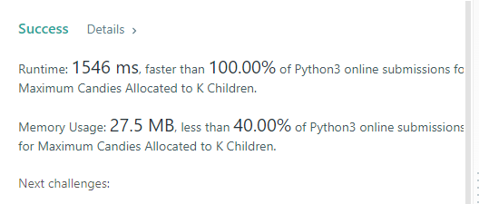

# 100% faster | C++ | Python | Java | Binary Search with Logic

**Author:** TejPratap1
**Votes:** 14
**Link:** [https://leetcode.com/problems/maximum-candies-allocated-to-k-children/solutions/1908775/](https://leetcode.com/problems/maximum-candies-allocated-to-k-children/solutions/1908775/)

---



**Idea**

* start can be taken as 1 , highest we can distribute equally is average.

* Use Binary Search and try to distribute the candies equal to mid, if possible try to maximize it by moving on right, else if not possible try it by decreasing the value by moving on left
* **TC: O(NlogN) SC: O(1)**

```
def canSplit(candies, mid, k):
    split = 0
    for i in candies:
        split += i//mid
    if split >= k:
        return True
    else:
        return False
    
class Solution:
    def maximumCandies(self, candies: List[int], k: int) -> int:
        end = sum(candies)//k
        start = 1
        ans = 0
        while start <= end:
            mid = (start + end)//2
            if canSplit(candies, mid, k):
                start = mid + 1
                ans = mid
            else:
                end = mid - 1
        return ans
        
```

**C++**

```
class Solution {
public:
    bool canSplit(vector<int>& candies, long long k, long long mid) {
        long long split = 0;
        for(int i = 0; i < candies.size(); ++i) {
            split += candies[i]/mid;
        }   
        if(split >= k)
            return true;
        else
            return false;
    }
    
    int maximumCandies(vector<int>& candies, long long k) {
        long long sum = 0;
        for(int i = 0; i < candies.size(); ++i) {
            sum += candies[i];
        }
        long long start = 1, end = sum/k;
        long long ans = 0;
        while(start <= end) {
            long long mid = (start + end)/2;
            if(canSplit(candies, k, mid)) {
                ans = mid;
                start = mid + 1;
            } else {
                end = mid-1;
            }
        }
        return ans;
    }
};
```

**Java**
```
class Solution {
    public boolean canSplit(int[] candies, long k, long mid) {
        long split = 0;
        for(int i = 0; i < candies.length; ++i) {
            split += candies[i]/mid;
        }   
        if(split >= k)
            return true;
        else
            return false;
    }
    
    public int maximumCandies(int[] candies, long k) {
        long sum = 0;
        for(int i = 0; i < candies.length; ++i) {
            sum += candies[i];
        }
        long start = 1, end = sum;
        long ans = 0;
        while(start <= end) {
            long mid = (start + end)/2;
            if(canSplit(candies, k, mid)) {
                ans = mid;
                start = mid + 1;
            } else {
                end = mid-1;
            }
        }
        return (int)ans;
    }
}
```