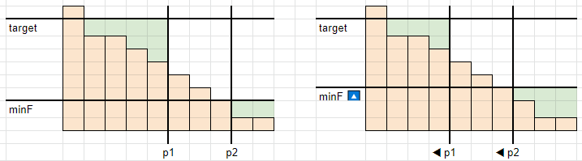

# Two Pointers

**Author:** votrubac
**Votes:** 50
**Link:** [https://leetcode.com/problems/maximum-total-beauty-of-the-gardens/solutions/1934318/](https://leetcode.com/problems/maximum-total-beauty-of-the-gardens/solutions/1934318/)

---

I do not think that we need a binary search here.

We sort gardens (descending), and then go left to right and make gardens full (until we run out of flowers). Thus, our first pointer `p1` indicates full gardens, and the last garden defines the minimum number of flowers (`minF`) among all gardens.
 
> There is a special case when we can make all gardens full - it may be better to only plant `target - 1` flowers in the last garden, if `(target - 1) * partial > full`.

We then go right-to-left, and try increasing the minimum number of flowers. The second pointer - `p2` - indicates how many gardens have less flowers than `minF`.
 
We plan necessary flowers to gardens right of `p2`. If we do not have enough flowers, we take it from the rightmost full garden, decreasing `p1`. For each `minF` we can achieve, we track and return the maximum beauty.

Here is an example for `[9, 7, 7, 6, 5, 4, 3, 2, 1, 1]` gardens, with target `8` and `9` new flowers to plant. As you see, for `minF == 2`, we have 5 full gardens. For `minF == 3`, we move `p1` to get enough flowers to plant, and now we have 4 full gardens. 



**C++**
```cpp
long long maximumBeauty(vector<int>& fl, long long newFlowers, int target, int full, int partial) {
    sort(begin(fl), end(fl), greater<int>());
    long long p1 = 0, sum = 0, res = 0, sz = fl.size();
    for (; p1 < sz; ++p1) {
        if (target - fl[p1] > newFlowers)
            break;
        newFlowers -= max(0, target - fl[p1]);
    }
    if (p1 == sz)
        return max(sz * full, (sz - 1) * full + (fl.back() < target ? (long long)(target - 1) * partial : full));
    for (long long minF = fl.back(), p2 = fl.size() - 1; minF < target; ) {
        while (p2 >= p1 && fl[p2] <= minF)
            sum += fl[p2--];
        int needed = (sz - p2 - 1) * minF - sum;
        if (needed > newFlowers) {
            if (--p1 < 0)
                break;
            newFlowers += max(0, target - fl[p1]);
        }
        else {
            res = max(p1 * full + minF * partial, res);    
            ++minF;
        }
    }
    return res;
}
```