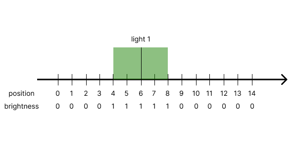
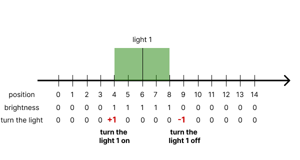
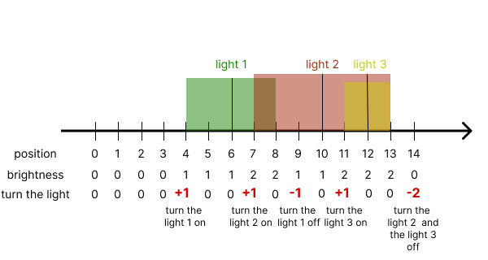

# C# Line Sweep With Explanation

**Author:** gregsklyanny
**Votes:** 0
**Link:** [https://leetcode.com/problems/count-positions-on-street-with-required-brightness/solutions/2999994/](https://leetcode.com/problems/count-positions-on-street-with-required-brightness/solutions/2999994/)

---


<!-- Describe your first thoughts on how to solve this problem. -->

# Intuition
<!-- Describe your approach to solving the problem. -->
Imagine that you are walking down the street and want to calculate the brightness at each meter (position). Each light gives 1 point of brightness.



Let's mark the positions where the light turns on and off. 
+1 - we turn the light on
-1 - we turn the light off
0 - we do nothing with the light




Imagine that we have a lot of lights:


This understanding is enough for us to try to solve the problem

# Approach
1) Create an array **turnTheLight** to store the states of the lights.
2) Iterate through the array **lights** to fill the array **turnTheLight**
```
for(int i = 0; i < lights.Length; i++)
    {
        int left = Math.Max(0, lights[i][0] - lights[i][1]);
        int right = lights[i][0] + lights[i][1];
        turnTheLight[left]++;
        if(right + 1 <= n - 1) turnTheLight[right+1]--;
    }
```
3) Initialize variable **brightness**. Iterate through the **turnTheLight** array, sum each step into a **brightness**. 
```
brightness += turnTheLight[i];
```
If the **brightness** is greater than or equal to the requirement, increment the result
```
if(brightness >= requirement[i]) result++;
```
# Code
```
public class Solution 
{
    public int MeetRequirement(int n, int[][] lights, int[] requirement) 
    {
        int[] turnTheLight = new int[n];
        int result = 0;
        for(int i = 0; i < lights.Length; i++)
        {
            int left = Math.Max(0, lights[i][0] - lights[i][1]);
            int right = lights[i][0] + lights[i][1];
            turnTheLight[left]++;
            if(right + 1 <= n - 1) turnTheLight[right+1]--;
        }
        int brightness = 0;
        for(int i = 0; i < n; i++)
        {
            brightness += turnTheLight[i];
            if(brightness >= requirement[i]) result++;
        }
        return result;
    }
}
```

# Complexity
- Time complexity: O(N+M) where N is a count of positions and M is a count of lights 
<!-- Add your time complexity here, e.g. $$O(n)$$ -->

- Space complexity: O(N)
<!-- Add your space complexity here, e.g. $$O(n)$$ -->