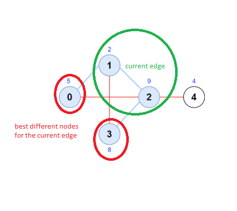
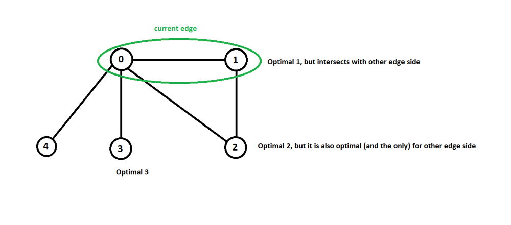

# [C++] [O(E)] Try every edge + find 2 more best nodes (one per each edge side)

**Author:** dm_a
**Votes:** 59
**Link:** [https://leetcode.com/problems/maximum-score-of-a-node-sequence/solutions/1953681/](https://leetcode.com/problems/maximum-score-of-a-node-sequence/solutions/1953681/)

---

The idea: try every edge, and select one more adjacent node per each of the edge ends.
The selected additional nodes must not be intersected with each other and with the other edge nodes.
Also there must be effective way to select additional nodes, so they provide max result. To achieve this - we can sort the adjacency list for each vertice (according to `scores`).
We must try 3 best nodes for each of the edge side (because they are optimal, and if we try just 1 or 2 best nodes - there could be intersections - which is not allowed) - so try at most 9 combinations per each edge.
**Optimization**: as we need just 3 top scored neighbours per each edge side - instead of full adjacency list sorting we can utilize a PriorityQueue to find top 3 nodes - this will decrease our time complexity from `O(Elog(E))` to `O(E)`

1. Create adjacency list
2. Sort adjacency list, so best adjacent nodes are in the beginning
	2.1 Optimized: no need to sort the full list - we need just 3 top scored adjacent nodes - so use PriorityQueue, find top 3 adjacent nodes
3. Try each edge:
	try <= 3 best adjacent nodes for each edge side. If no intersections - we have a sequence of 4 nodes (the current edge is in the middle), update result.
	
Time complexity:
`O(E log(E))` for adjacency list sorting
`O(E*9) = O(E)` for iterating over edges
Total: `O(E log(E))`
`E` is edges count

```cpp
int maximumScore(vector<int>& scores, vector<vector<int>>& edges) {
        const int n = scores.size();
        vector<vector<int>> adj(n);
        for (const vector<int>& edge : edges) {
            adj[edge[0]].push_back(edge[1]);
            adj[edge[1]].push_back(edge[0]);
        }
        for (vector<int>& a : adj) {
            sort(a.begin(), a.end(), [&scores](const int l, const int r) { return scores[l] > scores[r]; });
        }
        
        int result = -1;
        for (const vector<int>& edge : edges) {
            int u = edge[0];
            int v = edge[1];
            int base = scores[u] + scores[v];
            for (int i = 0; i < min(3, (int)adj[u].size()); ++i) {
                int x = adj[u][i];
                
                if (x == v) continue; // intersection - not allowed, continue
                
                for (int j = 0; j < min(3, (int)adj[v].size()); ++j) {
                    int y = adj[v][j];
                    
                    if (y == u || x == y) continue; // intersection - not allowed, continue
                    
                    result = max(result, base + scores[x] + scores[y]);
                }
            }
        }
        
        return result;
    }
```

**Optimized with PriorityQueue, time complexity:**
`O(E)` for adjacency list top scored 3 finding
`O(E*9) = O(E)` for iterating over edges
Total: `O(E)`
`E` is edges count
```cpp
int maximumScore(vector<int>& scores, vector<vector<int>>& edges) {
        const int n = scores.size();
        vector<vector<int>> adj(n);
        for (const vector<int>& edge : edges) {
            adj[edge[0]].push_back(edge[1]);
            adj[edge[1]].push_back(edge[0]);
        }
        for (vector<int>& a : adj) {
            // priority queue for top scored 3 vertices:
            priority_queue<pair<int, int>, vector<pair<int, int>>, greater<>> pq;
            for (int v : a) {
                int score = scores[v];
                if (pq.size() < 3 || pq.top().first < score) {
                    pq.push({score, v});
                    if (pq.size() > 3) {
                        pq.pop();
                    }
                }
            }
            a.resize(pq.size());
            for (int i = a.size() - 1; i >= 0; --i) {
                a[i] = pq.top().second;
                pq.pop();
            }
        }
        
        int result = -1;
        for (const vector<int>& edge : edges) {
            int u = edge[0];
            int v = edge[1];
            int base = scores[u] + scores[v];
            for (int x : adj[u]) {
                if (x == v) continue; // intersection - not allowed, continue
                
                for (int y : adj[v]) {
                    if (y == u || x == y) continue; // intersection - not allowed, continue
                    
                    result = max(result, base + scores[x] + scores[y]);
                }
            }
        }
        
        return result;
    }
```


Why 3 nodes (no more but no less) per each edge side are interesting?
E.g., if we handle the edge **[0-1]**, and highest score neighbours for the **0** node are: 1,2,3,4 (sorted from highest score to lowest):

If we try just 1 or 2 top score neighbors for the node **0** - it can intersect with other edge side (node **1**), or with the node which is optimal for other edge side (node **2**) - in this case we will not be able to get optimal node for other edge side, or we couldn't even find any node for other side. But if we try 3 nodes per each side - we guarantee to avoid intersection with (optimal) nodes from other side. At the picture it is required to try the node **3** (which is 3rd optimal for the node **0**) - so we'll have a **3-0-1-2** quadriplet, which is optimal. If we try only nodes **1** and **2** - we will not be able to find any valid neighbout for the node **1**, which is on the other side of the edge - so there will be no quadriplet.