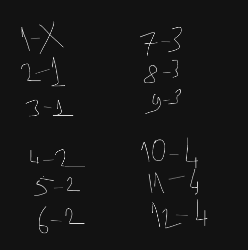

# Ruby solution - 3 lines

**Author:** ozovalihasan
**Votes:** 3
**Link:** [https://leetcode.com/problems/minimum-rounds-to-complete-all-tasks/solutions/2996569/](https://leetcode.com/problems/minimum-rounds-to-complete-all-tasks/solutions/2996569/)

---

# Approach
Firstly, let's check how many rounds the number of the same level tasks needs.



As you can see, there is a pattern. If the number of the same level tasks is 1, it fails. If it is greater than 1, the necessary round can be found by adding 2 to it and dividing by 3. For example; if the total number of the same level tasks is `7`, the result is `(7 + 2) / 3 => 3`.

# Code
```
# @param {Integer[]} tasks
# @return {Integer}
def minimum_rounds(tasks)
  tasks_values = tasks.tally.values

  return -1 if tasks_values.include? 1

  tasks_values.sum { |val| (val + 2) / 3 }
end
```