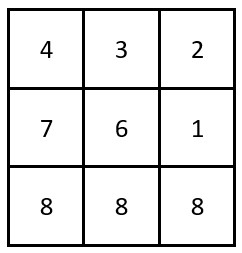

# [2245. Maximum Trailing Zeros in a Cornered Path](https://leetcode.com/problems/maximum-trailing-zeros-in-a-cornered-path/)

| Category | Difficulty | Likes | Dislikes |
| :------: | :--------: | :---: | :------: |
| Algorithms | Medium | 197 | 406 |

**Tags:** [`array`](https://leetcode.com/tag/array), [`matrix`](https://leetcode.com/tag/matrix), [`prefix-sum`](https://leetcode.com/tag/prefix-sum)


## Description

You are given a 2D integer array `grid` of size `m x n`, where each cell contains a positive integer.

A **cornered path** is defined as a set of adjacent cells with **at most** one turn. More specifically, the path should exclusively move either **horizontally** or **vertically** up to the turn (if there is one), without returning to a previously visited cell. After the turn, the path will then move exclusively in the **alternate** direction: move vertically if it moved horizontally, and vice versa, also without returning to a previously visited cell.

The **product** of a path is defined as the product of all the values in the path.

Return *the **maximum** number of **trailing zeros** in the product of a cornered path found in *`grid`.

Note:

	- **Horizontal** movement means moving in either the left or right direction.

	- **Vertical** movement means moving in either the up or down direction.

 

**Example 1:**


```

Input: grid = [[23,17,15,3,20],[8,1,20,27,11],[9,4,6,2,21],[40,9,1,10,6],[22,7,4,5,3]]
Output: 3
Explanation: The grid on the left shows a valid cornered path.
It has a product of 15 * 20 * 6 * 1 * 10 = 18000 which has 3 trailing zeros.
It can be shown that this is the maximum trailing zeros in the product of a cornered path.

The grid in the middle is not a cornered path as it has more than one turn.
The grid on the right is not a cornered path as it requires a return to a previously visited cell.

```

**Example 2:**


```

Input: grid = [[4,3,2],[7,6,1],[8,8,8]]
Output: 0
Explanation: The grid is shown in the figure above.
There are no cornered paths in the grid that result in a product with a trailing zero.

```

 

**Constraints:**

	- `m == grid.length`

	- `n == grid[i].length`

	- `1 <= m, n <= 10^5`

	- `1 <= m * n <= 10^5`

	- `1 <= grid[i][j] <= 1000`

---

**Links:** [Submissions](https://leetcode.com/problems/maximum-trailing-zeros-in-a-cornered-path/) | [Solutions](https://leetcode.com/problems/maximum-trailing-zeros-in-a-cornered-path/)
