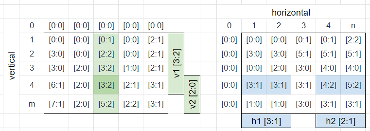

# Prefix Sum of Factors 2 and 5

**Author:** votrubac
**Votes:** 102
**Link:** [https://leetcode.com/problems/maximum-trailing-zeros-in-a-cornered-path/solutions/1955515/](https://leetcode.com/problems/maximum-trailing-zeros-in-a-cornered-path/solutions/1955515/)

---

The approach is not too hard to get, but the implementation is such a tongue-twister (or fingers-twister, I should say).

First, instead of multiplication, we just need to sum factors of `2` and `5`. Each pair of those factors produce one trailing zero.

We use grids `h` and `v` to compute prefix sum for each horizontal and vertical line in the grid. Note that we store the count of each factor separatelly. 

Then, for each position in the grid, we check four paths: `v1 + h1`, `v1 + h2`, `v2 + h1`, `v2 + h2`.

We count factors for each path, and track the maximum number of factor pairs (each pair gives us a trailing zero).

> I am not sure if we can use one grid instead of `v` and `h` and do some clever deduction, but the solution is already hard to debug with two grids. 

This is how the prefix sum grids look like for example 1 (see problem description), with the visualization for `v1`, `v2`, `h1` and `h2` sub-paths.



**C++**
```cpp
array<int, 2> operator+(const array<int, 2> &l, const array<int, 2> &r) { return { l[0] + r[0], l[1] + r[1] }; }
array<int, 2> operator-(const array<int, 2> &l, const array<int, 2> &r) { return { l[0] - r[0], l[1] - r[1] }; }
int pairs(const array<int, 2> &p) { return min(p[0], p[1]); }

class Solution {
public:
int factors(int i, int f) {
    return i % f ? 0 : 1 + factors(i / f, f);
}
int maxTrailingZeros(vector<vector<int>>& grid) {
    int m = grid.size(), n = grid[0].size(), res = 0;
    vector<vector<array<int, 2>>> h(m, vector<array<int, 2>>(n + 1)), v(m + 1, vector<array<int, 2>>(n));
    for (int i = 0; i < m; ++i)
        for (int j = 0; j < n; ++j) {
            array<int, 2> f25 = { factors(grid[i][j], 2), factors(grid[i][j], 5) };
            v[i + 1][j] = v[i][j] + f25;
            h[i][j + 1] = h[i][j] + f25;
        }
    for (int i = 0; i < m; ++i)
        for (int j = 0; j < n; ++j) {
            auto v1 = v[i + 1][j], v2 = v[m][j] - v[i][j];
            auto h1 = h[i][j], h2 = h[i][n] - h[i][j + 1];
            res = max({res, pairs(v1 + h1), pairs(v1 + h2), pairs(v2 + h1), pairs(v2 + h2)});
        }
    return res;
}
};
```
**Complexity Analysis**
- Time: O(n * m); we go through the grid twice; prefix sum grids allow computing zeros in O(1).
- Memory: O(n * m) for prefix sum grids.