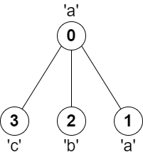

# [2246. Longest Path With Different Adjacent Characters](https://leetcode.com/problems/longest-path-with-different-adjacent-characters/)

| Category | Difficulty | Likes | Dislikes |
| :------: | :--------: | :---: | :------: |
| Algorithms | Hard | 2514 | 61 |

**Tags:** [`array`](https://leetcode.com/tag/array), [`string`](https://leetcode.com/tag/string), [`tree`](https://leetcode.com/tag/tree), [`depth-first-search`](https://leetcode.com/tag/depth-first-search), [`graph`](https://leetcode.com/tag/graph), [`topological-sort`](https://leetcode.com/tag/topological-sort)

**Companies:** `uber`, `microsoft`, `amazon`, `hrt`

## Description

You are given a **tree** (i.e. a connected, undirected graph that has no cycles) **rooted** at node `0` consisting of `n` nodes numbered from `0` to `n - 1`. The tree is represented by a **0-indexed** array `parent` of size `n`, where `parent[i]` is the parent of node `i`. Since node `0` is the root, `parent[0] == -1`.

You are also given a string `s` of length `n`, where `s[i]` is the character assigned to node `i`.

Return *the length of the **longest path** in the tree such that no pair of **adjacent** nodes on the path have the same character assigned to them.*

 

**Example 1:**


```

Input: parent = [-1,0,0,1,1,2], s = &quot;abacbe&quot;
Output: 3
Explanation: The longest path where each two adjacent nodes have different characters in the tree is the path: 0 -&gt; 1 -&gt; 3. The length of this path is 3, so 3 is returned.
It can be proven that there is no longer path that satisfies the conditions. 

```

**Example 2:**


```

Input: parent = [-1,0,0,0], s = &quot;aabc&quot;
Output: 3
Explanation: The longest path where each two adjacent nodes have different characters is the path: 2 -&gt; 0 -&gt; 3. The length of this path is 3, so 3 is returned.

```

 

**Constraints:**

	- `n == parent.length == s.length`

	- `1 = 1`

	- `parent[0] == -1`

	- `parent` represents a valid tree.

	- `s` consists of only lowercase English letters.

---

**Links:** [Submissions](https://leetcode.com/problems/longest-path-with-different-adjacent-characters/) | [Solutions](https://leetcode.com/problems/longest-path-with-different-adjacent-characters/)
