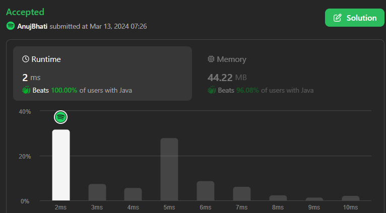
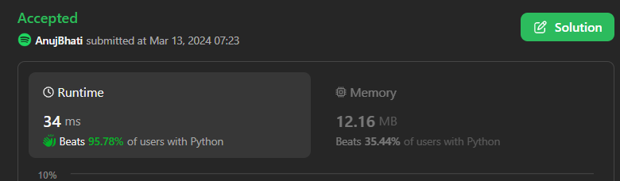
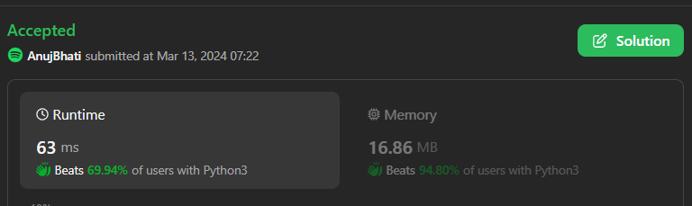
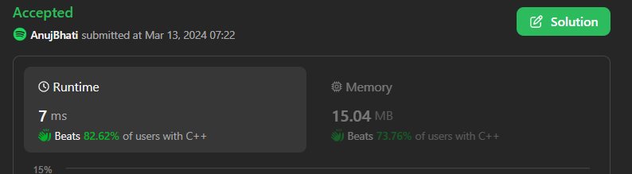
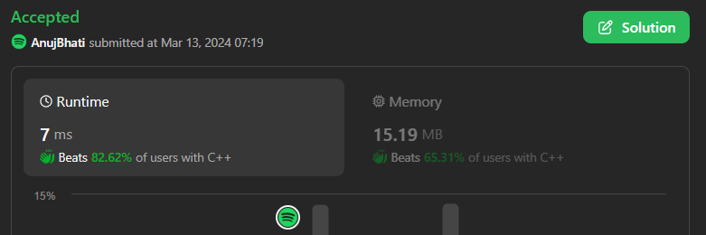

# Easiest C /C++ / Python3 / Java / Python With Hash or without beats 100%

**Author:** Edwards310
**Votes:** 2
**Link:** [https://leetcode.com/problems/intersection-of-multiple-arrays/solutions/4866849/](https://leetcode.com/problems/intersection-of-multiple-arrays/solutions/4866849/)

---

# Intuition





```C++ []
class Solution {
public:
    vector<int> intersection(vector<vector<int>>& nums) {
        map<int, int> mp;
        int len = nums.size();
        for (auto& x : nums)
            for (auto& y : x)
                mp[y]++;
        vector<int> res;
        for (auto& [key, value] : mp)
            if (value == len)
                res.push_back(key);
        return res;
    }
};
```
```python3 []
class Solution:
    def intersection(self, nums: List[List[int]]) -> List[int]:
        n = len(nums)
        ans = set(nums[0])
        for i in range(1, n):
            ans = ans.intersection(set(nums[i]))
        
        ans_lst = list(ans)
        ans_lst.sort()
        return ans_lst
```
```C++ []
class Solution {
public:
    vector<int> intersection(vector<vector<int>>& nums) {
        ios_base::sync_with_stdio(false);
        cin.tie(NULL);
        cout.tie(NULL);
        vector<int> ans(1001, 0);
        int n = nums.size();
        for(int i =0; i < n; i++)
            for(auto it : nums[i])
                ans[it]++;

        vector<int> finalans;
        for(int i =1; i <= 1000; i++)
            if(ans[i] == n)
                finalans.push_back(i);          
        
        return finalans;
    }
};
```
```java []
class Solution {
    public List<Integer> intersection(int[][] nums) {
        List<Integer> ans = new ArrayList<>();
        int[] count  = new int[1001];
        for(int[] arr : nums)
            for(int i : arr)
                count[i]++;

       for(int i = 0; i <count.length; i++)
           if(count[i]  == nums.length)
               ans.add(i); 

        return ans;
    }
}
```
```python []
class Solution(object):
    def intersection(self, nums):
        """
        :type nums: List[List[int]]
        :rtype: List[int]
        """
        ans = set(nums[0])
        for row in nums:
            row_set = set(row)
            ans = row_set & ans

        return sorted(list(ans))
```
```C []
/**
 * Note: The returned array must be malloced, assume caller calls free().
 */
int* intersection(int** nums, int numsSize, int* numsColSize, int* returnSize) {
    int arr[1001] = {0};
    for (int i = 0; i < numsSize; i++)
        for (int c = 0; c < numsColSize[i]; c++)
            arr[nums[i][c]]++;
    int* res = (int*)malloc(sizeof(int) * 1001);
    int t = 0;
    for (int x = 0; x < 1001; x++)
        if (arr[x] == numsSize)
            res[t++] = x;
    *returnSize = t;
    return res;
}
```

<!-- Describe your first thoughts on how to solve this problem. -->

# Approach
<!-- Describe your approach to solving the problem. -->

# Complexity
- Time complexity:
<!-- Add your time complexity here, e.g. $$O(n)$$ -->
    O(n)
- Space complexity:
<!-- Add your space complexity here, e.g. $$O(n)$$ -->
    O(1001) --> O(1)
# Code
```
/**
 * Note: The returned array must be malloced, assume caller calls free().
 */
int* intersection(int** nums, int numsSize, int* numsColSize, int* returnSize) {
    int arr[1001] = {0};
    for (int i = 0; i < numsSize; i++)
        for (int c = 0; c < numsColSize[i]; c++)
            arr[nums[i][c]]++;
    int* res = (int*)malloc(sizeof(int) * 1001);
    int t = 0;
    for (int x = 0; x < 1001; x++)
        if (arr[x] == numsSize)
            res[t++] = x;
    *returnSize = t;
    return res;
}
```
# Please Upvote if it's useful for you .. Thanks..

