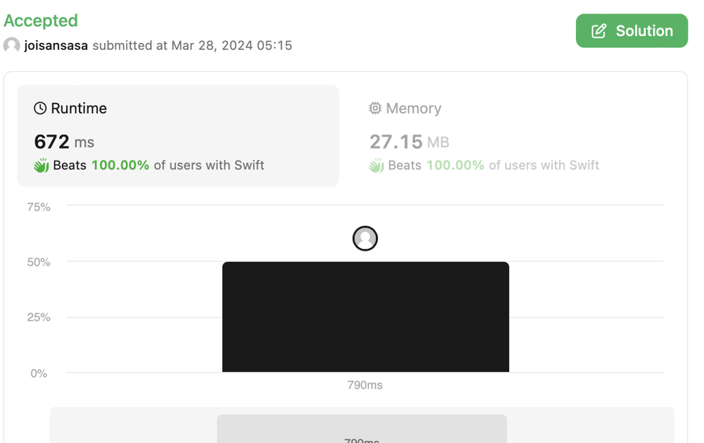

# Stepwise binary search

**Author:** joisansasa
**Votes:** 0
**Link:** [https://leetcode.com/problems/count-number-of-rectangles-containing-each-point/solutions/4937600/](https://leetcode.com/problems/count-number-of-rectangles-containing-each-point/solutions/4937600/)

---

# Intuition
<!-- Describe your first thoughts on how to solve this problem. -->


# Approach
<!-- Describe your approach to solving the problem. -->
Group all rectangles by heights: 
use array of 101 arrays (li), for each height group, only stores all length (li) as sorted array.

Sort all points by x.

Use binary search to find all rectangles of same or higher groups.
Remember and update the search start index for each group - because all points are sorted by x, so next point will search with much narrow range. 

# Complexity
- Time complexity:
<!-- Add your time complexity here, e.g. $$O(n)$$ -->
Given the number N as the size of points, O(Nlog(N))

- Space complexity:
<!-- Add your space complexity here, e.g. $$O(n)$$ -->
Given the number N as the size of points, O(N) extra space will be used.

# Code
```
class Solution {
    func countRectangles(_ rectangles: [[Int]], _ points: [[Int]]) -> [Int] {
        var rects: [[Int]] = Array(repeating: [], count: 101)
        for r in rectangles {
            let h = r[1]
            rects[h].append(r[0])
        }
        var i = 1
        while i < rects.count {
            rects[i].sort() //sort by l (x)
            i += 1
        }
        var xstarts: [Int] = Array(repeating: 0, count: rects.count)
        let px = points.enumerated().sorted { a, b in a.1[0] < b.1[0] }
        var count = Array(repeating: 0, count: points.count)
        // iterate through points
        for p in px {
            let i = p.0
            let x = p.1[0]
            let y = p.1[1]
            var j = y
            for j in y ..< rects.count where xstarts[j] < rects[j].count {
                //do a search
                let xpoints = rects[j]
                var l = xstarts[j]
                var r = xpoints.count - 1
                while l <= r {
                    let c = l + (r-l)/2
                    if xpoints[c] >= x {
                        r = c - 1
                    } else {
                        l = c + 1
                    }
                }
                count[i] += (xpoints.count - l)
                xstarts[j] = l
            }
        }
        return count
    }
}
```