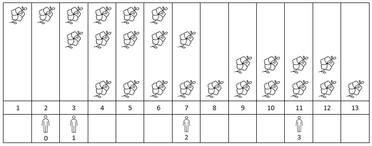

# 🚀 Priority Queue || Explained Intuition || Commented Code🚀

**Author:** MohamedMamdouh20
**Votes:** 29
**Link:** [https://leetcode.com/problems/number-of-flowers-in-full-bloom/solutions/4155617/](https://leetcode.com/problems/number-of-flowers-in-full-bloom/solutions/4155617/)

---

# Problem Description

The problem involves processing data about the **bloom time** of flowers and the arrival times of people to determine the **number** of flowers in full bloom at each person's arrival time.

Given a 2D array `flowers` representing the bloom intervals for each flower and an array `people` representing the arrival times of individuals, the task is to **calculate**, for each person, the **count** of flowers in **full bloom** at their respective arrival times.

---


# Intuition
Hi There! \uD83D\uDE03

Let's deep in our today's problem.\uD83E\uDD3F
The problem says that we have flowers which bloom in some interval from `[a, b]` and there are people arriving in **specific** time. Our task is to **calculate** for each person how many blooming flowers he would **see**.
Seems tough.\uD83D\uDCAA

**First Solution** that would pop into mind \uD83C\uDF7F is to iterate on every arrival time and for each arrival time iterate over all flowers and **count** the number of flowers for that time.
For sure, It is **correct** answer but it is **inefficient** solution since its Time complexity is `O(N * M)`.

How can we improve this solution or come with more efficient one?\uD83E\uDD14

Let's look at the first example of the problem.
```
flowers = [[1,6],[3,7],[9,12],[4,13]], poeple = [2,3,7,11]
Answer -> [1,2,2,2]
```



we can imagine that in the picture there is a certain data structure **storing** which flowers are blooming in the **current interval** and based on that we put it as an answer for **current person**.

Can we implement something like this?\uD83E\uDD14
Hopefully, we can !\uD83D\uDE03\uD83D\uDCAA

**First**, we will **sort** **people** based on their arrival time and the **flowers** based on the starting of the blooming interval, but why?\uD83E\uDD14
so we can **process** them **one by one** with the **same** data structure  without iterate over all the flowers again for each person.
like if we have two persons arrived at time = 2 then they will have the **same** answer from the **same** data structure.\uD83E\uDD2F

**Second**, the data structure which we want it to maintain a scheme like the above picture. I will pretend that I didn't say its name in the title.\uD83D\uDE02
- For **each person**, We want to **maintain** two things for the flowers in the data structure:
    - The **starting** of blooming interval of all flowers are less than or equal the current person `(meaning it started blooming before the current person arrival)`.
    - The **ending** of blooming interval of all flowers are more than or equal the current person `(meaning it ended blooming after the current person arrival)`.
    
Our hero for this job is the **Priority Queue** (Min Heap) \uD83E\uDDB8\u200D\u2642\uFE0F but how we will use it?\uD83E\uDD14
we will check for each flower that it **started** blooming before or as just as the person arrived then we will **push** its **ending** time in the Priority Queue so we maintained the **first feature**.
we will see the top of Priority Queue and check the ending time of it and pop it if the flower ended blooming before the persong arrived so 
we maintained the **second feature**.
Now, we are **sure** that for a **specific time** that the flowers in the Priority Queue are **blooming** in that time.\uD83C\uDF38

Last Thing, How will we store the answers ?\uD83E\uDD14
In a **dictionary** such that for each arrival time of a person we will store how many flowers in our Priority Queue that we are sure that thery are blooming in the arrival time of the person.

And this is the solution for our today'S problem I hope that you understood it\uD83D\uDE80\uD83D\uDE80


---


# Approach
1. **Sort** the arrival times of people `people` and the flower intervals `flowers` based on their starting in **ascending** order.
3. **Initialize** an empty dictionary `bloom_counts` to store **counts** of flowers in bloom for each arrival time and an empty **min heap** `bloom_end_times` to track flower bloom end times.
4. **Iterate** through the sorted arrival times and For each arrival time:
    - **Add** flowers that are in bloom at the current arrival time by pushing bloom end times into the min heap `bloom_end_times`.
    - **Remove** flowers that are no longer in bloom by popping the min heap.
    - **Store** the count of flowers in bloom for the current person's arrival time in the `bloom_counts` dictionary.
5.  **Return** `flowerCounts`, which contains the counts of flowers in bloom for each person's arrival time.

# Complexity
- **Time complexity:** $O(N * log(N) + M * (log(M) + log(N)))$
Since we are **sorting** people array and flowers array then this cost `O(M * log(M))` and `O(N * log(N))` then we have a **for loop** which we iterate over all people and in each iteration we do some operations using the min heap then its complexity is `O(M * log(N))` so total time complexity is `O(N * log(N) + M * log(M) + M * log(N))` which is `O(N * log(N) + M * (log(M) + log(N)))`.
Where `M` is the size of perple array and `N` is the soze of flower array.
- **Space complexity:** $O(M + N)$
Since we are storing **sorted arrival times** which has space of `M` and storing the **dictionary** for all arival times also has space `M` and the **min heap** for storing the flowers blooming intervals which has space of `N`. So total space is `N + 2 * M` which is `O(N + M)`. 


---


# Code

```C++ []
class Solution {
public:
    vector<int> fullBloomFlowers(vector<vector<int>>& flowers, vector<int>& people) {
        vector<int> sortedArrivalTimes(people.begin(), people.end());
        sort(sortedArrivalTimes.begin(), sortedArrivalTimes.end());

        // Sort the flower intervals based on their start times.
        sort(flowers.begin(), flowers.end()) ;
        
        unordered_map<int, int> bloomCounts;  // Map to store counts of flowers in bloom for each arrival time.
        priority_queue<int, vector<int>, greater<int>> bloomEndTimes;  // Min heap to track flower bloom end times.

        int flowerIdx = 0 ;
        for(int personTime: sortedArrivalTimes){
            // Add flowers that are in bloom at the person's arrival time.
            while(flowerIdx < flowers.size() && flowers[flowerIdx][0] <= personTime)
                bloomEndTimes.push(flowers[flowerIdx++][1]);

            // Remove flowers that are no longer in bloom.
            while(!bloomEndTimes.empty() && bloomEndTimes.top() < personTime)
                bloomEndTimes.pop();

            // Store the count of flowers in bloom for the person's arrival time.
            bloomCounts[personTime] = bloomEndTimes.size();
        }

        vector<int> flowerCounts;  // Resulting array to store flower counts for each person.
        for(int arrivalTime: people)
            flowerCounts.push_back(bloomCounts[arrivalTime]);

        return flowerCounts;  // Return the counts of flowers in bloom for each person's arrival time.
    }
};
```
```Java []
class Solution {
    public int[] fullBloomFlowers(int[][] flowers, int[] people) {
        int[] sortedArrivalTimes = Arrays.copyOf(people, people.length);
        Arrays.sort(sortedArrivalTimes);

        // Sort the flower intervals based on their start times.
        Arrays.sort(flowers, Comparator.comparingInt(flower -> flower[0]));

        Map<Integer, Integer> bloomCounts = new HashMap<>();  // Map to store counts of flowers in bloom for each arrival time.
        PriorityQueue<Integer> bloomEndTimes = new PriorityQueue<>();  // Min heap to track flower bloom end times.

        int flowerIdx = 0;
        for (int personTime : sortedArrivalTimes) {
            // Add flowers that are in bloom at the person's arrival time.
            while (flowerIdx < flowers.length && flowers[flowerIdx][0] <= personTime) {
                bloomEndTimes.offer(flowers[flowerIdx][1]);
                flowerIdx++;
            }

            // Remove flowers that are no longer in bloom.
            while (!bloomEndTimes.isEmpty() && bloomEndTimes.peek() < personTime) {
                bloomEndTimes.poll();
            }

            // Store the count of flowers in bloom for the person's arrival time.
            bloomCounts.put(personTime, bloomEndTimes.size());
        }

        int[] flowerCounts = new int[people.length];  // Resulting array to store flower counts for each person.
        for (int i = 0; i < people.length; i++) {
            flowerCounts[i] = bloomCounts.get(people[i]);
        }

        return flowerCounts;  // Return the counts of flowers in bloom for each person's arrival time.
    }
}
```
```Python []
class Solution:
    def fullBloomFlowers(self, flowers: List[List[int]], people: List[int]) -> List[int]:
        sorted_arrival_times = sorted(people)
        flowers.sort()  # Sort the flower intervals based on their start times.
        
        bloom_counts = {}  # Dictionary to store counts of flowers in bloom for each arrival time.
        bloom_end_times = []  # Min heap to track flower bloom end times.

        flower_idx = 0
        for person_time in sorted_arrival_times:
            # Add flowers that are in bloom at the person's arrival time.
            while flower_idx < len(flowers) and flowers[flower_idx][0] <= person_time:
                heapq.heappush(bloom_end_times, flowers[flower_idx][1])
                flower_idx += 1

            # Remove flowers that are no longer in bloom.
            while bloom_end_times and bloom_end_times[0] < person_time:
                heapq.heappop(bloom_end_times)

            # Store the count of flowers in bloom for the person's arrival time.
            bloom_counts[person_time] = len(bloom_end_times)

        # Resulting list to store flower counts for each person.
        flower_counts = [bloom_counts[arrival_time] for arrival_time in people]

        return flower_counts  # Return the counts of flowers in bloom for each person's arrival time.
```


