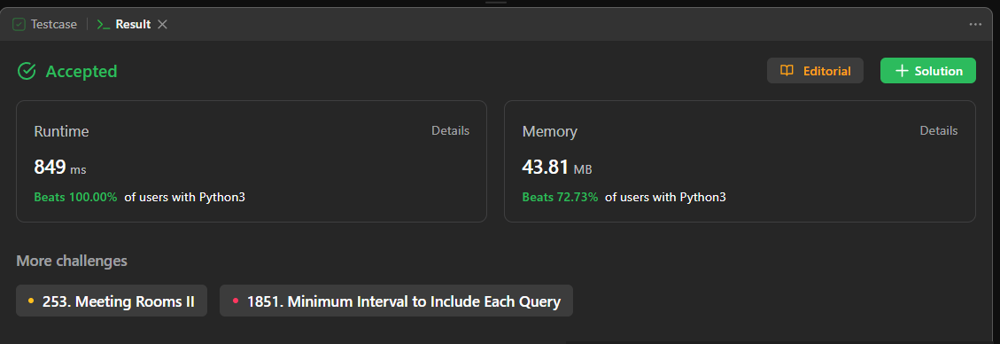

# || Beginner Friendly || Easy Solution Line By Line Explanation || Beats 100 % || PYTHON || C++ ||

**Author:** vaish_1929
**Votes:** 24
**Link:** [https://leetcode.com/problems/number-of-flowers-in-full-bloom/solutions/4155773/](https://leetcode.com/problems/number-of-flowers-in-full-bloom/solutions/4155773/)

---

# BEATS 100% Python And Ruby



# Intuition
The intuition for this problem is to track the bloom intervals of flowers and determine the bloom status for each person. This involves processing the intervals and persons in a way that efficiently calculates the bloom status.

# Approach
The approach used in this solution involves maintaining a defaultdict to track bloom intervals of flowers. The code iterates through the flower intervals, updates the intervals in the dictionary, and processes the persons in reverse order of their bloom time. It calculates the bloom count at each time step and records the bloom status for each person. The result is returned as a list of bloom statuses for each person.

# Complexity
- Time complexity:
The time complexity of this solution is determined by sorting the bloom times and processing the persons. In the worst case, it's O(n*log(n)) for sorting the bloom times and O(n) for processing the persons, resulting in a time complexity of O(n*log(n)).

- Space complexity:
The space complexity primarily depends on the dictionaries used to track bloom intervals and bloom status. The space complexity is O(n) to store bloom intervals, bloom statuses, and the remaining persons.

# Code
# PYTHON
```python
from collections import defaultdict

class Solution:
    def fullBloomFlowers(self, flowers, persons):
        # Create a defaultdict to track bloom intervals
        blooming_intervals = defaultdict(int)

        # Iterate through the flower intervals and update bloom_intervals
        for start, end in flowers:
            blooming_intervals[start] += 1
            blooming_intervals[end + 1] -= 1

        # Initialize dictionaries and variables
        blooming_status, bloom_count = {}, 0
        remaining_persons = sorted(persons, reverse=True)  # Sort persons in reverse order

        # Iterate through sorted bloom times
        for time in sorted(blooming_intervals.keys()):
            bloom_change = blooming_intervals[time]  # Get bloom change at this time

            # Process persons whose bloom time has arrived
            while remaining_persons and time > remaining_persons[-1]:
                blooming_status[remaining_persons.pop()] = bloom_count

            # If there are no remaining persons, exit the loop
            if not remaining_persons:
                break

            bloom_count += bloom_change  # Update bloom count

        # Create a list of bloom statuses for each person
        return [blooming_status[p] if p in blooming_status else 0 for p in persons]
```
# JAVA
```
class Solution {
    public int[] fullBloomFlowers(int[][] flowers, int[] persons) {
        int n = persons.length;
        int[] result = new int[n];
        
        // Create a TreeMap to track flower intervals and their frequencies.
        TreeMap<Integer, Integer> treeMap = new TreeMap<>();
        for (int i = 0; i < flowers.length; i++) {
            // Increment the start time frequency.
            treeMap.put(flowers[i][0], treeMap.getOrDefault(flowers[i][0], 0) + 1);
            // Decrement the end time frequency (add 1 to end time to indicate the end of the interval).
            treeMap.put(flowers[i][1] + 1, treeMap.getOrDefault(flowers[i][1] + 1, 0) - 1);
        }
        
        // Create another TreeMap to accumulate the frequencies and track the number of flowers blooming at each moment.
        TreeMap<Integer, Integer> sum = new TreeMap<>();
        int prev = 0;
        for (Map.Entry<Integer, Integer> entry : treeMap.entrySet()) {
            prev += entry.getValue();
            sum.put(entry.getKey(), prev);
        }
        
        // Calculate bloom statuses for each person.
        for (int i = 0; i < n; i++) {
            // Find the floor entry for the person's bloom time.
            Map.Entry<Integer, Integer> entry = sum.floorEntry(persons[i]);
            if (entry != null) {
                result[i] = entry.getValue(); // Store the number of blooming flowers at that time.
            }
        }
        return result;
    }
}

```
# C++
```
class Solution {
public:
    vector<int> fullBloomFlowers(vector<vector<int>>& flowers, vector<int>& people) {
        vector<int> st, bl; // Initialize vectors to store start and bloom times.
        int n = flowers.size();

        // Extract start and bloom times from the flowers array and store them in separate vectors.
        for (auto i : flowers) {
            int x = i[0];
            int y = i[1];
            st.push_back(x);
            bl.push_back(y);
        }

        // Sort the start and bloom time vectors in ascending order.
        sort(st.begin(), st.end());
        sort(bl.begin(), bl.end());

        vector<int> v; // Initialize a result vector to store bloom statuses.

        // Iterate through each person's bloom time.
        for (int i = 0; i < people.size(); i++) {
            // Calculate the number of flowers blooming at or before the person's bloom time.
            int p = st.size() - (upper_bound(st.begin(), st.end(), people[i]) - st.begin());

            // Calculate the number of flowers blooming at or after the person's bloom time.
            int q = bl.size() - (lower_bound(bl.begin(), bl.end(), people[i]) - bl.begin());

            // Calculate the bloom status for the person and store it in the result vector.
            v.push_back(q - p);
        }

        return v; // Return the vector containing bloom statuses for each person.
    }
};

```
# Ruby
```
# Define a function full_bloom_flowers that takes two arrays as input: flowers and people.
# It calculates the bloom status for each person based on their bloom time and flower intervals.

def full_bloom_flowers(flowers, people)
  flowers_size = flowers.size # Get the total number of flower intervals.
  
  # Extract and sort the start and end indices of flower intervals.
  start_indices = flowers.map(&:first).sort
  end_indices = flowers.map(&:last).sort

  # Initialize an array to store bloom statuses for each person and iterate through each person.
  people.map do |num|
    # Calculate the number of flowers starting after the person's bloom time.
    # Use bsearch_index to find the first start index greater than the person's bloom time.
    # If not found, use flowers_size (all intervals are valid).

    start_index = start_indices.bsearch_index { |start_index| start_index > num }
    start_index ||= flowers_size

    # Calculate the number of flowers blooming after or at the person's bloom time.
    # Use bsearch_index to find the first end index greater than or equal to the person's bloom time.
    # If not found, use flowers_size (all intervals are valid).

    end_index = end_indices.bsearch_index { |end_index| end_index >= num }
    end_index ||= flowers_size

    # Calculate the bloom status for the person by subtracting the end index from the start index.
    # This represents the number of flowers blooming in the person's desired time range.

    bloom_status = start_index - end_index

    # Return the calculated bloom status for the current person.
    bloom_status
  end
end

```
