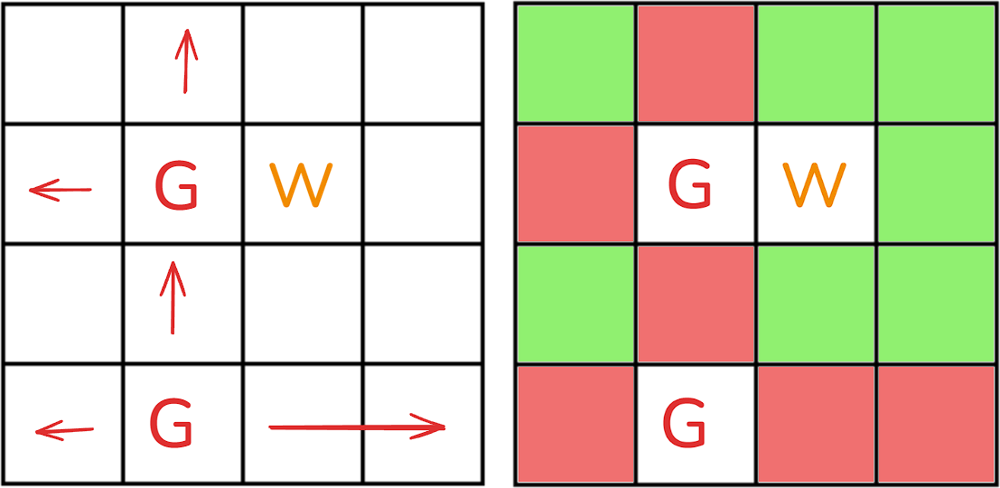

# ✅Beats 100% | Video Full Explain | 3 approaches ✅

**Author:** Piotr_Maminski
**Votes:** 130
**Link:** [https://leetcode.com/problems/count-unguarded-cells-in-the-grid/solutions/6067031/](https://leetcode.com/problems/count-unguarded-cells-in-the-grid/solutions/6067031/)

---


https://youtu.be/3WVHdSWHxxQ?si=nKwBBbCtYns462jU

# #1 (all beats 95-100%)

```python [PyShort]
class Solution:
    def countUnguarded(self, m: int, n: int, guards: List[List[int]], walls: List[List[int]]) -> int:
        grid = [[0] * n for _ in range(m)] # Initialize grid with zeros
        # Mark obstacles
        for x, y in guards + walls: # gx,gy - Guards/Walls position
            grid[x][y] = 2  
        # Process guards' vision
        directions = [(-1, 0), (0, 1), (1, 0), (0, -1)]
        for gx, gy in guards:
            for dx, dy in directions: # dx, dy - movement direction offsets
                x, y = gx, gy
                # Check cells in current direction until hitting boundary or obstacle
                while 0 <= x + dx < m and 0 <= y + dy < n and grid[x + dx][y + dy] != 2:
                    x += dx
                    y += dy
                    grid[x][y] = 1 
        return sum(row.count(0) for row in grid) # Count unguarded cells (value 0)
```
```python3 []
class Solution:
    def countUnguarded(self, m: int, n: int, guards: List[List[int]], walls: List[List[int]]) -> int:
        # Initialize grid with zeros
        g = [[0] * n for _ in range(m)] # g - 2D grid/matrix
        
        # Mark guards and walls as 2
        for x, y in guards:  # gx, gy -  guard's position 
            g[x][y] = 2    
        for x, y in walls:
            g[x][y] = 2
            
        # Directions: up, right, down, left
        dirs = [(-1, 0), (0, 1), (1, 0), (0, -1)]
        
        # Process each guard's line of sight
        for gx, gy in guards:
            for dx, dy in dirs: # dx, dy - movement direction offsets
                x, y = gx, gy
                while True:
                    x += dx
                    y += dy
                    # Check cells in current direction until hitting boundary or obstacle
                    if x < 0 or x >= m or y < 0 or y >= n or g[x][y] == 2:
                        break
                    g[x][y] = 1
        
        # Count unguarded cells (cells with value 0)
        return sum(row.count(0) for row in g)
        
```
```cpp []
class Solution {
public:
    int countUnguarded(int m, int n, vector<vector<int>>& guards, vector<vector<int>>& walls) {
        // Initialize grid with zeros
        int g[m][n];
        memset(g, 0, sizeof(g));
        
        // Mark guards and walls as 2
        for (auto& e : guards) {
            g[e[0]][e[1]] = 2;
        }
        for (auto& e : walls) {
            g[e[0]][e[1]] = 2;
        }
        
        // Directions: up, right, down, left
        int dirs[5] = {-1, 0, 1, 0, -1};
        
        // Process each guard's line of sight
        for (auto& e : guards) {
            for (int k = 0; k < 4; ++k) {
                int x = e[0], y = e[1];
                int dx = dirs[k], dy = dirs[k + 1];
                
                // Check cells in current direction until hitting boundary or obstacle
                while (x + dx >= 0 && x + dx < m && y + dy >= 0 && y + dy < n && g[x + dx][y + dy] < 2) {
                    x += dx;
                    y += dy;
                    g[x][y] = 1;
                }
            }
        }
        
        // Count unguarded cells (cells with value 0)
        int unguardedCount = 0;
        for (int i = 0; i < m; i++) {
            unguardedCount += count(g[i], g[i] + n, 0);
        }
        
        return unguardedCount;
    }
};

```
```java []
class Solution {
    public int countUnguarded(int m, int n, int[][] guards, int[][] walls) {
        // Initialize grid with zeros
        int[][] g = new int[m][n];
        
        // Mark guards and walls as 2
        for (int[] e : guards) {
            g[e[0]][e[1]] = 2;
        }
        for (int[] e : walls) {
            g[e[0]][e[1]] = 2;
        }
        
        // Directions: up, right, down, left
        int[] dirs = {-1, 0, 1, 0, -1};
        
        // Process each guard's line of sight
        for (int[] e : guards) {
            for (int k = 0; k < 4; ++k) {
                int x = e[0], y = e[1];
                int dx = dirs[k], dy = dirs[k + 1];
                
                // Check cells in current direction until hitting boundary or obstacle
                while (x + dx >= 0 && x + dx < m && y + dy >= 0 && y + dy < n && g[x + dx][y + dy] < 2) {
                    x += dx;
                    y += dy;
                    g[x][y] = 1;
                }
            }
        }
        
        // Count unguarded cells (cells with value 0)
        int unguardedCount = 0;
        for (int i = 0; i < m; i++) {
            for (int j = 0; j < n; j++) {
                if (g[i][j] == 0) {
                    unguardedCount++;
                }
            }
        }
        
        return unguardedCount;
    }
}
```
```csharp []
public class Solution {
    public int CountUnguarded(int m, int n, int[][] guards, int[][] walls) {
        // Initialize grid with zeros
        int[,] g = new int[m,n];
        
        // Mark guards and walls as 2
        foreach (var e in guards) {
            g[e[0],e[1]] = 2;
        }
        foreach (var e in walls) {
            g[e[0],e[1]] = 2;
        }
        
        // Directions: up, right, down, left
        int[] dirs = new int[] {-1, 0, 1, 0, -1};
        
        // Process each guard's line of sight
        foreach (var e in guards) {
            for (int k = 0; k < 4; ++k) {
                int x = e[0], y = e[1];
                int dx = dirs[k], dy = dirs[k + 1];
                
                // Check cells in current direction until hitting boundary or obstacle
                while (x + dx >= 0 && x + dx < m && y + dy >= 0 && y + dy < n && g[x + dx,y + dy] < 2) {
                    x += dx;
                    y += dy;
                    g[x,y] = 1;
                }
            }
        }
        
        // Count unguarded cells (cells with value 0)
        int unguardedCount = 0;
        for (int i = 0; i < m; i++) {
            for (int j = 0; j < n; j++) {
                if (g[i,j] == 0) {
                    unguardedCount++;
                }
            }
        }
        
        return unguardedCount;
    }
}

```
```golang []
func countUnguarded(m int, n int, guards [][]int, walls [][]int) int {
    // Initialize grid with zeros
    grid := make([]uint8, m*n)
    
    // Mark guards and walls as 2
    for _, pos := range guards {
        grid[pos[0]*n+pos[1]] = 2
    }
    for _, pos := range walls {
        grid[pos[0]*n+pos[1]] = 2
    }
    
    // Directions: up, right, down, left
    dx := [4]int{-1, 0, 1, 0}
    dy := [4]int{0, 1, 0, -1}
    
    // Process each guard's line of sight
    for _, guard := range guards {
        for k := 0; k < 4; k++ {
            x, y := guard[0], guard[1]
            newX, newY := x+dx[k], y+dy[k]
            
            // Check cells in current direction until hitting boundary or obstacle
            for newX >= 0 && newX < m && newY >= 0 && newY < n && grid[newX*n+newY] < 2 {
                grid[newX*n+newY] = 1
                newX += dx[k]
                newY += dy[k]
            }
        }
    }
    
    // Count unguarded cells (cells with value 0)
    unguardedCount := m*n - len(guards) - len(walls)
    for i := 0; i < m*n; i++ {
        if grid[i] == 1 {
            unguardedCount--
        }
    }
    
    return unguardedCount
}

```
```swift []
class Solution {
    func countUnguarded(_ m: Int, _ n: Int, _ guards: [[Int]], _ walls: [[Int]]) -> Int {
        // Initialize grid with zeros
        var g = Array(repeating: Array(repeating: 0, count: n), count: m)
        
        // Mark guards and walls as 2
        for e in guards {
            g[e[0]][e[1]] = 2
        }
        for e in walls {
            g[e[0]][e[1]] = 2
        }
        
        // Directions: up, right, down, left
        let dirs = [-1, 0, 1, 0, -1]
        
        // Process each guard's line of sight
        for e in guards {
            for k in 0..<4 {
                var x = e[0], y = e[1]
                let dx = dirs[k], dy = dirs[k + 1]
                
                // Check cells in current direction until hitting boundary or obstacle
                while x + dx >= 0 && x + dx < m && y + dy >= 0 && y + dy < n && g[x + dx][y + dy] < 2 {
                    x += dx
                    y += dy
                    g[x][y] = 1
                }
            }
        }
        
        // Count unguarded cells (cells with value 0)
        return g.reduce(0) { $0 + $1.filter { $0 == 0 }.count }
    }
}
```
```javascript [JS]
// JavaScript

var countUnguarded = function(m, n, guards, walls) {
    // Initialize grid with zeros
    const g = Array(m).fill().map(() => Array(n).fill(0));
    
    // Mark guards and walls as 2
    for (const [x, y] of guards) {
        g[x][y] = 2;
    }
    for (const [x, y] of walls) {
        g[x][y] = 2;
    }
    
    // Directions: up, right, down, left
    const dirs = [[-1, 0], [0, 1], [1, 0], [0, -1]];
    
    // Process each guard's line of sight
    for (const [gx, gy] of guards) {
        for (const [dx, dy] of dirs) {
            let x = gx;
            let y = gy;
            while (true) {
                x += dx;
                y += dy;
                // Check cells in current direction until hitting boundary or obstacle
                if (x < 0 || x >= m || y < 0 || y >= n || g[x][y] === 2) {
                    break;
                }
                g[x][y] = 1;
            }
        }
    }
    
    // Count unguarded cells (cells with value 0)
    return g.reduce((sum, row) => sum + row.filter(cell => cell === 0).length, 0);
};
```
```typescript [TS]
// TypeScript

function countUnguarded(m: number, n: number, guards: number[][], walls: number[][]): number {
    // Initialize grid with zeros
    const g: number[][] = Array(m).fill(0).map(() => Array(n).fill(0));
    
    // Mark guards and walls as 2
    for (const [x, y] of guards) {
        g[x][y] = 2;
    }
    for (const [x, y] of walls) {
        g[x][y] = 2;
    }
    
    // Directions: up, right, down, left
    const dirs = [-1, 0, 1, 0, -1];
    
    // Process each guard's line of sight
    for (const [guardX, guardY] of guards) {
        for (let k = 0; k < 4; k++) {
            let x = guardX, y = guardY;
            const dx = dirs[k], dy = dirs[k + 1];
            
            // Check cells in current direction until hitting boundary or obstacle
            while (x + dx >= 0 && x + dx < m && y + dy >= 0 && y + dy < n && g[x + dx][y + dy] < 2) {
                x += dx;
                y += dy;
                g[x][y] = 1;
            }
        }
    }
    
    // Count unguarded cells (cells with value 0)
    return g.reduce((count, row) => 
        count + row.filter(cell => cell === 0).length, 0);
}
```
```rust []
impl Solution {
    pub fn count_unguarded(m: i32, n: i32, guards: Vec<Vec<i32>>, walls: Vec<Vec<i32>>) -> i32 {
        let (m, n) = (m as usize, n as usize);
        // Initialize grid with zeros
        let mut g = vec![vec![0; n]; m];
        
        // Mark guards and walls as 2
        for e in guards.iter() {
            g[e[0] as usize][e[1] as usize] = 2;
        }
        for e in walls.iter() {
            g[e[0] as usize][e[1] as usize] = 2;
        }
        
        // Directions: up, right, down, left
        let dirs = [-1, 0, 1, 0, -1];
        
        // Process each guard's line of sight
        for e in guards.iter() {
            for k in 0..4 {
                let mut x = e[0] as i32;
                let mut y = e[1] as i32;
                let dx = dirs[k];
                let dy = dirs[k + 1];
                
                // Check cells in current direction until hitting boundary or obstacle
                while x + dx >= 0 && x + dx < m as i32 && y + dy >= 0 && y + dy < n as i32 
                    && g[(x + dx) as usize][(y + dy) as usize] < 2 {
                    x += dx;
                    y += dy;
                    g[x as usize][y as usize] = 1;
                }
            }
        }
        
        // Count unguarded cells (cells with value 0)
        g.iter().flat_map(|row| row.iter())
            .filter(|&&cell| cell == 0)
            .count() as i32
    }
}
```
```ruby []
def count_unguarded(m, n, guards, walls)
    # Initialize grid with zeros
    g = Array.new(m) { Array.new(n, 0) }
    
    # Mark guards and walls as 2
    guards.each { |x, y| g[x][y] = 2 }
    walls.each { |x, y| g[x][y] = 2 }
    
    # Directions: up, right, down, left
    dirs = [-1, 0, 1, 0, -1]
    
    # Process each guard's line of sight
    guards.each do |guard_x, guard_y|
        4.times do |k|
            x, y = guard_x, guard_y
            dx, dy = dirs[k], dirs[k + 1]
            
            # Check cells in current direction until hitting boundary or obstacle
            while x + dx >= 0 && x + dx < m && y + dy >= 0 && y + dy < n && g[x + dx][y + dy] < 2
                x += dx
                y += dy
                g[x][y] = 1
            end
        end
    end
    
    # Count unguarded cells (cells with value 0)
    g.sum { |row| row.count(0) }
end
```
- Complexy: Time O(m * n) & Space O(m * n) 

# #2 DFS - Depth-First Search (from video)

```python3 []
class Solution:
    def countUnguarded(self, m: int, n: int, guards: List[List[int]], walls: List[List[int]]) -> int:
        grid = [[0] * n for _ in range(m)]
        # 0 = free, 1 = guard, 2 = wall, 3 = guardable

        for r, c in guards:
            grid[r][c] = 1
        for r, c in walls:
            grid[r][c] = 2

        def mark_guarded(r, c):
            for row in range(r + 1, m):
                if grid[row][c] in [1, 2]:
                    break
                grid[row][c] = 3
            for row in reversed(range(0, r)):
                if grid[row][c] in [1, 2]:
                    break
                grid[row][c] = 3
            for col in range(c + 1, n):
                if grid[r][col] in [1, 2]:
                    break
                grid[r][col] = 3
            for col in reversed(range(0, c)):
                if grid[r][col] in [1, 2]:
                    break
                grid[r][col] = 3

        for r, c in guards:
            mark_guarded(r, c)

        res = 0
        for row in grid:
            for cell in row:
                if cell == 0:
                    res += 1

        return res

```
```cpp []
class Solution {
public:
    int countUnguarded(int m, int n, vector<vector<int>>& guards, vector<vector<int>>& walls) {
        vector<vector<int>> grid(m, vector<int>(n, 0));
        // 0 = free, 1 = guard, 2 = wall, 3 = guardable
        
        for (const auto& guard : guards) {
            grid[guard[0]][guard[1]] = 1;
        }
        for (const auto& wall : walls) {
            grid[wall[0]][wall[1]] = 2;
        }
        
        auto mark_guarded = [&](int r, int c) {
            for (int row = r + 1; row < m; row++) {
                if (grid[row][c] == 1 || grid[row][c] == 2) break;
                grid[row][c] = 3;
            }
            for (int row = r - 1; row >= 0; row--) {
                if (grid[row][c] == 1 || grid[row][c] == 2) break;
                grid[row][c] = 3;
            }
            for (int col = c + 1; col < n; col++) {
                if (grid[r][col] == 1 || grid[r][col] == 2) break;
                grid[r][col] = 3;
            }
            for (int col = c - 1; col >= 0; col--) {
                if (grid[r][col] == 1 || grid[r][col] == 2) break;
                grid[r][col] = 3;
            }
        };
        
        for (const auto& guard : guards) {
            mark_guarded(guard[0], guard[1]);
        }
        
        int res = 0;
        for (const auto& row : grid) {
            for (int cell : row) {
                if (cell == 0) res++;
            }
        }
        
        return res;
    }
};
```
```java []
class Solution {
    public int countUnguarded(int m, int n, int[][] guards, int[][] walls) {
        int[][] grid = new int[m][n];
        // 0 = free, 1 = guard, 2 = wall, 3 = guardable
        
        for (int[] guard : guards) {
            grid[guard[0]][guard[1]] = 1;
        }
        for (int[] wall : walls) {
            grid[wall[0]][wall[1]] = 2;
        }
        
        for (int[] guard : guards) {
            markGuarded(grid, guard[0], guard[1], m, n);
        }
        
        int res = 0;
        for (int[] row : grid) {
            for (int cell : row) {
                if (cell == 0) {
                    res++;
                }
            }
        }
        
        return res;
    }
    
    private void markGuarded(int[][] grid, int r, int c, int m, int n) {
        for (int row = r + 1; row < m; row++) {
            if (grid[row][c] == 1 || grid[row][c] == 2) break;
            grid[row][c] = 3;
        }
        for (int row = r - 1; row >= 0; row--) {
            if (grid[row][c] == 1 || grid[row][c] == 2) break;
            grid[row][c] = 3;
        }
        for (int col = c + 1; col < n; col++) {
            if (grid[r][col] == 1 || grid[r][col] == 2) break;
            grid[r][col] = 3;
        }
        for (int col = c - 1; col >= 0; col--) {
            if (grid[r][col] == 1 || grid[r][col] == 2) break;
            grid[r][col] = 3;
        }
    }
}
```
```csharp []
public class Solution {
    public int CountUnguarded(int m, int n, int[][] guards, int[][] walls) {
        int[,] grid = new int[m,n];
        // 0 = free, 1 = guard, 2 = wall, 3 = guardable
        
        foreach (var guard in guards) {
            grid[guard[0], guard[1]] = 1;
        }
        
        foreach (var wall in walls) {
            grid[wall[0], wall[1]] = 2;
        }
        
        void MarkGuarded(int r, int c) {
            for (int row = r + 1; row < m; row++) {
                if (grid[row,c] == 1 || grid[row,c] == 2) break;
                grid[row,c] = 3;
            }
            for (int row = r - 1; row >= 0; row--) {
                if (grid[row,c] == 1 || grid[row,c] == 2) break;
                grid[row,c] = 3;
            }
            for (int col = c + 1; col < n; col++) {
                if (grid[r,col] == 1 || grid[r,col] == 2) break;
                grid[r,col] = 3;
            }
            for (int col = c - 1; col >= 0; col--) {
                if (grid[r,col] == 1 || grid[r,col] == 2) break;
                grid[r,col] = 3;
            }
        }
        
        foreach (var guard in guards) {
            MarkGuarded(guard[0], guard[1]);
        }
        
        int result = 0;
        for (int i = 0; i < m; i++) {
            for (int j = 0; j < n; j++) {
                if (grid[i,j] == 0) {
                    result++;
                }
            }
        }
        
        return result;
    }
}
```
```golang []
func countUnguarded(m int, n int, guards [][]int, walls [][]int) int {
    grid := make([][]int, m)
    for i := range grid {
        grid[i] = make([]int, n)
    }
    // 0 = free, 1 = guard, 2 = wall, 3 = guardable
    
    for _, g := range guards {
        grid[g[0]][g[1]] = 1
    }
    for _, w := range walls {
        grid[w[0]][w[1]] = 2
    }
    
    markGuarded := func(r, c int) {
        for row := r + 1; row < m; row++ {
            if grid[row][c] == 1 || grid[row][c] == 2 {
                break
            }
            grid[row][c] = 3
        }
        for row := r - 1; row >= 0; row-- {
            if grid[row][c] == 1 || grid[row][c] == 2 {
                break
            }
            grid[row][c] = 3
        }
        for col := c + 1; col < n; col++ {
            if grid[r][col] == 1 || grid[r][col] == 2 {
                break
            }
            grid[r][col] = 3
        }
        for col := c - 1; col >= 0; col-- {
            if grid[r][col] == 1 || grid[r][col] == 2 {
                break
            }
            grid[r][col] = 3
        }
    }
    
    for _, g := range guards {
        markGuarded(g[0], g[1])
    }
    
    res := 0
    for i := 0; i < m; i++ {
        for j := 0; j < n; j++ {
            if grid[i][j] == 0 {
                res++
            }
        }
    }
    
    return res
}
```
```swift []
class Solution {
    func countUnguarded(_ m: Int, _ n: Int, _ guards: [[Int]], _ walls: [[Int]]) -> Int {
        var grid = Array(repeating: Array(repeating: 0, count: n), count: m)
        // 0 = free, 1 = guard, 2 = wall, 3 = guardable
        
        for guardPos in guards {
            grid[guardPos[0]][guardPos[1]] = 1
        }
        
        for wall in walls {
            grid[wall[0]][wall[1]] = 2
        }
        
        func markGuarded(_ r: Int, _ c: Int) {
            for row in (r + 1)..<m {
                if grid[row][c] == 1 || grid[row][c] == 2 { break }
                grid[row][c] = 3
            }
            
            for row in (0..<r).reversed() {
                if grid[row][c] == 1 || grid[row][c] == 2 { break }
                grid[row][c] = 3
            }
            
            for col in (c + 1)..<n {
                if grid[r][col] == 1 || grid[r][col] == 2 { break }
                grid[r][col] = 3
            }
            
            for col in (0..<c).reversed() {
                if grid[r][col] == 1 || grid[r][col] == 2 { break }
                grid[r][col] = 3
            }
        }
        
        for guardPos in guards {
            markGuarded(guardPos[0], guardPos[1])
        }
        
        var result = 0
        for row in grid {
            for cell in row {
                if cell == 0 {
                    result += 1
                }
            }
        }
        
        return result
    }
}
```
```javascript [JS]
// JavaScript

var countUnguarded = function(m, n, guards, walls) {
    const grid = Array(m).fill().map(() => Array(n).fill(0));
    // 0 = free, 1 = guard, 2 = wall, 3 = guardable
    
    for (const [r, c] of guards) {
        grid[r][c] = 1;
    }
    for (const [r, c] of walls) {
        grid[r][c] = 2;
    }
    
    function markGuarded(r, c) {
        // Check downward
        for (let row = r + 1; row < m; row++) {
            if (grid[row][c] === 1 || grid[row][c] === 2) break;
            grid[row][c] = 3;
        }
        // Check upward
        for (let row = r - 1; row >= 0; row--) {
            if (grid[row][c] === 1 || grid[row][c] === 2) break;
            grid[row][c] = 3;
        }
        // Check right
        for (let col = c + 1; col < n; col++) {
            if (grid[r][col] === 1 || grid[r][col] === 2) break;
            grid[r][col] = 3;
        }
        // Check left
        for (let col = c - 1; col >= 0; col--) {
            if (grid[r][col] === 1 || grid[r][col] === 2) break;
            grid[r][col] = 3;
        }
    }
    
    for (const [r, c] of guards) {
        markGuarded(r, c);
    }
    
    let res = 0;
    for (const row of grid) {
        for (const cell of row) {
            if (cell === 0) res++;
        }
    }
    
    return res;
};
```
```typescript [TS]
// TypeScript


function countUnguarded(m: number, n: number, guards: number[][], walls: number[][]): number {
    const grid: number[][] = Array(m).fill(0).map(() => Array(n).fill(0));
    // 0 = free, 1 = guard, 2 = wall, 3 = guardable

    for (const [r, c] of guards) {
        grid[r][c] = 1;
    }
    for (const [r, c] of walls) {
        grid[r][c] = 2;
    }

    const markGuarded = (r: number, c: number): void => {
        for (let row = r + 1; row < m; row++) {
            if (grid[row][c] === 1 || grid[row][c] === 2) break;
            grid[row][c] = 3;
        }
        for (let row = r - 1; row >= 0; row--) {
            if (grid[row][c] === 1 || grid[row][c] === 2) break;
            grid[row][c] = 3;
        }
        for (let col = c + 1; col < n; col++) {
            if (grid[r][col] === 1 || grid[r][col] === 2) break;
            grid[r][col] = 3;
        }
        for (let col = c - 1; col >= 0; col--) {
            if (grid[r][col] === 1 || grid[r][col] === 2) break;
            grid[r][col] = 3;
        }
    };

    for (const [r, c] of guards) {
        markGuarded(r, c);
    }

    let res = 0;
    for (const row of grid) {
        for (const cell of row) {
            if (cell === 0) {
                res++;
            }
        }
    }

    return res;
}

module.exports = countUnguarded;
```
```rust []
impl Solution {
    pub fn count_unguarded(m: i32, n: i32, guards: Vec<Vec<i32>>, walls: Vec<Vec<i32>>) -> i32 {
        let (m, n) = (m as usize, n as usize);
        let mut grid = vec![vec![0; n]; m];
        // 0 = free, 1 = guard, 2 = wall, 3 = guardable

        for guard in guards.iter() {
            grid[guard[0] as usize][guard[1] as usize] = 1;
        }
        for wall in walls.iter() {
            grid[wall[0] as usize][wall[1] as usize] = 2;
        }

        fn mark_guarded(grid: &mut Vec<Vec<i32>>, r: usize, c: usize, m: usize, n: usize) {
            for row in (r + 1)..m {
                if grid[row][c] == 1 || grid[row][c] == 2 {
                    break;
                }
                grid[row][c] = 3;
            }
            for row in (0..r).rev() {
                if grid[row][c] == 1 || grid[row][c] == 2 {
                    break;
                }
                grid[row][c] = 3;
            }
            for col in (c + 1)..n {
                if grid[r][col] == 1 || grid[r][col] == 2 {
                    break;
                }
                grid[r][col] = 3;
            }
            for col in (0..c).rev() {
                if grid[r][col] == 1 || grid[r][col] == 2 {
                    break;
                }
                grid[r][col] = 3;
            }
        }

        for guard in guards.iter() {
            mark_guarded(&mut grid, guard[0] as usize, guard[1] as usize, m, n);
        }

        let mut res = 0;
        for row in grid.iter() {
            for &cell in row.iter() {
                if cell == 0 {
                    res += 1;
                }
            }
        }

        res
    }
}
```
- Complexy: Time O(m * n) & Space O(m * n)


# #3 Overkill (C++: [0ms CPU:100% RAM:100%](https://leetcode.com/problems/count-unguarded-cells-in-the-grid/submissions/1458805101) , Java: [v1 18ms](https://leetcode.com/problems/count-unguarded-cells-in-the-grid/submissions/1459189717) , [v2 18ms](https://leetcode.com/problems/count-unguarded-cells-in-the-grid/submissions/1459208503) )

```cpp []
#define NO_SAN __attribute__((no_sanitize("undefined", "address", "coverage", "thread")))
#define INL __attribute__((always_inline))
#define HOT __attribute__((hot))

class Solution {
private:
    static constexpr uint MAXS = 100'000;
    static constexpr uint MAXC = (MAXS + 31u) >> 5;
    static constexpr uint64_t BIT_MASK = 0x5555555555555555ull;

    enum object_t : uint8_t { empty = 0, spied, guard, wall };

    alignas(64) static uint64_t grid[MAXC];

    static object_t get(const uint idx) noexcept {
        return static_cast<object_t>((grid[idx >> 5] >> ((idx & 31) << 1)) & 3u);
    }

    static void set(const uint idx, const object_t v) noexcept {
        const uint shift = (idx & 31) << 1;
        grid[idx >> 5] = (grid[idx >> 5] & ~(3ull << shift)) | (uint64_t(v) << shift);
    }

public:
    static int countUnguarded(uint m, uint n, 
                            const vector<vector<int>>& guards,
                            const vector<vector<int>>& walls) noexcept {
        const uint size = m * n;
        const uint qsize = (size + 31u) >> 5;
        
        __builtin_memset(grid, 0, qsize * sizeof(uint64_t));

        const uint guard_size = guards.size();
        const uint wall_size = walls.size();
        
        if (__builtin_expect(guard_size + wall_size == size, 0)) return 0;
        
        #pragma GCC unroll 4
        for (uint i = 0; i < wall_size; ++i) {
            set(walls[i][0] * n + walls[i][1], wall);
        }
        
        #pragma GCC unroll 4
        for (uint i = 0; i < guard_size; ++i) {
            set(guards[i][0] * n + guards[i][1], guard);
        }

        #pragma GCC unroll 2
        for (uint g = 0; g < guard_size; ++g) {
            const uint x = guards[g][0], y = guards[g][1];
            
            for (uint i = x - 1u, d = i * n + y; i + 1u && get(d) <= spied; i--, d -= n)
                set(d, spied);
            for (uint i = x + 1u, d = i * n + y; i < m && get(d) <= spied; i++, d += n)
                set(d, spied);
            for (uint j = y - 1u, d = x * n + j; j + 1u && get(d) <= spied; j--, d--)
                set(d, spied);
            for (uint j = y + 1u, d = x * n + j; j < n && get(d) <= spied; j++, d++)
                set(d, spied);
        }

        uint guarded = 0;
        #pragma GCC unroll 8
        for (uint k = 0; k < qsize; ++k) {
            guarded += __builtin_popcountll((grid[k] | (grid[k] >> 1)) & BIT_MASK);
        }

        return size - guarded;
    }
};

alignas(64) uint64_t Solution::grid[MAXC];

[[maybe_unused]] static const auto fast_io = []() noexcept {
    ios_base::sync_with_stdio(false);
    cin.tie(nullptr);
    return 0;
}();
```
```java [java 1]
// Sorry Java developers, JVM is not my strong suit
class Solution {
    public int countUnguarded(int m, int n, int[][] guards, int[][] walls) {
        long[][] grid = new long[(m + 63) >>> 6][n];
        long[][] guardedMask = new long[(m + 63) >>> 6][n];
        
        int total = m * n;
        int guardedCount = guards.length + walls.length;
        for (int[] wall : walls) {
            int row = wall[0];
            int blockIdx = row >>> 6;
            grid[blockIdx][wall[1]] |= 1L << (row & 63);
        }
        for (int[] guard : guards) {
            int row = guard[0];
            int blockIdx = row >>> 6;
            grid[blockIdx][guard[1]] |= 1L << (row & 63);
        }
        final int[] dx = {-1, 0, 1, 0};
        final int[] dy = {0, 1, 0, -1};
        for (int[] guard : guards) {
            int x0 = guard[0], y0 = guard[1];
            for (int dir = 0; dir < 4; dir++) {
                int x = x0 + dx[dir];
                int y = y0 + dy[dir];
                while (x >= 0 && x < m && y >= 0 && y < n) {
                    int blockIdx = x >>> 6;
                    long mask = 1L << (x & 63);
                    if ((grid[blockIdx][y] & mask) != 0) break;
                    if ((guardedMask[blockIdx][y] & mask) == 0) {
                        guardedMask[blockIdx][y] |= mask;
                        guardedCount++;
                    }
                    x += dx[dir];
                    y += dy[dir];
                }
            }
        }
        
        return total - guardedCount;
    }
}
```
```java [java 2]
// Sorry Java developers, JVM is not my strong suit
class Solution {
    private static final int[] DX = {-1, 0, 1, 0};
    private static final int[] DY = {0, 1, 0, -1};
    private static final int BLOCK_SHIFT = 6;
    private static final int BLOCK_MASK = 63;

    public int countUnguarded(int m, int n, int[][] guards, int[][] walls) {
        int blockRows = (m + BLOCK_MASK) >>> BLOCK_SHIFT;
        long[][] grid = new long[blockRows][n];
        long[][] guardedMask = new long[blockRows][n];

        int total = m * n;
        int guardedCount = guards.length + walls.length;

        for (int[] wall : walls) {
            setGridBit(grid, wall[0], wall[1]);
        }
        for (int[] guard : guards) {
            setGridBit(grid, guard[0], guard[1]);
        }

        for (int[] guard : guards) {
            for (int dir = 0; dir < 4; dir++) {
                int x = guard[0] + DX[dir];
                int y = guard[1] + DY[dir];

                while (x >= 0 && x < m && y >= 0 && y < n) {
                    int blockIdx = x >>> BLOCK_SHIFT;
                    long mask = 1L << (x & BLOCK_MASK);

                    if ((grid[blockIdx][y] & mask) != 0) {
                        break;
                    }

                    if ((guardedMask[blockIdx][y] & mask) == 0) {
                        guardedMask[blockIdx][y] |= mask;
                        guardedCount++;
                    }

                    x += DX[dir];
                    y += DY[dir];
                }
            }
        }

        return total - guardedCount;
    }

    private void setGridBit(long[][] grid, int row, int col) {
        grid[row >>> BLOCK_SHIFT][col] |= 1L << (row & BLOCK_MASK);
    }
}
```


- Bit manipulation,CPU instruction, I/O, Static array, Compiler Optymalization, bit shifting


# Explanation #1 Aapproach
---




# Execution

1.  Create empty grid
2.  Mark walls and guards
3. Guard Vision Checking
    - For each guard, mark cells they can see in all 4 directions
    1. Start from guard position
    2. Move in one direction until hitting boundary/wall/guard
    3. Mark all cells along the way as guarded
 
4.  Count remaining unguarded cells


- 0 = empty/unguarded cell
- 1 = guarded cell
- 2 = wall or guard


### Easier to understand version, same approach:

```python3 []
class Solution:
    def countUnguarded(self, m: int, n: int, guards: List[List[int]], walls: List[List[int]]) -> int:
        # Create grid: 0=empty, 1=guarded, 2=wall/guard
        grid = [[0] * n for _ in range(m)]
        
        # Mark walls and guards as 2
        for x, y in walls + guards:
            grid[x][y] = 2
            
        # For each guard, mark cells they can see
        for guard_x, guard_y in guards:
            # Look in all 4 directions: up, right, down, left
            for dx, dy in [(-1,0), (0,1), (1,0), (0,-1)]:
                x, y = guard_x, guard_y
                
                # Keep moving in current direction until hitting wall/guard/boundary
                while True:
                    x += dx
                    y += dy
                    
                    # Stop if we hit boundary
                    if x < 0 or x >= m or y < 0 or y >= n:
                        break
                    
                    # Stop if we hit wall or guard
                    if grid[x][y] == 2:
                        break
                        
                    # Mark cell as guarded
                    grid[x][y] = 1
        
        # Count remaining unguarded cells (still marked as 0)
        unguarded = 0
        for row in grid:
            unguarded += row.count(0)
            
        return unguarded
```
```java [PSEUDOCODE]
Function CountUnguarded(m, n, guards, walls):
    // Initialize grid of size m x n with all cells set to 0 (empty)
    Create grid[m][n] filled with 0s
    
    // Mark walls and guards positions with 2
    For each position (x,y) in walls and guards:
        grid[x][y] = 2
    
    // Process each guard's line of sight
    For each guard position (guard_x, guard_y) in guards:
        // Check all 4 directions
        directions = [(-1,0), (0,1), (1,0), (0,-1)]  // up, right, down, left
        
        For each direction (dx,dy) in directions:
            x = guard_x
            y = guard_y
            
            // Keep moving in current direction
            Loop:
                x = x + dx
                y = y + dy
                
                // Check if position is within grid bounds
                If x < 0 OR x >= m OR y < 0 OR y >= n:
                    Break loop
                
                // Check if we hit wall or guard
                If grid[x][y] == 2:
                    Break loop
                
                // Mark cell as guarded
                grid[x][y] = 1
    
    // Count unguarded cells
    unguarded = 0
    For each row in grid:
        unguarded = unguarded + count of 0s in row
    
    Return unguarded
```

Done.


---


