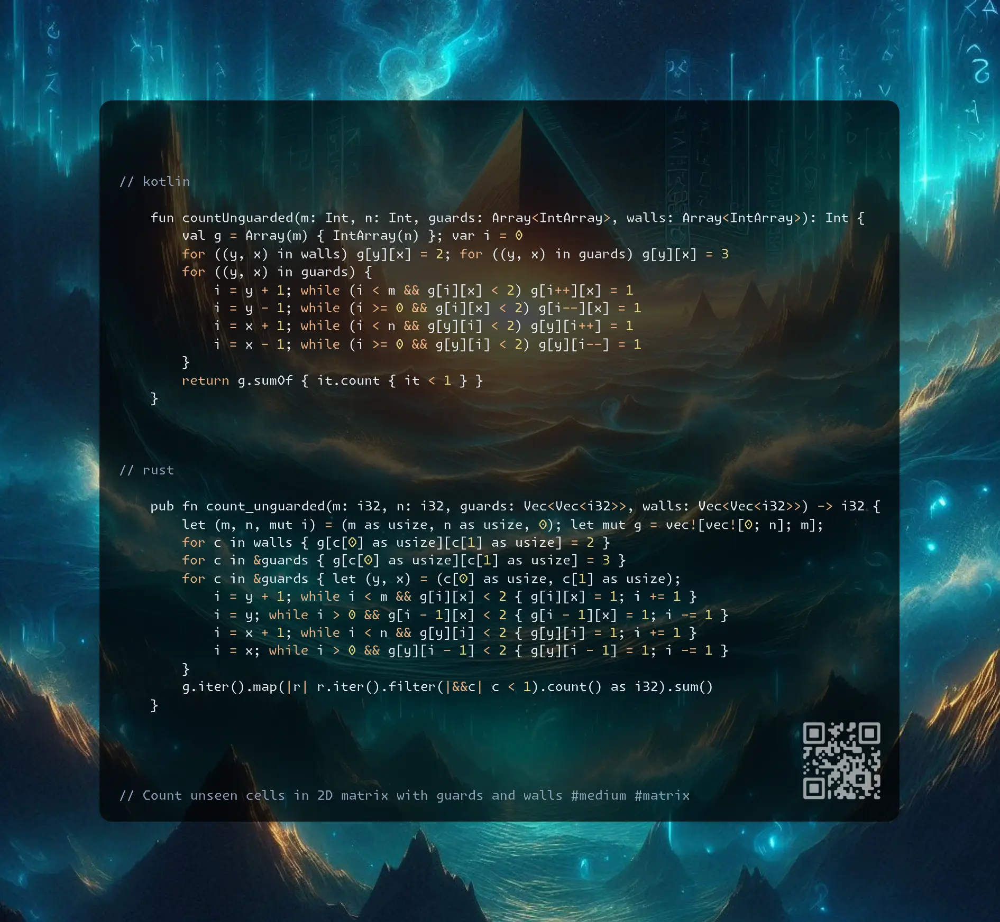

# Kotlin | Rust

**Author:** SamoylenkoDmitry
**Votes:** 4
**Link:** [https://leetcode.com/problems/count-unguarded-cells-in-the-grid/solutions/6068264/](https://leetcode.com/problems/count-unguarded-cells-in-the-grid/solutions/6068264/)

---



https://youtu.be/bR2zLEM0Giw

#### Join me on Telegram

https://t.me/leetcode_daily_unstoppable/807

#### Problem TLDR

Count unseen cells in 2D matrix with guards and walls #medium #matrix

#### Intuition

Two ways to cast a ray: 
1. Cast left-right, up-down for each row/column
2. Cast in 4 direaction from each guard (sligthly faster)


#### Approach

* write explicit loops or iterate over directions
* use 2D or 1D support grid

#### Complexity

- Time complexity:
$$O(nm)$$

- Space complexity:
$$O(nm)$$

#### Code

```kotlin []

    fun countUnguarded(m: Int, n: Int, guards: Array<IntArray>, walls: Array<IntArray>): Int {
        val g = Array(m) { IntArray(n) }; var i = 0
        for ((y, x) in walls) g[y][x] = 2; for ((y, x) in guards) g[y][x] = 3
        for ((y, x) in guards) {
            i = y + 1; while (i < m && g[i][x] < 2) g[i++][x] = 1
            i = y - 1; while (i >= 0 && g[i][x] < 2) g[i--][x] = 1
            i = x + 1; while (i < n && g[y][i] < 2) g[y][i++] = 1
            i = x - 1; while (i >= 0 && g[y][i] < 2) g[y][i--] = 1
        }
        return g.sumOf { it.count { it < 1 } }
    }

```
```rust []

    pub fn count_unguarded(m: i32, n: i32, guards: Vec<Vec<i32>>, walls: Vec<Vec<i32>>) -> i32 {
        let (m, n, mut i) = (m as usize, n as usize, 0); let mut g = vec![vec![0; n]; m];
        for c in walls { g[c[0] as usize][c[1] as usize] = 2 }
        for c in &guards { g[c[0] as usize][c[1] as usize] = 3 }
        for c in &guards { let (y, x) = (c[0] as usize, c[1] as usize);
            i = y + 1; while i < m && g[i][x] < 2 { g[i][x] = 1; i += 1 }
            i = y; while i > 0 && g[i - 1][x] < 2 { g[i - 1][x] = 1; i -= 1 }
            i = x + 1; while i < n && g[y][i] < 2 { g[y][i] = 1; i += 1 }
            i = x; while i > 0 && g[y][i - 1] < 2 { g[y][i - 1] = 1; i -= 1 }
        }
        g.iter().map(|r| r.iter().filter(|&&c| c < 1).count() as i32).sum()
    }

```
```c++ []

    int countUnguarded(int m, int n, vector<vector<int>>& guards, vector<vector<int>>& walls) {
        vector<int> g(m * n);
        for (auto& pos : walls) g[pos[0] * n + pos[1]] = 2;
        for (auto& pos : guards) g[pos[0] * n + pos[1]] = 2;
        for (auto& pos : guards)
            for (int i = 0, d[] = {1,0,-1,0,0,1,0,-1}; i < 7; i += 2) 
                for (int y = pos[0] + d[i], x = pos[1] + d[i + 1];
                    y >= 0 && y < m && x >= 0 && x < n && g[y * n + x] < 2;)
                        g[y * n + x] = 1, y += d[i], x += d[i + 1];
        return count_if(g.begin(), g.end(), [](int v){ return v < 1; }); 
    }

```
```kotlin []

    fun countUnguarded(m: Int, n: Int, guards: Array<IntArray>, walls: Array<IntArray>): Int {
        val g = Array(m) { IntArray(n) }; var i = 0; var j = 0
        for ((y, x) in (walls + guards)) g[y][x] = 2
        for ((y, x) in guards) for (f in listOf({i++;1}, {i--;1}, {j++;1}, {j--;1})) {
            i = y; j = x; f()
            while (i in 0..<m && j in 0..<n && g[i][j] < 2) g[i][j] = f()
        }
        return g.sumOf { it.count { it < 1 } }
    }

```