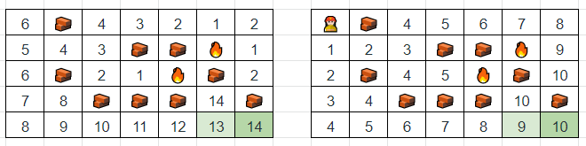
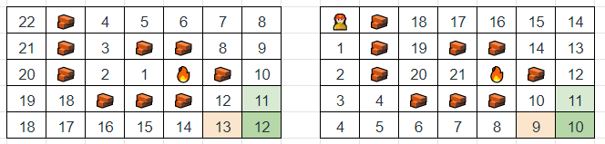

# No BS

**Author:** votrubac
**Votes:** 49
**Link:** [https://leetcode.com/problems/escape-the-spreading-fire/solutions/2016835/](https://leetcode.com/problems/escape-the-spreading-fire/solutions/2016835/)

---

This is a very daunting problem - difficult to code, frustrating edge cases...

The solution - once you figure it out - is quite straightforward. No need for a binary search.

We use BFS to calculate steps from the person to the safehouse, and the closest distance from any fire to the safehouse. The difference between fire distance and person steps is our answer. This is how the BFS grid looks for fire and person, based on Example 1 (see problem description):



So, the result is `3` (`14 - 10 - 1`). Note that we subtract one - to make sure fire would not catch up to the person during the "spread" phase.

Easy, right?

Not. This is the frustrating edge case. If a person reaches the safehouse, they escape even if the fire spreads to the safehouse in the same minute. So, when the safehouse is the first cell when person and fire cross their paths, we do not subtract one.

I could not figure it out myself, but our community is awesome. To check if the safehouse is the first cell when person and fire "meet", we compare the difference for two adjacent (to the safehouse) cells. If the difference is larger for any of the adjacent cells, then we do not need to subtract one. For the following example, the result is `2`, not `1`:



**C++**
The `step` function returns the number of steps to the safehouse, and two adjacent to the safehouse cells.
```cpp
int maximumMinutes(vector<vector<int>>& g) {
    int m = g.size(), n = g[0].size();
    deque<pair<int, int>> fire, person({{0, 0}});
    for (int i = 0; i < m; ++i)
        for (int j = 0; j < n; ++j)
            if (g[i][j] == 1) 
                fire.push_back({i, j});
    auto steps = [&](deque<pair<int, int>> &pos) {
        vector<vector<int>> st(m, vector<int>(n));
        while(!pos.empty()) {
            auto [i, j] = pos.front();
            pos.pop_front();
            for (auto [di, dj] : vector<pair<int, int>>{{0, 1}, {1, 0}, {0, -1}, {-1, 0}}) {
                int x = i + di, y = j + dj;
                if (min(x, y) >= 0 && x < m && y < n && g[x][y] == 0 && st[x][y] == 0) {
                    st[x][y] = st[i][j] + 1;
                    pos.push_back({x, y});
                }
            }
        }
        return array<int, 3>{st[m - 1][n - 1], st[m - 2][n - 1], st[m - 1][n - 2]};
    };
    auto f = steps(fire), p = steps(person);
    if (f[0] == 0 && p[0] != 0)
        return 1000000000;
    if (int diff = f[0] - p[0]; p[0] != 0 && diff >= 0)
        return diff - (f[1] - p[1] <= diff && f[2] - p[2] <= diff);
    return -1;
}
```